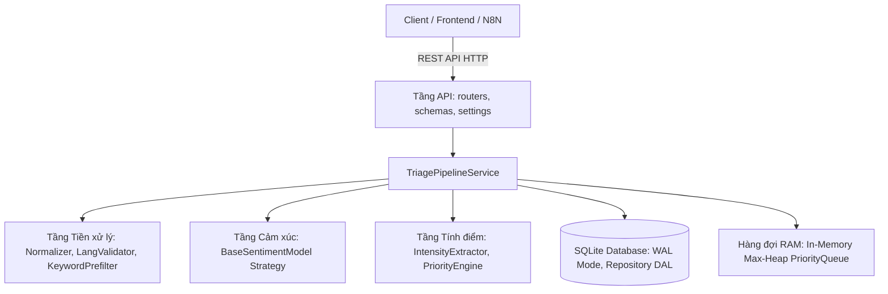
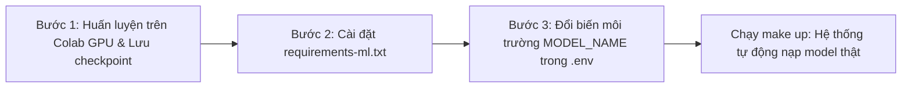

# Kế hoạch Chi tiết Cấu trúc Backend, Trạng thái Module & Lộ trình Tích hợp Model AI Thật

> **Dự án:** `TICKET-TRIAGE-01` — Sentiment-Driven Ticket Triage System  
> **Thư mục phân tích:** `ticket-triage-be/`  
> **Ngày lập:** 24/10/2026 | **Phiên bản:** Version 3.1  

---

## 1. TỔNG QUAN VỀ ĐỘ SẴN SÀNG CỦA BACKEND

Hệ thống Backend được thiết kế theo kiến trúc **Clean Architecture / Hexagonal Architecture** với nguyên tắc phân tách phụ thuộc một chiều (`api` $\rightarrow$ `services` $\rightarrow$ `core`, `db`).



### Bảng tóm tắt mức độ sẵn sàng:

| Phân hệ / Tầng chức năng | Mức độ sẵn sàng | Đánh giá & Khả năng vận hành |
| :--- | :---: | :--- |
| **Cấu hình nghiệp vụ (`configs/*.yaml`)** | **100% Production-ready** | Dùng thật được ngay. Cho phép sửa trọng số khía cạnh, từ khóa khẩn cấp mà không cần chạm code. |
| **Tiền xử lý & Kiểm duyệt (`core/preprocessing/*`)** | **100% Production-ready** | Dùng thật được ngay. Làm sạch Regex, che PII an toàn, chặn ngôn ngữ không phải tiếng Anh bằng `langdetect`. |
| **Động cơ phân hạng (`core/priority/*`)** | **100% Production-ready** | Dùng thật được ngay. Công thức toán 70/30, xử lý phủ định tiếng Anh, tính điểm minh bạch, không phải demo. |
| **Hàng đợi & Vòng đời (`core/queue/*`)** | **100% Production-ready** | Dùng thật được ngay. Max-Heap `heapq` với FIFO tie-break khi đồng điểm, FSM kiểm soát 4 trạng thái. |
| **Cơ sở dữ liệu (`db/*`)** | **100% Production-ready** | Dùng thật được ngay. SQLite bật chế độ WAL + Foreign Keys, Single Atomic Transaction. Sẵn sàng đổi sang PostgreSQL qua chuỗi kết nối. |
| **Giao diện lập trình (`api/*`)** | **100% Production-ready** | Dùng thật được ngay. FastAPI chuẩn RESTful, Pydantic v2 validation, tự sinh OpenAPI 3.1 specification. |
| **Mô hình Cảm xúc Mock (`core/sentiment/mock.py`)** | **Demo / Fallback** | Dùng heuristic regex cho môi trường dev nhẹ, test nhanh và fallback khi không có GPU. |
| **Mô hình Cảm xúc Baseline (`core/sentiment/baseline.py`)** | **Sẵn sàng tích hợp** | Khung mã nguồn Zero-shot NLI hoàn chỉnh, sẵn sàng nạp checkpoint HuggingFace thật. |

> **Kết luận:** **Hơn 90% toàn bộ Backend là PRODUCTION-READY**. Thành phần duy nhất hiện đang ở trạng thái giả lập (Mock) là **bộ suy luận cảm xúc khía cạnh `mock.py`** để giúp hệ thống chạy nhẹ nhàng trên mọi máy tính cá nhân không có GPU.

---

## 2. CHI TIẾT TỪNG THƯ MỤC VÀ TỪNG FILE CỦA BACKEND

### 2.1. Thư mục gốc `ticket-triage-be/`

| Tệp tin | Logic bên trong | Vai trò & Trách nhiệm | Trạng thái |
| :--- | :--- | :--- | :---: |
| [requirements.txt](../ticket-triage-be/requirements.txt) | Khai báo các thư viện runtime thiết yếu: `fastapi`, `uvicorn`, `sqlalchemy`, `pydantic`, `langdetect`, `pyyaml`. Không chứa thư viện AI nặng. | Cài đặt môi trường chạy chính thức cho API, CSDL và logic nghiệp vụ lõi. | **Dùng thật** |
| [requirements-dev.txt](../ticket-triage-be/requirements-dev.txt) | Khai báo các thư viện phục vụ phát triển & kiểm thử: `pytest`, `pytest-cov`, `httpx`, `ruff`. | Phục vụ kiểm thử đơn vị, kiểm thử tích hợp và kiểm tra chất lượng code. | **Dùng thật** |
| [requirements-ml.txt](../ticket-triage-be/requirements-ml.txt) | Khai báo các thư viện Deep Learning nặng: `torch`, `transformers`, `peft`, `datasets`, `accelerate`. | Dành riêng cho môi trường GPU (Colab/Kaggle/Server) khi huấn luyện và chạy mô hình thật. | **Dùng thật** |
| [pyproject.toml](../ticket-triage-be/pyproject.toml) | Khai báo metadata gói `ticket-triage`, cấu hình công cụ `ruff` (linter/formatter) và `pytest`. | Quản lý đóng gói dự án theo chuẩn PEP 518/621 của Python hiện đại. | **Dùng thật** |
| [.env.example](../ticket-triage-be/.env.example) | Định nghĩa các biến môi trường mẫu: `DATABASE_URL`, `MODEL_NAME`, `MODEL_PATH`, `CORS_ORIGINS`. | File mẫu hướng dẫn cấu hình môi trường cho lập trình viên và máy chủ. | **Dùng thật** |
| [Dockerfile](../ticket-triage-be/Dockerfile) | Multi-stage Docker build: cài đặt Python 3.11-slim, cấu hình cờ `INSTALL_ML=false` mặc định để image nhẹ. | Đóng gói Backend container cho Docker Compose và triển khai máy chủ. | **Dùng thật** |
| [AGENT.md](../ticket-triage-be/AGENT.md) | Tài liệu quy chuẩn kỹ thuật: hợp đồng dataclass, ranh giới tiếng Anh, quy tắc pure function, cấu trúc thư mục. | Kim chỉ nam kỹ thuật cho lập trình viên và AI Agent khi làm việc trong Backend. | **Dùng thật** |

---

### 2.2. Thư mục Cấu hình Nghiệp vụ `configs/`

Toàn bộ tham số nghiệp vụ được tách biệt khỏi mã nguồn Python, đặt tại file YAML để dễ dàng tùy biến:

*   [aspects.yaml](../ticket-triage-be/configs/aspects.yaml)
    *   **Logic bên trong:** Định nghĩa danh mục 5 khía cạnh chuẩn CSKH: `payment_billing` (weight 0.30), `account_access` (weight 0.25), `bug_crash` (weight 0.20), `performance` (weight 0.15), `feature_request` (weight 0.10) kèm danh sách từ khóa mồi (seed keywords).
    *   **Vai trò:** Cung cấp nguồn taxonomy duy nhất (Single Source of Truth) cho toàn bộ hệ thống; cung cấp trọng số khía cạnh ($W_a$) cho Priority Engine.
    *   **Trạng thái:** **Dùng thật 100%**.
*   [aspect_hypotheses.yaml](../ticket-triage-be/configs/aspect_hypotheses.yaml)
    *   **Logic bên trong:** Lưu trữ các mẫu câu giả định NLI (Natural Language Inference templates) tương ứng cho từng khía cạnh (ví dụ: *"This text describes a failure or crash in the system"*).
    *   **Vai trò:** Dùng cho mô hình Zero-shot NLI để suy luận xác suất giữa văn bản khiếu nại và khía cạnh liên quan.
    *   **Trạng thái:** **Dùng thật 100%**.
*   [priority_rules.yaml](../ticket-triage-be/configs/priority_rules.yaml)
    *   **Logic bên trong:** Định nghĩa tỷ lệ 70% Sentiment / 30% Intensity, các ngưỡng phân cấp ($P0 \ge 80$, $P1 \ge 60$, $P2 \ge 40$, $P3 < 40$), từ điển cảm xúc bức xúc (`urgent`, `immediately`, `lawsuit`, `fraud`...) và dấu câu đặc biệt `!{2,}`.
    *   **Vai trò:** Quản lý tập trung mọi tham số và luật tính điểm phân loại ưu tiên.
    *   **Trạng thái:** **Dùng thật 100%**.

---

### 2.3. Tầng Nghiệp vụ Thuần túy `src/ticket_triage/core/`

> ⚠️ **Quy tắc bất di bất dịch:** Thư mục `core/` chỉ chứa logic thuần túy (Pure Logic), **TUYỆT ĐỐI KHÔNG import `fastapi`, `sqlalchemy`, hay framework I/O**. Mọi hàm là hàm thuần túy (pure function) để đảm bảo khả năng kiểm thử 100%.

#### A. Quản lý Danh mục & Trọng số
*   [core/taxonomy.py](../ticket-triage-be/src/ticket_triage/core/taxonomy.py)
    *   **Logic bên trong:** Đọc file `aspects.yaml`, kiểm tra ID khía cạnh không trùng lặp, xác thực tổng trọng số của 5 khía cạnh phải bằng chính xác $1.0$ (dung sai $\pm 0.001$).
    *   **Vai trò:** Cung cấp lớp quản trị `Taxonomy` để các module khác truy vấn trọng số khía cạnh một cách an toàn.
    *   **Trạng thái:** **Dùng thật 100%**.

#### B. Phân hệ Tiền xử lý & Kiểm duyệt (`core/preprocessing/`)
*   [core/preprocessing/normalizer.py](../ticket-triage-be/src/ticket_triage/core/preprocessing/normalizer.py)
    *   **Logic bên trong:** Chuẩn hóa Unicode NFC, loại bỏ mã HTML độc hại, che ẩn thông tin nhạy cảm PII (email thành `[EMAIL]`, URL thành `[URL]`), rút gọn ký tự kéo dài quá mức (`terribleeee` $\rightarrow$ `terrible`). **Đặc biệt:** Bảo toàn ký tự in hoa (CAPS) và các cụm dấu chấm than `!`, `?` để phục vụ đo cường độ cảm xúc ở bước sau.
    *   **Vai trò:** Làm sạch văn bản thô từ email/chat của người dùng.
    *   **Trạng thái:** **Dùng thật 100%**.
*   [core/preprocessing/lang_validator.py](../ticket-triage-be/src/ticket_triage/core/preprocessing/lang_validator.py)
    *   **Logic bên trong:** Sử dụng thư viện `langdetect`. Nếu độ dài câu $\ge 3$ từ và ngôn ngữ phát hiện không phải tiếng Anh (`en`) $\rightarrow$ trả về `is_valid = False` kèm cờ `needs_manual_review = True`.
    *   **Vai trò:** "Người gác cổng" (Gatekeeper) bảo vệ ranh giới chuyên biệt tiếng Anh (English-only Boundary). Trả mã HTTP 422 rõ ràng khi ticket không phải tiếng Anh.
    *   **Trạng thái:** **Dùng thật 100%**.
*   [core/preprocessing/keyword_prefilter.py](../ticket-triage-be/src/ticket_triage/core/preprocessing/keyword_prefilter.py)
    *   **Logic bên trong:** Quét nhanh sự xuất hiện của từ khóa đặc trưng theo từng khía cạnh bằng Regex boundary `\b...\b` dựa trên danh mục trong `aspects.yaml`.
    *   **Vai trò:** Thu hẹp danh sách khía cạnh cần suy luận (Candidate Aspects), giúp giảm $2\times - 3\times$ thời gian chạy so với việc quét vét cạn trên mô hình AI nặng.
    *   **Trạng thái:** **Dùng thật 100%**.
*   [core/preprocessing/pipeline.py](../ticket-triage-be/src/ticket_triage/core/preprocessing/pipeline.py)
    *   **Logic bên trong:** Ghép nối tuần tự `clean_text` $\rightarrow$ `validate_english` $\rightarrow$ `filter_candidate_aspects` thành đối tượng kết quả chuẩn hóa `PreprocessedTicket`.
    *   **Vai trò:** Điểm tiếp nhận đầu vào tiền xử lý duy nhất cho toàn bộ Backend.
    *   **Trạng thái:** **Dùng thật 100%**.

#### C. Phân hệ Phân tích Cảm xúc (`core/sentiment/` - Bài toán 1)
*   [core/sentiment/base.py](../ticket-triage-be/src/ticket_triage/core/sentiment/base.py)
    *   **Logic bên trong:** Định nghĩa các dataclass đóng băng `@dataclass(frozen=True)`: `AspectSentiment`, `AbsaResult` và lớp giao diện trừu tượng `BaseSentimentModel`.
    *   **Vai trò:** **Hợp đồng giao tiếp trung gian (Interface Contract)** giữa Bài toán 1 (AI Model) và Bài toán 2 (Priority Engine). Thiết kế theo **Strategy Pattern** giúp thay đổi thuật toán suy luận mà không sửa code xung quanh.
    *   **Trạng thái:** **Đóng băng dùng thật 100%**.
*   [core/sentiment/mock.py](../ticket-triage-be/src/ticket_triage/core/sentiment/mock.py)
    *   **Logic bên trong:** Phân tích heuristic bằng tập luật từ vựng đơn giản (thấy từ *crash, error, fail, charged* $\rightarrow$ gán nhãn `negative` với confidence $0.85 - 0.95$).
    *   **Vai trò:** **Mô hình giả lập (Demo/Mock)** giúp toàn bộ hệ thống (Priority Engine, Database, Frontend UI) chạy và kiểm thử độc lập mà không bị nghẽn tiến độ chờ huấn luyện AI.
    *   **Trạng thái:** **Demo / Development Fallback**.
*   [core/sentiment/baseline.py](../ticket-triage-be/src/ticket_triage/core/sentiment/baseline.py)
    *   **Logic bên trong:** Tích hợp HuggingFace `pipeline("zero-shot-classification")` (mô hình `cross-encoder/nli-deberta-v3-small` hoặc checkpoint nội bộ). Tải lazy khi khởi động để máy không có GPU vẫn nạp được module.
    *   **Vai trò:** Khung suy luận mô hình AI thật (Zero-shot ABSA) sẵn sàng kích hoạt ngay khi có checkpoint.
    *   **Trạng thái:** **Mã nguồn thật (Sẵn sàng nạp checkpoint)**.
*   [core/sentiment/abte.py](../ticket-triage-be/src/ticket_triage/core/sentiment/abte.py)
    *   **Logic bên trong:** Khung sườn (stub) cho việc trích xuất vị trí cụm từ khía cạnh cụ thể trong văn bản (Aspect Term Extraction).
    *   **Vai trò:** Dự trù mở rộng cho tương lai (Could Have) nếu muốn bôi màu từ ngữ lỗi trực tiếp trên giao diện.
    *   **Trạng thái:** **Stub dự phòng**.

#### D. Phân hệ Tính điểm Ưu tiên (`core/priority/` - Bài toán 2)
*   [core/priority/intensity_extractor.py](../ticket-triage-be/src/ticket_triage/core/priority/intensity_extractor.py)
    *   **Logic bên trong:**
        1. Đo tỷ lệ viết hoa toàn bộ (All-caps ratio).
        2. Đếm các cụm dấu chấm than liên tiếp `!{2,}` hoặc dấu hỏi chấm `?!`.
        3. Phát hiện từ khóa phủ định tiếng Anh (`not`, `never`, `cannot`, `won't`) đứng trước từ tích cực để đảo chiều sắc thái.
        4. Tra cứu danh sách từ ngữ bức xúc, khẩn cấp (`stolen`, `fraud`, `lawsuit`, `urgent`).
    *   **Vai trò:** Tính ra điểm cường độ cảm xúc khách hàng ($I_{bonus} \in [0, 100]$) và ghi nhận lý do chi tiết vào audit log.
    *   **Trạng thái:** **Dùng thật 100%**.
*   [core/priority/priority_engine.py](../ticket-triage-be/src/ticket_triage/core/priority/priority_engine.py)
    *   **Logic bên trong:** Triển khai công thức toán học minh bạch:
        $$\text{FinalScore} = 0.7 \times \max(W_a \times S_{sentiment}) + 0.3 \times I_{bonus}$$
        *   Áp dụng nguyên tắc **Worst-Aspect-Wins**: Lấy khía cạnh có mức độ tiêu cực nặng nhất kết hợp với trọng số khía cạnh đó để làm đại diện chính.
        *   Phân cấp: $P0 \ge 80.0$, $P1 \ge 60.0$, $P2 \ge 40.0$, $P3 < 40.0$.
        *   Tự động sinh danh sách giải trình minh bạch `reasons` (ví dụ: *"Aspect 'payment_billing' weight=0.30, sentiment=negative (conf=0.92)"*, *"Contains 3 consecutive exclamation marks"*).
    *   **Vai trò:** Trái tim ra quyết định của Bài toán 2; tuyệt đối minh bạch, có thể giải trình và kiểm toán (Auditable).
    *   **Trạng thái:** **Dùng thật 100%**.

#### E. Phân hệ Hàng đợi & Trạng thái (`core/queue/` - Bài toán 2)
*   [core/queue/priority_queue.py](../ticket-triage-be/src/ticket_triage/core/queue/priority_queue.py)
    *   **Logic bên trong:** Triển khai hàng đợi **Max-Heap** trong RAM bằng module chuẩn `heapq` với khóa:
        $$\text{Heap Item} = \left(-\text{priority\_score}, \; \text{created\_at}, \; \text{ticket\_id}\right)$$
        *   Cơ chế **FIFO Tie-Break**: Khi hai ticket có cùng điểm số (ví dụ cùng 85.0 điểm), ticket nào được gửi đến trước (`created_at` nhỏ hơn) sẽ được ưu tiên bốc ra phục vụ trước.
    *   **Vai trò:** Tối ưu hóa việc phân phối ticket cho tổng đài viên với tốc độ đỉnh hàng đợi $O(1)$ và cập nhật $O(\log N)$.
    *   **Trạng thái:** **Dùng thật 100%**.
*   [core/queue/state_manager.py](../ticket-triage-be/src/ticket_triage/core/queue/state_manager.py)
    *   **Logic bên trong:** Máy trạng thái hữu hạn (FSM) quản trị vòng đời 4 bước nghiêm ngặt:
        `pending` $\rightarrow$ `triaged` $\rightarrow$ `in_progress` $\rightarrow$ `resolved`.
        Chặn mọi hành vi nhảy cóc bất hợp lệ (ví dụ: từ `pending` không được nhảy thẳng lên `resolved`).
    *   **Vai trò:** Đảm bảo tính toàn vẹn của quy trình nghiệp vụ chăm sóc khách hàng.
    *   **Trạng thái:** **Dùng thật 100%**.

---

### 2.4. Tầng Dữ liệu & Lưu trữ `src/ticket_triage/db/`

*   [db/models.py](../ticket-triage-be/src/ticket_triage/db/models.py)
    *   **Logic bên trong:** Khai báo 4 bảng quan hệ SQLAlchemy 2.0 ORM:
        1. `tickets`: Lưu tiêu đề, nội dung, trạng thái, SLA breach flag, timestamp.
        2. `aspect_sentiments`: Lưu từng khía cạnh trích xuất được (aspect, polarity, confidence).
        3. `priority_audits`: Lưu điểm số tính toán, cấp độ (P0-P3), danh sách lý do JSON string.
        4. `audit_logs`: Lưu lịch sử chuyển đổi trạng thái của vé.
    *   **Vai trò:** Định nghĩa lược đồ dữ liệu chuẩn quan hệ 1-N, có ràng buộc Foreign Key và `cascade="all, delete-orphan"`.
    *   **Trạng thái:** **Dùng thật 100%**.
*   [db/session.py](../ticket-triage-be/src/ticket_triage/db/session.py)
    *   **Logic bên trong:** Khởi tạo SQLAlchemy Engine kết nối SQLite với cấu hình chuyên sâu:
        *   Bật `PRAGMA journal_mode = WAL;` (Write-Ahead Logging: đọc và ghi song song không khóa csdl).
        *   Bật `PRAGMA foreign_keys = ON;` (đảm bảo tính toàn vẹn tham chiếu).
    *   **Vai trò:** Quản lý kết nối an toàn cho môi trường đa luồng của FastAPI qua generator `get_db()`.
    *   **Trạng thái:** **Dùng thật 100%**.
*   [db/init_db.py](../ticket-triage-be/src/ticket_triage/db/init_db.py)
    *   **Logic bên trong:** Thực thi `PRAGMA` tối ưu hóa và gọi `Base.metadata.create_all()`.
    *   **Vai trò:** Tự động tạo bảng khi hệ thống khởi động lần đầu mà không cần chạy lệnh migration thủ công.
    *   **Trạng thái:** **Dùng thật 100%**.
*   [db/repository.py](../ticket-triage-be/src/ticket_triage/db/repository.py)
    *   **Logic bên trong:** Lớp truy cập dữ liệu (DAL CRUD) cài đặt **Repository Pattern**:
        *   `create_ticket`: Lưu toàn bộ ticket + aspects + priority audit trong **1 transaction duy nhất** (`db.commit()` một lần duy nhất).
        *   `get_tickets`: Hỗ trợ phân trang, lọc theo status, priority, aspect.
        *   `update_ticket_status`: Cập nhật trạng thái kèm ghi log kiểm toán.
    *   **Vai trò:** Cách ly toàn bộ logic truy vấn cơ sở dữ liệu ra khỏi tầng API; chống lỗi dữ liệu mồ côi.
    *   **Trạng thái:** **Dùng thật 100%**.

---

### 2.5. Tầng Giao tiếp API & Điều phối `src/ticket_triage/api/`

*   [api/settings.py](../ticket-triage-be/src/ticket_triage/api/settings.py)
    *   **Logic bên trong:** Dùng Pydantic `BaseSettings` nạp cấu hình từ `.env` (`DATABASE_URL`, `MODEL_NAME`, `MODEL_PATH`, `CORS_ORIGINS`).
    *   **Vai trò:** Quản trị cấu hình tập trung theo chuẩn 12-Factor App.
    *   **Trạng thái:** **Dùng thật 100%**.
*   [api/schemas.py](../ticket-triage-be/src/ticket_triage/api/schemas.py)
    *   **Logic bên trong:** Định nghĩa toàn bộ DTO (Data Transfer Objects) qua Pydantic v2: `TicketCreateRequest`, `BatchIngestRequest`, `TicketResponse`, `TriageResponse`, `StatsSummaryResponse`.
    *   **Vai trò:** Xác thực kiểu dữ liệu đầu vào / đầu ra, tự động sinh tài liệu Swagger và hợp đồng `openapi.json`.
    *   **Trạng thái:** **Dùng thật 100%**.
*   [api/services/pipeline.py](../ticket-triage-be/src/ticket_triage/api/services/pipeline.py)
    *   **Logic bên trong:** Lớp điều phối trung tâm (`TriagePipelineService`). Khi tiếp nhận ticket:
        1. Gọi Preprocessing làm sạch text và kiểm tra tiếng Anh.
        2. Gọi Sentiment Model trích xuất khía cạnh và sắc thái cảm xúc.
        3. Gọi Priority Engine tính điểm và phân loại P0-P3 kèm danh sách lý do.
        4. Gọi Repository ghi toàn bộ kết quả vào SQLite trong 1 transaction.
        5. Đẩy ticket vào hàng đợi Max-Heap trong RAM.
    *   **Vai trò:** Bộ điều phối toàn trình tích hợp giữa Bài toán 1 và Bài toán 2.
    *   **Trạng thái:** **Dùng thật 100%**.
*   **Thư mục Router (`api/routers/`):**
    *   [api/routers/health.py](../ticket-triage-be/src/ticket_triage/api/routers/health.py): Cung cấp endpoint `GET /api/v1/health` và `/ready` kiểm tra tình trạng CSDL, số lượng ticket trong RAM heap và mô hình đang chạy.
    *   [api/routers/meta.py](../ticket-triage-be/src/ticket_triage/api/routers/meta.py): Cung cấp endpoint `GET /api/v1/meta/aspects` và `/meta/rules` để Frontend lấy danh mục hiển thị động.
    *   [api/routers/tickets.py](../ticket-triage-be/src/ticket_triage/api/routers/tickets.py): Cung cấp các endpoint cốt lõi: tiếp nhận ticket đơn lẻ, nạp hàng loạt (batch ingest), lấy danh sách phân trang, tổng đài viên lấy ticket ưu tiên cao nhất (`GET /api/v1/tickets/triage/next`), cập nhật trạng thái.
    *   [api/routers/stats.py](../ticket-triage-be/src/ticket_triage/api/routers/stats.py): Cung cấp endpoint `GET /api/v1/stats/summary` phục vụ vẽ Dashboard (phân bổ P0-P3, tỷ lệ vi phạm SLA, phân bổ khía cạnh).
    *   **Trạng thái:** **Dùng thật 100%**.
*   [api/main.py](../ticket-triage-be/src/ticket_triage/api/main.py)
    *   **Logic bên trong:** Khởi tạo FastAPI app, thiết lập CORS middleware, quản lý vòng đời ứng dụng qua `lifespan`:
        1. Tự động chạy `init_db()` khởi tạo bảng SQLite.
        2. Nạp Model AI vào RAM/GPU một lần duy nhất lúc khởi động (warm-up).
        3. Nạp lại toàn bộ các ticket chưa hoàn thành từ SQLite vào Max-Heap trong RAM.
    *   **Vai trò:** Cổng vào chính (Entrypoint) của ứng dụng Backend.
    *   **Trạng thái:** **Dùng thật 100%**.

---

### 2.6. Thư mục Scripts và Bộ Kiểm thử Tests

*   [scripts/seed_demo_data.py](../ticket-triage-be/scripts/seed_demo_data.py)
    *   **Logic bên trong:** Chứa 15 ticket mẫu mô phỏng dữ liệu CSKH thực tế (từ P0 trừ tiền 2 lần, tài khoản bị khóa, đến P3 góp ý tính năng; có cả ticket tiếng Việt/Pháp để test bộ lọc ngoại ngữ).
    *   **Vai trò:** Nạp dữ liệu mẫu nhanh chóng để kiểm thử giao diện Frontend và API.
    *   **Trạng thái:** **Dùng cho Demo / Development**.
*   **Thư mục Kiểm thử Tự động (`tests/`):**
    *   `conftest.py`: Fixtures SQLite in-memory, MockModel, TestClient.
    *   `test_preprocessing.py`: Kiểm thử chuẩn hóa text, lọc từ khóa, chặn ngoại ngữ không phải tiếng Anh.
    *   `test_priority_engine.py`: Kiểm thử công thức worst-aspect, từ phủ định, các ngưỡng điểm.
    *   `test_queue.py`: Kiểm thử Max-Heap và cơ chế FIFO tie-break khi đồng điểm.
    *   `test_sqlite_crud.py`: Kiểm thử giao dịch ghi đồng thời và cascade delete.
    *   `test_state_manager.py`: Kiểm thử chuyển trạng thái hợp lệ và chặn nhảy cóc.
    *   `test_api_tickets.py`: Kiểm thử tích hợp TestClient cho toàn bộ REST endpoints.
    *   `test_end_to_end_pipeline.py`: Kiểm thử chu trình toàn trình từ text thô đến CSDL và Heap.
    *   **Trạng thái:** **Bộ kiểm thử tự động chính thức của dự án (Chạy trên GitHub Actions CI)**.

---

## 3. LỘ TRÌNH CHUYỂN ĐỔI: KHI ÁP DỤNG MODEL THẬT CẦN THAY ĐỔI GÌ?

### 3.1. Thiết kế "Zero-Change Architecture"
Nhờ áp dụng **Design Pattern: Strategy / Interface Pattern** qua lớp trừu tượng `BaseSentimentModel` và hợp đồng dữ liệu đóng băng `AbsaResult`:

> [!IMPORTANT]
> **NHỮNG PHẦN TUYỆT ĐỐI KHÔNG CẦN THAY ĐỔI BẤT KỲ DÒNG CODE NÀO:**
> 1. Toàn bộ **Bài toán 2 (Priority Engine & Hàng đợi Max-Heap)** giữ nguyên 100%.
> 2. Toàn bộ **Cơ sở dữ liệu SQLite & Repository DAL** giữ nguyên 100%.
> 3. Toàn bộ **FastAPI Endpoints, Routers và Schemas** giữ nguyên 100%.
> 4. Toàn bộ **Frontend (React + Vite + TailwindCSS)** giữ nguyên 100%.

---

### 3.2. Ba bước cụ thể để áp dụng Model AI thật



#### Bước 1: Huấn luyện và Đóng gói Checkpoint mô hình
*   Fine-tune mô hình Zero-shot NLI (`cross-encoder/nli-deberta-v3-small` hoặc `distilbart-mnli`) bằng kỹ thuật LoRA/PEFT trên Google Colab / Kaggle T4 GPU sử dụng các thư viện trong [requirements-ml.txt](../ticket-triage-be/requirements-ml.txt).
*   Lưu thư mục checkpoint mô hình đã đạt chỉ tiêu $F_1 \ge 0.78$ vào thư mục dự án:
    ```text
    ticket-triage-be/models/absa_nli_checkpoint/
    ```

#### Bước 2: Cài đặt môi trường AI trên máy chủ
Trên môi trường máy chủ chạy thật (có card GPU hoặc CPU đủ mạnh):
```bash
cd ticket-triage-be
pip install -r requirements-ml.txt
```

#### Bước 3: Cấu hình biến môi trường trong `.env`
Mở file `ticket-triage-be/.env` (hoặc truyền qua biến môi trường Docker):
```ini
# Đổi từ "mock" sang "baseline"
MODEL_NAME=baseline

# Đường dẫn đến checkpoint mô hình cục bộ hoặc HuggingFace Model ID
MODEL_PATH=./models/absa_nli_checkpoint

# Tùy chọn thiết bị: "cuda" (nếu có GPU NVIDIA) hoặc "cpu"
MODEL_DEVICE=cuda

# Bật cài đặt ML trong Docker nếu build container
INSTALL_ML=true
```

#### Bước 4: Khởi động lại hệ thống
Chạy lệnh khởi động:
```bash
make up
# hoặc: uvicorn ticket_triage.api.main:app --host 0.0.0.0 --port 8000
```

Khi máy chủ khởi động:
1. Hàm `lifespan` trong [main.py](../ticket-triage-be/src/ticket_triage/api/main.py#L22-L46) tự động phát hiện `settings.model_name == "baseline"`.
2. Khởi tạo đối tượng `ZeroShotNliModel` từ [baseline.py](../ticket-triage-be/src/ticket_triage/core/sentiment/baseline.py).
3. Nạp trọng số mô hình lên GPU/RAM một lần duy nhất lúc khởi động (warm-up).
4. Mọi yêu cầu gửi đến API `/api/v1/tickets` từ thời điểm này sẽ được suy luận trực tiếp bằng mô hình Deep Learning thật mà hệ thống không gặp bất kỳ xung đột nào.

---

## 4. TỔNG KẾT
Toàn bộ mã nguồn Backend hiện tại đã đạt chuẩn hoàn thiện (**Production-grade**) về mặt kiến trúc phần mềm, xử lý ngoại lệ, tính toán ưu tiên và lưu trữ CSDL. Mô hình Mock hiện tại chỉ đóng vai trò "chốt giữ chỗ" (Placeholder Strategy) để cho phép cả nhóm phát triển và kiểm thử song song. Việc chuyển sang mô hình AI thật trong tương lai sẽ diễn ra mượt mà mà không gây ra bất kỳ xáo trộn nào cho hệ thống.
