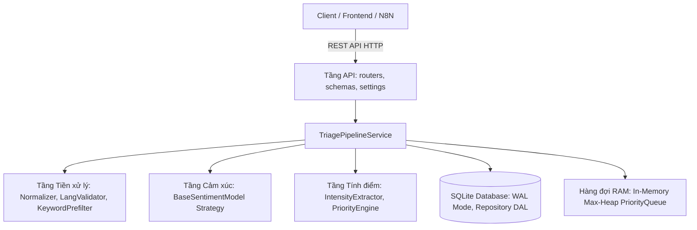
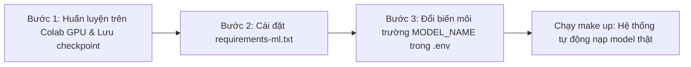

# Kế hoạch Chi tiết Cấu trúc Backend, Trạng thái Module & Lộ trình Tích hợp Model AI Thật

> **Dự án:** `TICKET-TRIAGE-01` — Sentiment-Driven Ticket Triage System  
> **Thư mục phân tích:** `ticket-triage-be/`  
> **Ngày lập:** 24/10/2026 | **Cập nhật:** 06/11/2026 | **Phiên bản:** Version 3.2 (Đồng bộ hóa 100% với System Architecture Report v3.0, AGENT.md và Codebase thực tế)  

---

## 1. TỔNG QUAN VỀ ĐỘ SẴN SÀNG CỦA BACKEND

Hệ thống Backend được thiết kế theo kiến trúc **Clean Architecture / Hexagonal Architecture** với nguyên tắc phân tách phụ thuộc một chiều (`api` $\rightarrow$ `services` $\rightarrow$ `core`, `db`).



### Bảng tóm tắt mức độ sẵn sàng:

| Phân hệ / Tầng chức năng | Mức độ sẵn sàng | Đánh giá & Khả năng vận hành |
| :--- | :---: | :--- |
| **Cấu hình nghiệp vụ (`configs/*.yaml`)** | **100% Production-ready** | Dùng thật được ngay. Cho phép sửa trọng số khía cạnh, từ khóa khẩn cấp mà không cần chạm code. |
| **Tiền xử lý & Kiểm duyệt (`core/preprocessing/*`)** | **100% Production-ready** | Dùng thật được ngay. Làm sạch Regex, che PII an toàn, chặn ngôn ngữ không phải tiếng Anh bằng `langdetect`. |
| **Động cơ phân hạng (`core/priority/*`)** | **100% Production-ready** | Dùng thật được ngay. Công thức toán 70/30, xử lý phủ định tiếng Anh, tính điểm minh bạch, không phải demo. |
| **Hàng đợi & Vòng đời (`core/queue/*`)** | **100% Production-ready** | Dùng thật được ngay. Max-Heap `heapq` với FIFO tie-break khi đồng điểm, FSM kiểm soát 4 trạng thái. |
| **Cơ sở dữ liệu (`db/*`)** | **100% Production-ready** | Dùng thật được ngay. SQLite bật chế độ WAL + Foreign Keys, Single Atomic Transaction. Sẵn sàng đổi sang PostgreSQL qua chuỗi kết nối. |
| **Giao diện lập trình (`api/*`)** | **100% Production-ready** | Dùng thật được ngay. FastAPI chuẩn RESTful, Pydantic v2 validation, tự sinh OpenAPI 3.1 specification. |
| **Mô hình Cảm xúc Mock (`core/sentiment/mock.py`)** | **Demo / Fallback** | Dùng heuristic regex cho môi trường dev nhẹ, test nhanh và fallback khi không có GPU. |
| **Mô hình Cảm xúc Baseline / DeBERTa (`core/sentiment/baseline.py`)** | **Sẵn sàng tích hợp** | Hỗ trợ Zero-shot NLI (`MODEL_NAME=baseline\|deberta`), tự giải quyết nguồn checkpoint (`MODEL_PATH` / `MODEL_ID` / PEFT adapter) và `MODEL_TASK` (`aspect`/`document`). |

> **Kết luận:** **Hơn 90% toàn bộ Backend là PRODUCTION-READY**. Khi chưa cài đặt `requirements-ml.txt` hoặc chưa cấu hình checkpoint (`MODEL_NAME=mock` mặc định, hoặc tự động fallback an toàn khi thiếu dependency/model), hệ thống sử dụng **`mock.py`** để chạy nhẹ nhàng trên mọi máy tính cá nhân không có GPU.

---

## 2. CHI TIẾT TỪNG THƯ MỤC VÀ TỪNG FILE CỦA BACKEND

### 2.1. Thư mục gốc `ticket-triage-be/`

| Tệp tin | Logic bên trong | Vai trò & Trách nhiệm | Trạng thái |
| :--- | :--- | :--- | :---: |
| [requirements.txt](../ticket-triage-be/requirements.txt) | Khai báo các thư viện runtime thiết yếu: `fastapi`, `uvicorn`, `sqlalchemy`, `pydantic`, `langdetect`, `pyyaml`. Không chứa thư viện AI nặng. | Cài đặt môi trường chạy chính thức cho API, CSDL và logic nghiệp vụ lõi. | **Dùng thật** |
| [requirements-dev.txt](../ticket-triage-be/requirements-dev.txt) | Khai báo các thư viện phục vụ phát triển & kiểm thử: `pytest`, `pytest-cov`, `httpx`, `ruff`. | Phục vụ kiểm thử đơn vị, kiểm thử tích hợp và kiểm tra chất lượng code. | **Dùng thật** |
| [requirements-ml.txt](../ticket-triage-be/requirements-ml.txt) | Khai báo các thư viện Deep Learning nặng: `torch`, `transformers`, `peft`, `datasets`, `accelerate`. | Dành riêng cho môi trường GPU (Colab/Kaggle/Server) khi huấn luyện và chạy mô hình thật. | **Dùng thật** |
| [pyproject.toml](../ticket-triage-be/pyproject.toml) | Khai báo metadata gói `ticket-triage`, cấu hình công cụ `ruff` (linter/formatter) và `pytest`. | Quản lý đóng gói dự án theo chuẩn PEP 518/621 của Python hiện đại. | **Dùng thật** |
| [.env.example](../ticket-triage-be/.env.example) | Định nghĩa các biến môi trường mẫu: `DATABASE_URL`, `MODEL_NAME`, `MODEL_PATH`, `MODEL_ID`, `MODEL_TASK`, `MODEL_DEVICE`, `ENABLE_ABTE`, `HF_HUB_OFFLINE`, `CORS_ORIGINS`. | File mẫu hướng dẫn cấu hình môi trường cho lập trình viên và máy chủ. | **Dùng thật** |
| [Dockerfile](../ticket-triage-be/Dockerfile) | Multi-stage Docker build: cài đặt Python 3.11-slim, cấu hình cờ `INSTALL_ML=false` mặc định để image nhẹ. | Đóng gói Backend container cho Docker Compose và triển khai máy chủ. | **Dùng thật** |
| [AGENT.md](../ticket-triage-be/AGENT.md) | Tài liệu quy chuẩn kỹ thuật: hợp đồng dataclass, ranh giới tiếng Anh, quy tắc pure function, cấu trúc thư mục. | Kim chỉ nam kỹ thuật cho lập trình viên và AI Agent khi làm việc trong Backend. | **Dùng thật** |

---

### 2.2. Thư mục Cấu hình Nghiệp vụ `configs/`

Toàn bộ tham số nghiệp vụ được tách biệt khỏi mã nguồn Python, đặt tại file YAML để dễ dàng tùy biến:

*   [aspects.yaml](../ticket-triage-be/configs/aspects.yaml)
    *   **Logic bên trong:** Định nghĩa danh mục 5 khía cạnh chuẩn CSKH: `customer_service` (weight 1.0), `refund_payment` (weight 1.0), `product_quality` (weight 0.8), `shipping` (weight 0.7), `general` (weight 0.5) kèm mô tả nghiệp vụ và bộ phận tiếp nhận.
    *   **Vai trò:** Cung cấp nguồn taxonomy duy nhất (Single Source of Truth) cho toàn bộ hệ thống; cung cấp trọng số khía cạnh ($W_a$) cho Priority Engine.
    *   **Trạng thái:** **Dùng thật 100%**.
*   [aspect_hypotheses.yaml](../ticket-triage-be/configs/aspect_hypotheses.yaml)
    *   **Logic bên trong:** Lưu trữ các mẫu câu giả định NLI (Natural Language Inference templates), định nghĩa khía cạnh bằng ngôn ngữ tự nhiên và danh mục từ ngữ biểu đạt sắc thái (verbalizers: positive, neutral, negative).
    *   **Vai trò:** Dùng cho mô hình Zero-shot NLI để suy luận xác suất giữa văn bản khiếu nại và khía cạnh/cảm xúc liên quan.
    *   **Trạng thái:** **Dùng thật 100%**.
*   [priority_rules.yaml](../ticket-triage-be/configs/priority_rules.yaml)
    *   **Logic bên trong:** Định nghĩa danh mục từ khóa khẩn cấp (`critical`, `high`), điểm cộng vị trí câu `urgency_points` (`critical_last_sentence: 30.0`, `critical_other_sentence: 20.0`, `high_last_sentence: 15.0`, `high_other_sentence: 10.0`), trần điểm khẩn cấp (`urgency_cap = 30.0`), trần điểm khía cạnh (`aspect_cap = 20.0`), điểm cường độ cú pháp (`intensity_bonus = 5.0`), và các ngưỡng phân cấp ưu tiên (`high: 70.0`, `medium: 30.0`).
    *   **Vai trò:** Quản lý tập trung mọi tham số và luật tính điểm phân loại ưu tiên có thể tinh chỉnh mà không cần sửa code.
    *   **Trạng thái:** **Dùng thật 100%**.

---

### 2.3. Tầng Nghiệp vụ Thuần túy `src/ticket_triage/core/`

> ⚠️ **Quy tắc bất di bất dịch:** Thư mục `core/` chỉ chứa logic thuần túy (Pure Logic), **TUYỆT ĐỐI KHÔNG import `fastapi`, `sqlalchemy`, hay framework I/O**. Mọi hàm là hàm thuần túy (pure function) để đảm bảo khả năng kiểm thử 100%.

#### A. Quản lý Danh mục & Trọng số
*   [core/taxonomy.py](../ticket-triage-be/src/ticket_triage/core/taxonomy.py)
    *   **Logic bên trong:** Đọc file `aspects.yaml`, kiểm tra ID khía cạnh không trùng lặp, xác thực trọng số của từng khía cạnh nằm trong khoảng hợp lệ `[0.0, 2.0]`.
    *   **Vai trò:** Cung cấp lớp quản trị `Taxonomy` để các module khác truy vấn trọng số khía cạnh một cách an toàn.
    *   **Trạng thái:** **Dùng thật 100%**.

#### B. Phân hệ Tiền xử lý & Kiểm duyệt (`core/preprocessing/`)
*   [core/preprocessing/normalizer.py](../ticket-triage-be/src/ticket_triage/core/preprocessing/normalizer.py)
    *   **Logic bên trong:** Chuẩn hóa Unicode NFC, loại bỏ thẻ HTML, thay thế thông tin nhạy cảm PII (email, URL) bằng khoảng trắng để tránh nhiễu phân tích ngôn ngữ/từ khóa, rút gọn ký tự kéo dài quá mức (`terribleeee` $\rightarrow$ `terrible`). **Đặc biệt:** Bảo toàn ký tự in hoa (CAPS) và các cụm dấu chấm than `!`, `?` để phục vụ đo cường độ cảm xúc ở bước sau.
    *   **Vai trò:** Làm sạch văn bản thô từ email/chat của người dùng.
    *   **Trạng thái:** **Dùng thật 100%**.
*   [core/preprocessing/lang_validator.py](../ticket-triage-be/src/ticket_triage/core/preprocessing/lang_validator.py)
    *   **Logic bên trong:** Sử dụng thư viện `langdetect` (kèm fallback an toàn cho chuỗi ngắn/ASCII). Nếu văn bản không phải tiếng Anh (`en`) hoặc không xác định được $\rightarrow$ trả về `is_valid = False` kèm mã ngôn ngữ phát hiện (`vi`, `fr`, `unknown`...), `needs_manual_review = True`.
    *   **Vai trò:** "Người gác cổng" (Gatekeeper) bảo vệ ranh giới chuyên biệt tiếng Anh (English-only Boundary). Vẫn tiếp nhận ticket (HTTP `201 Created`) với mức ưu tiên mặc định `50.0` (`MEDIUM`) và gắn cờ chờ kiểm duyệt thủ công thay vì chạy qua mô hình NLI.
    *   **Trạng thái:** **Dùng thật 100%**.
*   [core/preprocessing/keyword_prefilter.py](../ticket-triage-be/src/ticket_triage/core/preprocessing/keyword_prefilter.py)
    *   **Logic bên trong:** Quét nhanh sự xuất hiện của từ khóa đặc trưng theo từng khía cạnh bằng Regex boundary `\b...\b`; bắt buộc nạp cấu hình từ `configs/aspects.yaml` qua `load_aspect_keywords()` theo cơ chế fail-fast (`FileNotFoundError` / `ValueError` / `TypeError`, không giữ bộ từ khóa fallback trong Python).
    *   **Vai trò:** Thu hẹp danh sách khía cạnh cần suy luận (Candidate Aspects), giúp giảm $2\times - 3\times$ thời gian chạy so với việc quét vét cạn trên mô hình AI nặng.
    *   **Trạng thái:** **Dùng thật 100%**.
*   [core/preprocessing/pipeline.py](../ticket-triage-be/src/ticket_triage/core/preprocessing/pipeline.py)
    *   **Logic bên trong:** Ghép nối tuần tự `clean_text` $\rightarrow$ `validate_english` $\rightarrow$ `filter_candidate_aspects` thành đối tượng kết quả chuẩn hóa `PreprocessedTicket`.
    *   **Vai trò:** Điểm tiếp nhận đầu vào tiền xử lý duy nhất cho toàn bộ Backend.
    *   **Trạng thái:** **Dùng thật 100%**.

#### C. Phân hệ Phân tích Cảm xúc (`core/sentiment/` - Bài toán 1)
*   [core/sentiment/base.py](../ticket-triage-be/src/ticket_triage/core/sentiment/base.py)
    *   **Logic bên trong:** Định nghĩa các dataclass đóng băng `@dataclass(frozen=True)`: `AspectSentiment`, `AbsaResult` và lớp giao diện trừu tượng `BaseSentimentModel`.
    *   **Vai trò:** **Hợp đồng giao tiếp trung gian (Interface Contract)** giữa Bài toán 1 (AI Model) và Bài toán 2 (Priority Engine). Thiết kế theo **Strategy Pattern** giúp thay đổi thuật toán suy luận mà không sửa code xung quanh.
    *   **Trạng thái:** **Đóng băng dùng thật 100%**.
*   [core/sentiment/mock.py](../ticket-triage-be/src/ticket_triage/core/sentiment/mock.py)
    *   **Logic bên trong:** Phân tích heuristic bằng tập luật từ vựng đơn giản (thấy từ *crash, error, fail, charged* $\rightarrow$ gán nhãn `negative` với confidence $0.85 - 0.95$).
    *   **Vai trò:** **Mô hình giả lập (Demo/Mock)** giúp toàn bộ hệ thống (Priority Engine, Database, Frontend UI) chạy và kiểm thử độc lập mà không bị nghẽn tiến độ chờ huấn luyện AI.
    *   **Trạng thái:** **Demo / Development Fallback**.
*   [core/sentiment/baseline.py](../ticket-triage-be/src/ticket_triage/core/sentiment/baseline.py)
    *   **Logic bên trong:** Tích hợp HuggingFace `pipeline("zero-shot-classification")` (`ZeroShotNliModel`), mặc định chọn `distilbart-mnli` cho `MODEL_NAME=baseline` hoặc `deberta-v3-base-zeroshot` cho `MODEL_NAME=deberta`, tự động giải quyết nguồn checkpoint cục bộ / PEFT LoRA / HuggingFace ID qua `_resolve_nli_model_source`, hỗ trợ `MODEL_TASK=aspect|document` và nạp template từ `configs/aspect_hypotheses.yaml`.
    *   **Vai trò:** Khung suy luận mô hình AI thật (Zero-shot ABSA) sẵn sàng kích hoạt ngay khi có checkpoint và `requirements-ml.txt`.
    *   **Trạng thái:** **Mã nguồn thật (Sẵn sàng nạp checkpoint)**.
*   [core/sentiment/abte.py](../ticket-triage-be/src/ticket_triage/core/sentiment/abte.py)
    *   **Logic bên trong:** Cài đặt `extract_aspect_terms(text, aspect, aspect_keywords)` khớp từ khóa dài trước theo word-boundary regex từ `aspects.yaml`, giữ nguyên chữ hoa/thường và loại bỏ trùng lặp. Được bật qua cờ môi trường `ENABLE_ABTE=true` trong pipeline.
    *   **Vai trò:** Trích xuất cụm từ chứng cứ theo từng khía cạnh để điền vào trường `terms` của response/DB.
    *   **Trạng thái:** **Dùng thật (bật qua `ENABLE_ABTE=true`)**.

#### D. Phân hệ Tính điểm Ưu tiên (`core/priority/` - Bài toán 2)
*   [core/priority/intensity_extractor.py](../ticket-triage-be/src/ticket_triage/core/priority/intensity_extractor.py)
    *   **Logic bên trong:**
        1. Bắt từ viết hoa toàn bộ (`\b[A-Z]{6,}\b`, CAPS LOCK từ 6 ký tự trở lên).
        2. Bắt chuỗi dấu chấm than liên tiếp (`!{3,}`) và dấu hỏi dồn dập (`\?{3,}`).
        3. Chỉ cộng điểm `bonus_value` (mặc định `5.0` từ `priority_rules.yaml`) khi `overall.label == "negative"` để tránh cộng nhầm câu khen phấn khích.
    *   **Vai trò:** Tính điểm cường độ cảm xúc khách hàng (`intensity_bonus`) và ghi nhận lý do chi tiết vào danh sách giải trình `reasons`.
    *   **Trạng thái:** **Dùng thật 100%**.
*   [core/priority/priority_engine.py](../ticket-triage-be/src/ticket_triage/core/priority/priority_engine.py)
    *   **Logic bên trong:** Triển khai công thức toán học minh bạch theo nguyên lý **Worst-Aspect-Wins**:
        $$\text{score} = \min\left(100.0, \; \text{base} + \text{urgency\_bonus} + \text{intensity\_bonus} + \text{aspect\_bonus}\right)$$
        *   Điểm nền `base`: Negative ($60.0 \times \text{confidence}$), Neutral ($20.0$), Positive ($5.0$).
        *   Điểm khẩn cấp `urgency_bonus`: Nạp từ `priority_rules.yaml` (`critical`: `+30.0` câu kết / `+20.0` câu trước; `high`: `+15.0` câu kết / `+10.0` câu trước; trần $30.0$). Xử lý đa phủ định (`re.finditer`), giữ nhóm `REMEDY_ACTION_KEYWORDS` (`refund`, `cancel`) khi bị từ chối quyền lợi (`no refund`, `could not cancel`), bỏ qua mệnh đề đã giải quyết (có chống phủ định ngược) và tách mệnh đề tương phản (`but`, `however`, `although`, `though`).
        *   Điểm cường độ `intensity_bonus`: +5.0 nếu có `!!!`, `???` hoặc CAPS LOCK ($\ge 6$ ký tự) và cảm xúc overall là `negative`.
        *   Điểm khía cạnh `aspect_bonus`: Khía cạnh tiêu cực nặng nhất cộng đủ 100% ($W_{\text{worst}} \times \text{conf} \times 10.0$), các khía cạnh tiêu cực còn lại phạt dồn 25%, trần $20.0$. Trọng số mặc định tự đồng bộ từ `aspects.yaml` qua `load_aspect_weights()` khi caller không truyền `aspect_weights`.
        *   Phân cấp qua `classify_priority_level()`: `CRITICAL` ($\ge 70.0$, Đỏ), `MEDIUM` ($30.0 - 69.9$, Vàng), `LOW` ($< 30.0$, Xanh).
        *   Tự động sinh danh sách giải trình minh bạch `reasons` cho từng thành phần điểm.
    *   **Vai trò:** Trái tim ra quyết định của Bài toán 2; tuyệt đối minh bạch, có thể giải trình và kiểm toán (Auditable).
    *   **Trạng thái:** **Dùng thật 100%**.

#### E. Phân hệ Hàng đợi & Trạng thái (`core/queue/` - Bài toán 2)
*   [core/queue/priority_queue.py](../ticket-triage-be/src/ticket_triage/core/queue/priority_queue.py)
    *   **Logic bên trong:** Triển khai hàng đợi **Max-Heap** an toàn đa luồng (`threading.RLock`) trong RAM bằng module chuẩn `heapq` với khóa:
        $$\text{Heap Item} = \left(-\text{priority\_score}, \; \text{sort\_dt (UTC)}, \; \text{ticket\_id}\right)$$
        *   Cơ chế **FIFO Tie-Break**: Khi hai ticket có cùng điểm số (ví dụ cùng 85.0 điểm), ticket nào được gửi đến trước (`created_at` chuẩn hóa UTC nhỏ hơn) sẽ được ưu tiên bốc ra phục vụ trước.
        *   Chống trùng lặp `push()` theo `ticket_id` và chỉ lưu metadata nguyên thủy (`ticket_queue_metadata`) thay vì giữ ORM `Ticket` instance.
    *   **Vai trò:** Tối ưu hóa việc phân phối ticket cho tổng đài viên với tốc độ đỉnh hàng đợi $O(1)$ và cập nhật $O(\log N)$.
    *   **Trạng thái:** **Dùng thật 100%**.
*   [core/queue/state_manager.py](../ticket-triage-be/src/ticket_triage/core/queue/state_manager.py)
    *   **Logic bên trong:** Máy trạng thái hữu hạn (FSM) quản trị vòng đời 4 bước nghiêm ngặt:
        `new` $\rightarrow$ `assigned` $\rightarrow$ `in_progress` $\rightarrow$ `resolved` (hỗ trợ mở lại `resolved` $\rightarrow$ `new`).
        Chặn mọi hành vi nhảy cóc bất hợp lệ (ví dụ: từ `new` không được nhảy thẳng lên `resolved`).
    *   **Vai trò:** Đảm bảo tính toàn vẹn của quy trình nghiệp vụ chăm sóc khách hàng.
    *   **Trạng thái:** **Dùng thật 100%**.

---

### 2.4. Tầng Dữ liệu & Lưu trữ `src/ticket_triage/db/`

*   [db/models.py](../ticket-triage-be/src/ticket_triage/db/models.py)
    *   **Logic bên trong:** Khai báo 2 bảng quan hệ SQLAlchemy 2.0 ORM:
        1. `tickets`: Lưu ID, nội dung thô, nội dung đã làm sạch, cờ ngôn ngữ (`language_flag`), cờ kiểm tra thủ công (`needs_manual_review`), nhãn cảm xúc tổng thể (`sentiment_label`), độ tin cậy (`confidence`), cờ tin cậy thấp (`low_confidence`), điểm ưu tiên (`priority_score`), cấp độ ưu tiên (`priority_level`: CRITICAL/MEDIUM/LOW), khía cạnh nổi bật (`dominant_aspect`), chi tiết giải trình phân rã JSON (`priority_breakdown`), trạng thái vòng đời (`status`: new/assigned/in_progress/resolved), nhân viên phân công (`assigned_to`), và timestamps UTC (`created_at`, `updated_at`).
        2. `ticket_aspects`: Lưu từng khía cạnh phát hiện được (`aspect`), nhãn cảm xúc (`sentiment`: negative/neutral/positive), độ tin cậy (`confidence`), và cụm từ ABTE (`terms` JSON), có ràng buộc Foreign Key `ticket_id` trỏ về `tickets` với `ondelete="CASCADE"`.
    *   **Vai trò:** Định nghĩa lược đồ dữ liệu chuẩn quan hệ 1-N, tối ưu hóa lưu trữ và truy vấn trong một transaction duy nhất.
    *   **Trạng thái:** **Dùng thật 100%**.
*   [db/session.py](../ticket-triage-be/src/ticket_triage/db/session.py)
    *   **Logic bên trong:** Khởi tạo SQLAlchemy Engine kết nối SQLite với cấu hình chuyên sâu:
        *   Bật `PRAGMA journal_mode = WAL;` (Write-Ahead Logging: đọc và ghi song song không khóa csdl).
        *   Bật `PRAGMA foreign_keys = ON;` (đảm bảo tính toàn vẹn tham chiếu).
    *   **Vai trò:** Quản lý kết nối an toàn cho môi trường đa luồng của FastAPI qua generator `get_db()`.
    *   **Trạng thái:** **Dùng thật 100%**.
*   [db/init_db.py](../ticket-triage-be/src/ticket_triage/db/init_db.py)
    *   **Logic bên trong:** Thực thi `PRAGMA` tối ưu hóa và gọi `Base.metadata.create_all()`.
    *   **Vai trò:** Tự động tạo bảng khi hệ thống khởi động lần đầu mà không cần chạy lệnh migration thủ công.
    *   **Trạng thái:** **Dùng thật 100%**.
*   [db/repository.py](../ticket-triage-be/src/ticket_triage/db/repository.py)
    *   **Logic bên trong:** Lớp truy cập dữ liệu (DAL CRUD) cài đặt **Repository Pattern**:
        *   `create_ticket`: Lưu toàn bộ ticket + danh sách khía cạnh `ticket_aspects` trong **1 transaction duy nhất** (`db.commit()` một lần duy nhất).
        *   `get_tickets`: Hỗ trợ phân trang, lọc theo status, sentiment, aspect.
        *   `update_status`: Cập nhật trạng thái hợp lệ theo FSM StateManager.
    *   **Vai trò:** Cách ly toàn bộ logic truy vấn cơ sở dữ liệu ra khỏi tầng API; chống lỗi dữ liệu mồ côi.
    *   **Trạng thái:** **Dùng thật 100%**.

---

### 2.5. Tầng Giao tiếp API & Điều phối `src/ticket_triage/`

*   [settings.py](../ticket-triage-be/src/ticket_triage/settings.py)
    *   **Logic bên trong:** Dùng Pydantic `BaseSettings` nạp cấu hình từ `.env` (`DATABASE_URL`, `MODEL_NAME`, `MODEL_PATH`, `MODEL_ID`, `MODEL_TASK`, `MODEL_DEVICE`, `ENABLE_ABTE`, `HF_HUB_OFFLINE`, `CORS_ORIGINS`, `CONFIGS_DIR`).
    *   **Vai trò:** Quản trị cấu hình tập trung theo chuẩn 12-Factor App.
    *   **Trạng thái:** **Dùng thật 100%**.
*   [api/schemas.py](../ticket-triage-be/src/ticket_triage/api/schemas.py)
    *   **Logic bên trong:** Định nghĩa toàn bộ DTO (Data Transfer Objects) qua Pydantic v2: `TicketCreateIn` (chặn chuỗi rỗng/spam/DoS [3, 5000]), `TicketOut` (serialize datetime ISO 8601 kèm hậu tố `Z`), `StatusUpdateIn`, `StatusEnum`, `HealthResponse` (có `is_mock`, `model_loaded`, `queue_size`), `StatsOverviewResponse`, `AspectStatItem`, `AspectMetaItem`.
    *   **Vai trò:** Xác thực kiểu dữ liệu đầu vào / đầu ra, tự động sinh tài liệu Swagger và hợp đồng `openapi.json`.
    *   **Trạng thái:** **Dùng thật 100%**.
*   [api/services/pipeline.py](../ticket-triage-be/src/ticket_triage/api/services/pipeline.py)
    *   **Logic bên trong:** Lớp điều phối trung tâm (`process_ticket_pipeline`). Khi tiếp nhận ticket:
        1. Gọi Preprocessing làm sạch text, kiểm tra tiếng Anh và lọc trước khía cạnh tiềm năng (`candidate_aspects`).
        2. Nếu phát hiện ngoại ngữ: gắn cờ `needs_manual_review = True`, gán điểm sàn an toàn 50.0 (`MEDIUM`), không gọi model NLI.
        3. Nếu tiếng Anh hợp lệ: gọi Sentiment Model trích xuất cảm xúc tổng thể và cảm xúc từng khía cạnh ứng viên.
        4. Gọi Priority Engine tính điểm Worst-Aspect-Wins và phân loại CRITICAL/MEDIUM/LOW kèm danh sách lý do.
        5. Gọi Repository ghi toàn bộ kết quả vào SQLite trong 1 transaction duy nhất.
        6. Đẩy ticket vào hàng đợi Max-Heap trong RAM.
    *   **Vai trò:** Bộ điều phối toàn trình tích hợp giữa Bài toán 1 và Bài toán 2.
    *   **Trạng thái:** **Dùng thật 100%**.
*   **Thư mục Router (`api/routers/`):**
    *   [api/routers/health.py](../ticket-triage-be/src/ticket_triage/api/routers/health.py): Cung cấp endpoint `GET /api/v1/health` kiểm tra tình trạng hệ thống, cờ `is_mock`, `model_loaded`, và số lượng ticket trong hàng đợi RAM.
    *   [api/routers/meta.py](../ticket-triage-be/src/ticket_triage/api/routers/meta.py): Cung cấp endpoint `GET /api/v1/meta/aspects` để Frontend lấy danh mục khía cạnh động từ taxonomy.
    *   [api/routers/tickets.py](../ticket-triage-be/src/ticket_triage/api/routers/tickets.py): Cung cấp các endpoint cốt lõi: tiếp nhận ticket (`POST /api/v1/tickets`), lấy danh sách phân trang và lọc (`GET /api/v1/tickets`), lấy chi tiết (`GET /api/v1/tickets/{id}`), cập nhật trạng thái (`PATCH /api/v1/tickets/{id}/status` đồng bộ trực tiếp với `heapq`).
    *   [api/routers/stats.py](../ticket-triage-be/src/ticket_triage/api/routers/stats.py): Cung cấp endpoint `GET /api/v1/stats/overview` (tổng quan, phân bổ trạng thái/ưu tiên) và `GET /api/v1/stats/aspects` (ma trận khía cạnh x cảm xúc) phục vụ vẽ Dashboard.
    *   **Trạng thái:** **Dùng thật 100%**.
*   [api/main.py](../ticket-triage-be/src/ticket_triage/api/main.py)
    *   **Logic bên trong:** Khởi tạo FastAPI app, thiết lập CORS middleware, quản lý vòng đời ứng dụng qua `lifespan`:
        1. Tự động chạy `init_db()` khởi tạo bảng SQLite.
        2. Nạp Model AI vào RAM/GPU một lần duy nhất lúc khởi động (warm-up).
        3. Nạp lại toàn bộ các ticket chưa hoàn thành từ SQLite vào Max-Heap trong RAM.
    *   **Vai trò:** Cổng vào chính (Entrypoint) của ứng dụng Backend.
    *   **Trạng thái:** **Dùng thật 100%**.

---

### 2.6. Thư mục Scripts và Bộ Kiểm thử Tests

*   [scripts/seed_demo_data.py](../ticket-triage-be/scripts/seed_demo_data.py)
    *   **Logic bên trong:** Chứa 15 ticket mẫu mô phỏng dữ liệu CSKH thực tế (từ P0 trừ tiền 2 lần, tài khoản bị khóa, đến P3 góp ý tính năng; có cả ticket tiếng Việt/Pháp để test bộ lọc ngoại ngữ).
    *   **Vai trò:** Nạp dữ liệu mẫu nhanh chóng để kiểm thử giao diện Frontend và API.
    *   **Trạng thái:** **Dùng cho Demo / Development**.
*   **Thư mục Kiểm thử Tự động (`tests/`):**
    *   `conftest.py`: Fixtures SQLite in-memory, MockModel, TestClient.
    *   `test_preprocessing.py`: Kiểm thử chuẩn hóa text, lọc từ khóa từ `aspects.yaml`, trích xuất `terms` (ABTE), chặn ngoại ngữ không phải tiếng Anh.
    *   `test_priority_engine.py`: Kiểm thử công thức worst-aspect, từ phủ định/đã giải quyết, tải `priority_rules.yaml`, các ngưỡng điểm.
    *   `test_queue.py`: Kiểm thử Max-Heap, thread-safety (`RLock`) và cơ chế FIFO tie-break khi đồng điểm.
    *   `test_sqlite_crud.py`: Kiểm thử giao dịch ghi đồng thời và cascade delete.
    *   `test_state_manager.py`: Kiểm thử chuyển trạng thái hợp lệ và chặn nhảy cóc.
    *   `test_model_loading.py`: Kiểm thử luồng nạp `ZeroShotNliModel`, `MODEL_NAME=baseline|deberta`, `MODEL_TASK`, fallback mock và `model_loaded` trên `/api/v1/health`.
    *   `test_api_tickets.py`: Kiểm thử tích hợp TestClient cho toàn bộ REST endpoints (bao gồm `/tickets/triage`, `/tickets/queue`, `/stats/aspects`).
    *   `test_end_to_end_pipeline.py`: Kiểm thử chu trình toàn trình từ text thô đến CSDL và Heap (kể cả `ENABLE_ABTE`).
    *   `test_regression_issues.py`: Kiểm thử hồi quy các vấn đề đã xử lý (YAML single-source-of-truth, logic ngữ cảnh đã giải quyết, cô lập ORM khỏi Heap).
    *   **Trạng thái:** **Bộ kiểm thử tự động chính thức của dự án (62 tests pass)**.

---

## 3. LỘ TRÌNH CHUYỂN ĐỔI: KHI ÁP DỤNG MODEL THẬT CẦN THAY ĐỔI GÌ?

### 3.1. Thiết kế "Zero-Change Architecture"
Nhờ áp dụng **Design Pattern: Strategy / Interface Pattern** qua lớp trừu tượng `BaseSentimentModel` và hợp đồng dữ liệu đóng băng `AbsaResult`:

> [!IMPORTANT]
> **NHỮNG PHẦN TUYỆT ĐỐI KHÔNG CẦN THAY ĐỔI BẤT KỲ DÒNG CODE NÀO:**
> 1. Toàn bộ **Bài toán 2 (Priority Engine & Hàng đợi Max-Heap)** giữ nguyên 100%.
> 2. Toàn bộ **Cơ sở dữ liệu SQLite & Repository DAL** giữ nguyên 100%.
> 3. Toàn bộ **FastAPI Endpoints, Routers và Schemas** giữ nguyên 100%.
> 4. Toàn bộ **Frontend (React + Vite + TailwindCSS)** giữ nguyên 100%.

---

### 3.2. Ba bước cụ thể để áp dụng Model AI thật



#### Bước 1: Huấn luyện hoặc chọn Checkpoint mô hình
*   Fine-tune mô hình Zero-shot NLI (`MoritzLaurer/deberta-v3-base-zeroshot-v2.0` hoặc `valhalla/distilbart-mnli-12-1`) bằng kỹ thuật LoRA/PEFT trên Google Colab / Kaggle T4 GPU sử dụng các thư viện trong [requirements-ml.txt](../ticket-triage-be/requirements-ml.txt), hoặc dùng trực tiếp HuggingFace model ID qua `MODEL_ID`.
*   Nếu dùng checkpoint cục bộ (đạt chỉ tiêu $F_1 \ge 0.78$), lưu vào thư mục dự án:
    ```text
    ticket-triage-be/models/absa_nli_checkpoint/
    ```

#### Bước 2: Cài đặt môi trường AI trên máy chủ
Trên môi trường máy chủ chạy thật (có card GPU hoặc CPU đủ mạnh):
```bash
cd ticket-triage-be
pip install -r requirements-ml.txt
```

#### Bước 3: Cấu hình biến môi trường trong `.env`
Mở file `ticket-triage-be/.env` (hoặc truyền qua biến môi trường trong `docker.yaml`):
```ini
# Đổi từ "mock" sang "baseline" (DistilBART) hoặc "deberta" (DeBERTa-v3)
MODEL_NAME=deberta

# Đường dẫn đến checkpoint cục bộ (nếu bỏ trống sẽ tự fallback sang MODEL_ID / mặc định)
MODEL_PATH=./models/absa_nli_checkpoint

# HuggingFace Model ID ghi đè tùy chọn (mặc định tự chọn theo MODEL_NAME)
MODEL_ID=MoritzLaurer/deberta-v3-base-zeroshot-v2.0

# Kiểu suy luận NLI: "aspect" (theo từng khía cạnh) hoặc "document"
MODEL_TASK=aspect

# Bật trích xuất cụm từ khía cạnh (ABTE)
ENABLE_ABTE=true

# Đặt 0 nếu cho phép tải model từ HuggingFace Hub, 1 để chạy offline
HF_HUB_OFFLINE=1

# Tùy chọn thiết bị: "cuda" (nếu có GPU NVIDIA), "cpu" hoặc "auto"
MODEL_DEVICE=auto

# Bật cài đặt ML trong Docker nếu build container
INSTALL_ML=true
```

#### Bước 4: Khởi động lại hệ thống
Chạy lệnh khởi động:
```bash
make up
# hoặc: uvicorn ticket_triage.api.main:app --host 0.0.0.0 --port 8000
```

Khi máy chủ khởi động:
1. Hàm `lifespan` trong [main.py](../ticket-triage-be/src/ticket_triage/api/main.py) kiểm tra `settings.model_name` thuộc `("baseline", "deberta")`, chuẩn hóa `model_task` và truyền `model_id`, `model_path` vào `_build_sentiment_model(...)`.
2. Khởi tạo đối tượng `ZeroShotNliModel` từ [baseline.py](../ticket-triage-be/src/ticket_triage/core/sentiment/baseline.py) (tự hỗ trợ local HuggingFace checkpoint, LoRA/PEFT adapter, hoặc fallback an toàn về `MockSentimentModel` nếu thiếu thư viện/checkpoint).
3. Nạp bảng từ khóa từ `configs/aspects.yaml` vào `app.state.aspect_keywords` và cấu hình `app.state.enable_abte`.
4. Mọi yêu cầu gửi đến API `/api/v1/tickets` và `/api/v1/tickets/triage` sẽ chạy qua mô hình đã nạp; trạng thái thực tế được phản ánh minh bạch qua `model_loaded` và `is_mock` trên `/api/v1/health`.

---

## 4. TỔNG KẾT
Toàn bộ mã nguồn Backend hiện tại đã đạt chuẩn hoàn thiện (**Production-grade**) về mặt kiến trúc phần mềm, xử lý ngoại lệ, tính toán ưu tiên và lưu trữ CSDL. Mô hình Mock hiện tại chỉ đóng vai trò "chốt giữ chỗ" (Placeholder Strategy) để cho phép cả nhóm phát triển và kiểm thử song song. Việc chuyển sang mô hình AI thật trong tương lai sẽ diễn ra mượt mà mà không gây ra bất kỳ xáo trộn nào cho hệ thống.
