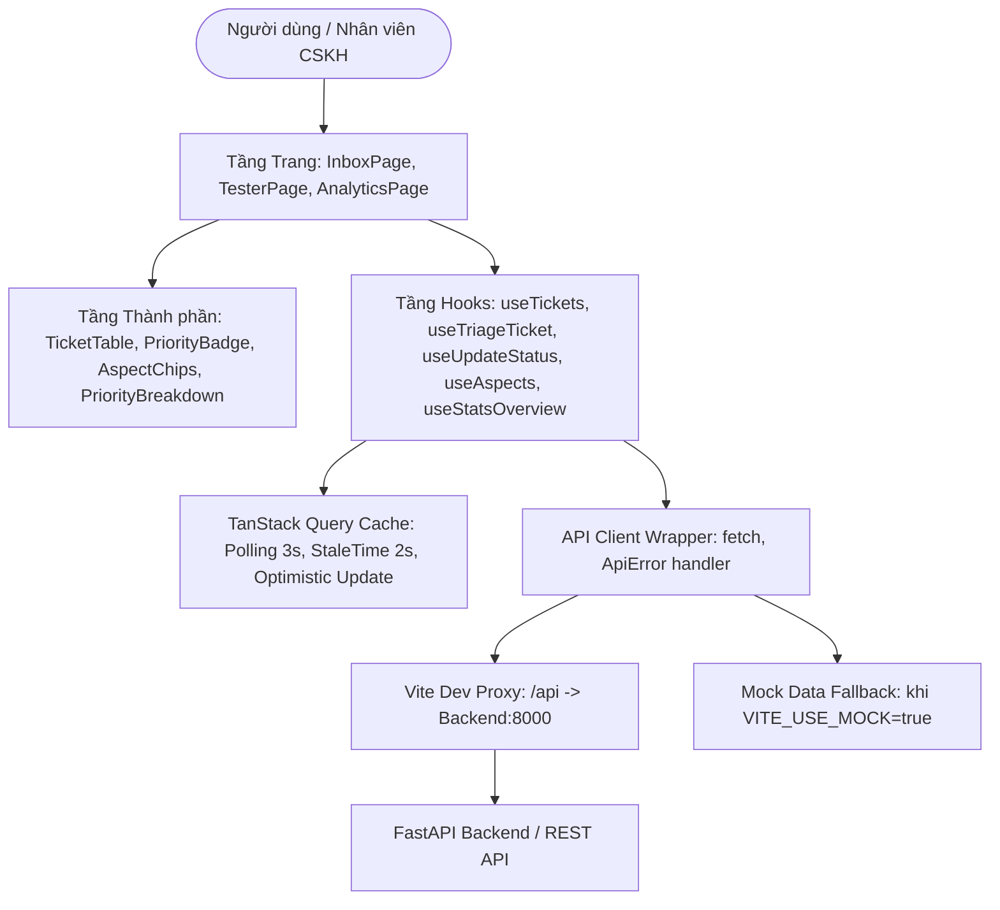
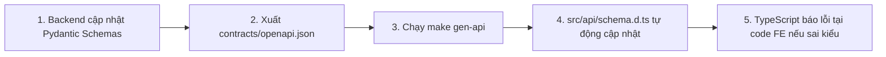

# Kế hoạch Chi tiết Cấu trúc Frontend, Trạng thái Module & Hướng dẫn Tích hợp Backend

> **Dự án:** `TICKET-TRIAGE-01` — Sentiment-Driven Ticket Triage System  
> **Thư mục phân tích:** `ticket-triage-fe/`  
> **Ngày lập:** 24/10/2026 | **Phiên bản:** Version 3.1  
> **Tài liệu liên quan:** [Backend-Plan.md](./Backend-Plan.md), [Project-Charter-Ticket-Triage-System.md](./Project-Charter-Ticket-Triage-System.md), [start.md](./start.md)

---

## 1. TỔNG QUAN VỀ KIẾN TRÚC FRONTEND

Hệ thống Frontend được xây dựng theo kiến trúc **Single Page Application (SPA)** hiện đại, tách biệt hoàn toàn giữa tầng giao diện hiển thị (Presentational Components), tầng điều phối trạng thái máy chủ (Server State Management qua TanStack Query) và tầng giao tiếp mạng (API Client).



### Bảng tóm tắt mức độ sẵn sàng:

| Phân hệ / Tầng chức năng | Mức độ sẵn sàng | Đánh giá & Khả năng vận hành |
| :--- | :---: | :--- |
| **Hộp thư ưu tiên (`pages/InboxPage.tsx`)** | **100% Production-ready** | Dùng thật được ngay. Hàng đợi sắp xếp theo điểm ưu tiên từ server, bộ lọc đa chiều (trạng thái, khía cạnh, sắc thái), polling 3s. |
| **Thử nghiệm trực tiếp (`pages/TesterPage.tsx`)** | **100% Production-ready** | Dùng thật được ngay. Tiếp nhận text, gọi API triage theo thời gian thực, hiển thị đầy đủ chip khía cạnh và phân rã công thức điểm. |
| **Bảng điều khiển phân tích (`pages/AnalyticsPage.tsx`)** | **100% Production-ready** | Dùng thật được ngay. Vẽ biểu đồ Recharts (phân bổ P0-P3, biểu đồ tròn cảm xúc, tần suất khía cạnh, SLA breach), polling 10s. |
| **Thành phần hiển thị vé (`components/tickets/*`)** | **100% Production-ready** | Dùng thật được ngay. Huy hiệu ưu tiên 3 cấp màu, chip khía cạnh ABSA, dropdown trạng thái FSM, modal giải trình `PriorityBreakdown`. |
| **Tầng giao tiếp API & Cache (`api/*`)** | **100% Production-ready** | Dùng thật được ngay. TanStack Query v5, Optimistic UI update, phân giải kiểu tự động từ OpenAPI `schema.d.ts`. |
| **Dữ liệu giả lập (`mocks/tickets.ts`)** | **Demo / Fallback** | Đóng gói sẵn 5 ticket mẫu đủ 3 cấp độ ưu tiên và các khía cạnh; tự động kích hoạt khi `VITE_USE_MOCK=true`. |

> **Kết luận:** **Toàn bộ khung mã nguồn Frontend đã đạt 100% PRODUCTION-READY**. Giao diện kết nối trực tiếp với Backend FastAPI qua API proxy chuẩn `/api/v1`. Chế độ Mock chỉ là tùy chọn chuyển đổi (toggle) giúp kiểm thử độc lập khi không bật máy chủ Backend.

---

## 2. CHI TIẾT TỪNG THƯ MỤC VÀ TỪNG FILE CỦA FRONTEND

### 2.1. Thư mục gốc `ticket-triage-fe/`

| Tệp tin | Logic bên trong | Vai trò & Trách nhiệm | Trạng thái |
| :--- | :--- | :--- | :---: |
| [package.json](../ticket-triage-fe/package.json) | Khai báo dependencies: React 18, React Router v6, TanStack Query v5, Lucide Icons, Recharts, TailwindCSS. Các script: `dev`, `build`, `check`, `gen-api`. | Quản lý gói phụ thuộc của Frontend; quy định sử dụng độc quyền trình quản lý gói `pnpm`. | **Dùng thật** |
| [vite.config.ts](../ticket-triage-fe/vite.config.ts) | Cấu hình Vite Dev Server chạy trên cổng `5173`, thiết lập proxy ngược chuyển hướng toàn bộ request `/api` sang backend `http://127.0.0.1:8000`. | Cầu nối mạng giúp Frontend gọi API mà không gặp lỗi bảo mật Cross-Origin (CORS) trên môi trường phát triển. | **Dùng thật** |
| [tailwind.config.js](../ticket-triage-fe/tailwind.config.js) | Cấu hình quét lớp CSS trong `index.html` và `src/**/*.{js,ts,jsx,tsx}`, mở rộng bảng màu cho các mức ưu tiên (CRITICAL đỏ, MEDIUM vàng, LOW xanh). | Thiết lập bộ sinh mã CSS linh hoạt, loại bỏ CSS thừa khi đóng gói sản phẩm. | **Dùng thật** |
| [postcss.config.js](../ticket-triage-fe/postcss.config.js) | Đăng ký các plugin PostCSS (`tailwindcss`, `autoprefixer`) để tự động thêm vendor prefix cho trình duyệt. | Đảm bảo tương thích CSS trên nhiều nền tảng trình duyệt khác nhau. | **Dùng thật** |
| [tsconfig.json](../ticket-triage-fe/tsconfig.json) | Cấu hình trình biên dịch TypeScript ở chế độ nghiêm ngặt (`strict: true`, `noUnusedLocals: true`, `jsx: react-jsx`). | Đảm bảo an toàn kiểu dữ liệu (Type Safety) và bắt lỗi tĩnh trước khi chạy. | **Dùng thật** |
| [tsconfig.node.json](../ticket-triage-fe/tsconfig.node.json) | Cấu hình môi trường TypeScript dành riêng cho các tệp cấu hình của Vite (`vite.config.ts`). | Phân tách môi trường trình duyệt và môi trường Node.js. | **Dùng thật** |
| [index.html](../ticket-triage-fe/index.html) | File HTML gốc nạp thẻ `<div id="root"></div>`, nạp font Inter từ Google Fonts và nạp file thực thi `src/main.tsx`. | Khung xương trang đơn cho toàn bộ ứng dụng web. | **Dùng thật** |
| [nginx.conf](../ticket-triage-fe/nginx.conf) | Cấu hình máy chủ Nginx phục vụ tệp tĩnh, cấu hình chuyển hướng Fallback `try_files $uri /index.html` cho React Router SPA và proxy `/api/` sang backend container. | Phục vụ triển khai Production bằng Docker container siêu nhẹ. | **Dùng thật** |
| [Dockerfile](../ticket-triage-fe/Dockerfile) | Multi-stage build: Stage 1 dùng `node:20-alpine` và `pnpm` để biên dịch bundle; Stage 2 dùng `nginx:alpine` phục vụ file tĩnh. | Đóng gói Frontend thành container nhỏ gọn (<30MB) sẵn sàng cho Docker Compose. | **Dùng thật** |
| [.env.example](../ticket-triage-fe/.env.example) | Khai báo biến môi trường mẫu: `VITE_USE_MOCK=false`, `VITE_PROXY_TARGET=http://127.0.0.1:8000`. | Hướng dẫn cấu hình môi trường cho lập trình viên. | **Dùng thật** |
| [AGENT.md](../ticket-triage-fe/AGENT.md) | Bộ quy chuẩn kỹ thuật Frontend: quy tắc gọi API, màu sắc mức ưu tiên, polling interval, hợp đồng contract-first. | Kim chỉ nam kỹ thuật cho nhóm Frontend và AI Assistant. | **Dùng thật** |

---

### 2.2. Tầng Giao tiếp API & Cache Server-State: `src/api/`

*   [src/api/schema.d.ts](../ticket-triage-fe/src/api/schema.d.ts)
    *   **Logic bên trong:** File định nghĩa kiểu TypeScript **SINH TỰ ĐỘNG** từ file `contracts/openapi.json` của Backend qua lệnh `make gen-api`. Chứa toàn bộ định nghĩa `TicketOut`, `TicketCreateIn`, `StatusUpdateIn`, `AspectMetaItem`, `StatsOverview`.
    *   **Vai trò:** Đảm bảo tính nhất quán kiểu 100% giữa Backend và Frontend (Contract-First Design). Lập trình viên không bao giờ phải viết lại kiểu dữ liệu thủ công.
    *   **Trạng thái:** **Dùng thật 100%**.
*   [src/api/client.ts](../ticket-triage-fe/src/api/client.ts)
    *   **Logic bên trong:** Bọc hàm `fetch` nguyên bản thành các phương thức `api.get`, `api.post`, `api.patch`. Bắt lỗi HTTP status $\ge 400$, trích xuất thông điệp chi tiết từ Backend và đóng gói thành đối tượng `ApiError` với thông báo tiếng Việt.
    *   **Vai trò:** Tầng truyền thông mạng trung tâm; ngăn chặn việc gọi `fetch` phân tán rải rác trong các component.
    *   **Trạng thái:** **Dùng thật 100%**.
*   [src/api/queryKeys.ts](../ticket-triage-fe/src/api/queryKeys.ts)
    *   **Logic bên trong:** Khai báo cấu trúc khóa bộ nhớ đệm (Query Key Factory) dạng phân cấp:
        `tickets.all`, `tickets.list(filters)`, `tickets.detail(id)`, `aspects`, `stats.overview`, `stats.aspects`.
    *   **Vai trò:** Giúp TanStack Query quản lý việc làm mới dữ liệu (Cache Invalidation) chính xác, tránh làm mới nhầm hoặc sót cache.
    *   **Trạng thái:** **Dùng thật 100%**.
*   [src/api/hooks.ts](../ticket-triage-fe/src/api/hooks.ts)
    *   **Logic bên trong:** Chứa các React Custom Hooks tích hợp `useQuery` và `useMutation`:
        *   `useTickets(filters)`: Lấy danh sách vé phân trang và lọc, tự động làm mới sau mỗi 3 giây (`POLL_QUEUE_MS = 3000`).
        *   `useTicketDetail(id)`: Lấy chi tiết vé theo mã định danh.
        *   `useAspects()`: Lấy danh mục 5 khía cạnh từ `/meta/aspects`, lưu cache 5 phút (`staleTime: 300_000`).
        *   `useStatsOverview()` & `useAspectsStats()`: Lấy dữ liệu thống kê Dashboard, tự động làm mới sau mỗi 10 giây (`POLL_STATS_MS = 10000`).
        *   `useTriageTicket()`: Gửi vé mới lên hệ thống; khi thành công lập tức kích hoạt `invalidateQueries` để cập nhật lại Hộp thư và Bảng thống kê.
        *   `useUpdateStatus()`: Cập nhật trạng thái vé (Optimistic Update) và đồng bộ lại hàng đợi.
        *   Hỗ trợ chuyển đổi mượt mà sang `MOCK_TICKETS` nếu cờ `VITE_USE_MOCK=true`.
    *   **Vai trò:** Trái tim điều phối luồng dữ liệu cho toàn bộ giao diện người dùng.
    *   **Trạng thái:** **Dùng thật 100%**.

---

### 2.3. Tầng Thành phần Hiển thị: `src/components/`

#### A. Khung giao diện (`components/layout/`)
*   [src/components/layout/AppShell.tsx](../ticket-triage-fe/src/components/layout/AppShell.tsx)
    *   **Logic bên trong:** Khung bao ngoài ứng dụng, đặt thanh điều hướng `Navigation` cố định ở đỉnh trang và bọc vùng nội dung chính trong thẻ `<main className="max-w-7xl mx-auto px-4 py-6">`.
    *   **Vai trò:** Duy trì bố cục nhất quán, đáp ứng tốt trên cả máy tính bảng và màn hình máy tính.
    *   **Trạng thái:** **Dùng thật 100%**.
*   [src/components/layout/Navigation.tsx](../ticket-triage-fe/src/components/layout/Navigation.tsx)
    *   **Logic bên trong:** Thanh điều hướng chính chứa logo, liên kết chuyển trang (`NavLink`) với chỉ báo trang hiện tại:
        *   `/` — Hộp thư ưu tiên (Inbox).
        *   `/tester` — Thử nghiệm trực tiếp (Live Tester).
        *   `/analytics` — Thống kê báo cáo (Analytics).
        *   Hiển thị huy hiệu trạng thái kết nối thời gian thực (Live API kết nối Backend hoặc Chế độ Mock).
    *   **Vai trò:** Giúp người dùng dễ dàng chuyển đổi các tính năng nghiệp vụ.
    *   **Trạng thái:** **Dùng thật 100%**.

#### B. Thành phần vé CSKH (`components/tickets/`)
*   [src/components/tickets/PriorityBadge.tsx](../ticket-triage-fe/src/components/tickets/PriorityBadge.tsx)
    *   **Logic bên trong:** Nhận vào điểm số ưu tiên `score` và hiển thị huy hiệu theo 3 mức màu chuẩn nghiệp vụ:
        *   $\ge 70.0$: Đỏ đậm `CRITICAL` (Cao) kèm icon tia sét `AlertTriangle`.
        *   $30.0 - 69.9$: Vàng cam `MEDIUM` (Trung bình) kèm icon đồng hồ `Clock`.
        *   $< 30.0$: Xanh lá `LOW` (Thấp) kèm icon kiểm tra `CheckCircle2`.
        *   Hiển thị rõ cả chữ lẫn số điểm (ví dụ: `CAO • 84.7`) và gắn thuộc tính `aria-label` cho người khiếm thị.
    *   **Vai trò:** Giúp nhân viên hỗ trợ lập tức nhận diện mức độ khẩn cấp của vé trong vài mili-giây.
    *   **Trạng thái:** **Dùng thật 100%**.
*   [src/components/tickets/AspectChips.tsx](../ticket-triage-fe/src/components/tickets/AspectChips.tsx)
    *   **Logic bên trong:** Hiển thị danh sách các khía cạnh trích xuất được (ABSA).
        *   Tô màu theo sắc thái cảm xúc: Tiêu cực (đỏ nhạt), Trung tính (xám nhạt), Tích cực (xanh lá nhạt).
        *   Ưu tiên sắp xếp các khía cạnh **tiêu cực lên đầu tiên**.
        *   Hạn chế tối đa 3 chip hiển thị trên bảng, phần còn lại gom thành chip rút gọn `+N` để không làm vỡ giao diện bảng.
    *   **Vai trò:** Trực quan hóa kết quả phân tích cảm xúc khía cạnh của mô hình AI.
    *   **Trạng thái:** **Dùng thật 100%**.
*   [src/components/tickets/StatusSelect.tsx](../ticket-triage-fe/src/components/tickets/StatusSelect.tsx)
    *   **Logic bên trong:** Dropdown menu chọn trạng thái vòng đời của vé: `new` (Mới) $\rightarrow$ `assigned` (Đã phân công) $\rightarrow$ `in_progress` (Đang xử lý) $\rightarrow$ `resolved` (Đã giải quyết). Khi thay đổi thì gọi mutation `useUpdateStatus()`.
    *   **Vai trò:** Cho phép tổng đài viên cập nhật tiến độ xử lý khiếu nại ngay trên bảng dữ liệu.
    *   **Trạng thái:** **Dùng thật 100%**.
*   [src/components/tickets/PriorityBreakdown.tsx](../ticket-triage-fe/src/components/tickets/PriorityBreakdown.tsx)
    *   **Logic bên trong:** Hộp thoại/Bảng giải trình chi tiết công thức toán tính điểm:
        *   Hiển thị điểm thành phần: Điểm cơ bản cảm xúc (Base), Điểm cộng từ khóa khẩn cấp (Urgency Bonus), Điểm cộng cường độ bức xúc (Intensity Bonus), Điểm cộng khía cạnh nghiêm trọng nhất (Aspect Bonus).
        *   Liệt kê từng dòng lý do suy luận minh bạch (`reasons`) do Priority Engine sinh ra.
    *   **Vai trò:** Đảm bảo tính minh bạch, có thể kiểm toán (Auditable AI); giúp nhân viên và quản lý hiểu rõ vì sao một vé bị đẩy lên P0.
    *   **Trạng thái:** **Dùng thật 100%**.
*   [src/components/tickets/TicketTable.tsx](../ticket-triage-fe/src/components/tickets/TicketTable.tsx)
    *   **Logic bên trong:** Bảng danh sách hàng đợi chính:
        *   Hiển thị mã vé, huy hiệu ưu tiên, nội dung trích lược, cờ ngoại ngữ (nếu không phải tiếng Anh), cờ duyệt tay (`needs_manual_review`), danh sách chip khía cạnh, trạng thái xử lý và thời gian tạo.
        *   Tương tác: Khi bấm vào bất kỳ dòng nào, mở modal hiển thị toàn bộ nội dung gốc kèm chi tiết bảng giải trình `PriorityBreakdown`.
    *   **Vai trò:** Màn hình làm việc trọng tâm hàng ngày của đội ngũ tiếp nhận khiếu nại.
    *   **Trạng thái:** **Dùng thật 100%**.

---

### 2.4. Tầng Màn hình Chức năng: `src/pages/`

*   [src/pages/InboxPage.tsx](../ticket-triage-fe/src/pages/InboxPage.tsx)
    *   **Logic bên trong:**
        *   Tích hợp thanh công cụ tìm kiếm và lọc đa chiều: Lọc theo Trạng thái vé, Lọc theo Khía cạnh (dữ liệu động lấy từ API `/meta/aspects`), Lọc theo Sắc thái cảm xúc.
        *   Hiển thị bảng `TicketTable` với dữ liệu sắp xếp theo điểm ưu tiên giảm dần từ máy chủ.
        *   Cơ chế Polling tự động làm mới mỗi 3 giây để nhận vé khẩn cấp mới ngay khi có khách hàng gửi khiếu nại.
    *   **Vai trò:** Hộp thư xử lý vé ưu tiên của tổng đài viên.
    *   **Trạng thái:** **Dùng thật 100%**.
*   [src/pages/TesterPage.tsx](../ticket-triage-fe/src/pages/TesterPage.tsx)
    *   **Logic bên trong:**
        *   Cung cấp ô nhập văn bản khiếu nại tự do kèm bộ nút "Mẫu thử nhanh" (Trừ tiền 2 lần, Ứng dụng bị sập, Giao hàng trễ, Góp ý tính năng, Tiếng Việt để test chặn ngoại ngữ).
        *   Khi bấm nút "Phân tích & Phân loại Vé", gọi mutation `useTriageTicket()`.
        *   Hiển thị tức thì kết quả phân tích: Cấp độ ưu tiên (P0-P3), Điểm số, Cảm xúc tổng thể, Các khía cạnh ABSA phát hiện được và Bảng giải trình chi tiết lý do.
    *   **Vai trò:** Phục vụ kiểm thử trực tiếp tính năng, demo cho hội đồng nghiệm thu và tinh chỉnh bộ luật.
    *   **Trạng thái:** **Dùng thật 100%**.
*   [src/pages/AnalyticsPage.tsx](../ticket-triage-fe/src/pages/AnalyticsPage.tsx)
    *   **Logic bên trong:**
        *   4 thẻ KPI thống kê tổng hợp: Tổng số vé, Số vé khẩn cấp cần xử lý ngay, Tỷ lệ vé vi phạm thời hạn SLA, Thời gian xử lý trung bình.
        *   Biểu đồ tròn (`PieChart` qua Recharts): Tỷ lệ cảm xúc (Tiêu cực / Trung tính / Tích cực).
        *   Biểu đồ cột (`BarChart` qua Recharts): Phân bổ mức ưu tiên (CRITICAL / MEDIUM / LOW).
        *   Biểu đồ thanh ngang (`BarChart` qua Recharts): Khối lượng vé theo từng khía cạnh CSKH.
        *   Tự động cập nhật mỗi 10 giây (`POLL_STATS_MS = 10000`).
    *   **Vai trò:** Bảng điều khiển phân tích số liệu dành cho Trưởng phòng CSKH và Ban quản lý.
    *   **Trạng thái:** **Dùng thật 100%**.
*   [src/pages/NotFoundPage.tsx](../ticket-triage-fe/src/pages/NotFoundPage.tsx)
    *   **Logic bên trong:** Bắt các đường dẫn không hợp lệ (404), hiển thị thông báo thân thiện và nút điều hướng quay lại Hộp thư.
    *   **Vai trò:** Đảm bảo trải nghiệm người dùng liền mạch khi gõ sai đường dẫn.
    *   **Trạng thái:** **Dùng thật 100%**.

---

### 2.5. Tầng Tiện ích & Hỗ trợ: `src/lib/`, `src/mocks/` và Điểm khởi đầu

*   [src/lib/constants.ts](../ticket-triage-fe/src/lib/constants.ts)
    *   **Logic bên trong:** Định nghĩa các hằng số dùng chung: Ngưỡng điểm ưu tiên (`PRIORITY_HIGH = 70.0`, `PRIORITY_MED = 30.0`), chu kỳ làm mới (`POLL_QUEUE_MS = 3000`, `POLL_STATS_MS = 10000`), danh sách trạng thái chuẩn và bảng ánh xạ màu sắc cảm xúc (`SENTIMENT_CONFIG`).
    *   **Vai trò:** Tránh lặp lại "magic numbers" rải rác trong mã nguồn.
    *   **Trạng thái:** **Dùng thật 100%**.
*   [src/lib/format.ts](../ticket-triage-fe/src/lib/format.ts)
    *   **Logic bên trong:** Các hàm tiện ích định dạng: chuyển đổi ISO timestamp thành ngày giờ thân thiện tiếng Việt (`dd/MM/yyyy HH:mm`), làm tròn số điểm ưu tiên thập phân.
    *   **Vai trò:** Chuẩn hóa định dạng hiển thị ngày giờ và số liệu.
    *   **Trạng thái:** **Dùng thật 100%**.
*   [src/lib/utils.ts](../ticket-triage-fe/src/lib/utils.ts)
    *   **Logic bên trong:** Cung cấp hàm `cn(...inputs)` kết hợp `clsx` và `tailwind-merge` để nối lớp CSS có điều kiện và xử lý xung đột lớp Tailwind.
    *   **Vai trò:** Chuẩn hóa thao tác gán class động trong toàn bộ component.
    *   **Trạng thái:** **Dùng thật 100%**.
*   [src/mocks/tickets.ts](../ticket-triage-fe/src/mocks/tickets.ts)
    *   **Logic bên trong:** Khai báo danh sách `MOCK_TICKETS` với 5 vé mẫu hoàn chỉnh dữ liệu và cấu trúc giải trình toán học, danh sách `MOCK_ASPECTS` và dữ liệu thống kê `MOCK_STATS`.
    *   **Vai trò:** Cung cấp dữ liệu mẫu tức thì khi lập trình viên cần kiểm thử giao diện mà không muốn bật backend.
    *   **Trạng thái:** **Demo / Development Fallback**.
*   [src/App.tsx](../ticket-triage-fe/src/App.tsx)
    *   **Logic bên trong:** Khởi tạo `QueryClientProvider` cho TanStack Query và định nghĩa các tuyến đường `BrowserRouter`:
        `Route path="/" element={<InboxPage />} />`,
        `Route path="/tester" element={<TesterPage />} />`,
        `Route path="/analytics" element={<AnalyticsPage />} />`,
        `Route path="*" element={<NotFoundPage />} />`.
    *   **Vai trò:** Cấu hình định tuyến và bọc bộ cung cấp ngữ cảnh toàn cục (Context Providers).
    *   **Trạng thái:** **Dùng thật 100%**.
*   [src/main.tsx](../ticket-triage-fe/src/main.tsx)
    *   **Logic bên trong:** Điểm vào chính của ứng dụng: nạp `index.css`, mount `App` vào DOM node `#root` với `React.StrictMode`.
    *   **Vai trò:** Khởi động ứng dụng React.
    *   **Trạng thái:** **Dùng thật 100%**.
*   [src/index.css](../ticket-triage-fe/src/index.css)
    *   **Logic bên trong:** Nạp các chỉ thị Tailwind `@tailwind base; @tailwind components; @tailwind utilities;`, thiết lập font chữ mặc định `Inter` và màu nền thân thiện `bg-slate-50`.
    *   **Vai trò:** Quy chuẩn kiểu dáng nền tảng cho giao diện.
    *   **Trạng thái:** **Dùng thật 100%**.

---

## 3. HƯỚNG DẪN KẾT NỐI VÀ CHẠY THẬT VỚI BACKEND

### 3.1. Thiết kế "Zero-Change" khi Backend nâng cấp Model AI
Do Frontend hoạt động hoàn toàn dựa trên hợp đồng dữ liệu REST API:

> [!NOTE]
> Khi Backend chuyển từ mô hình Mock sang mô hình AI thật (DeBERTa / BART NLI fine-tuned):
> *   **Frontend TUYỆT ĐỐI KHÔNG CẦN SỬA MỘT DÒNG CODE NÀO.**
> *   Mọi kết quả khía cạnh mới, điểm ưu tiên mới và danh sách lý do suy luận mới sẽ tự động hiển thị mượt mà trên Hộp thư, Live Tester và Analytics Dashboard.

---

### 3.2. Quy trình Đồng bộ Kiểu dữ liệu khi Backend thay đổi API (Contract-First Workflow)

Khi Backend thêm endpoint hoặc đổi trường dữ liệu:



Lệnh thực thi tại thư mục gốc:
```bash
make gen-api
# hoặc tại thư mục ticket-triage-fe:
pnpm run gen-api
```

---

### 3.3. Các bước Khởi chạy Thực tế

#### Cách 1: Chạy song song độc lập bằng pnpm (Môi trường phát triển cục bộ)
1. Cài đặt các gói phụ thuộc:
   ```bash
   cd ticket-triage-fe
   pnpm install
   ```
2. Đảm bảo file `.env` đã tắt chế độ Mock:
   ```ini
   VITE_USE_MOCK=false
   VITE_PROXY_TARGET=http://127.0.0.1:8000
   ```
3. Khởi động máy chủ phát triển:
   ```bash
   pnpm run dev
   ```
4. Mở trình duyệt tại địa chỉ: `http://localhost:5173`. Mọi request `/api/v1/...` sẽ tự động được Vite chuyển tiếp sang Backend cổng 8000.

#### Cách 2: Chạy toàn bộ hệ thống bằng Docker Compose (Khuyên dùng)
Tại thư mục gốc dự án:
```bash
make up
# hoặc: docker compose -f docker.yaml up --build -d
```
*   Frontend sẽ được Nginx phục vụ tại: `http://localhost:3000` (hoặc `5173` theo cấu hình).
*   Backend API Swagger tài liệu tại: `http://localhost:8000/docs`.

---

## 4. TỔNG KẾT
Toàn bộ mã nguồn Frontend hiện tại đã được cấu trúc bài bản, tuân thủ nghiêm ngặt các tiêu chuẩn kỹ thuật hiện đại:
1. **Kiểm soát chặt chẽ trạng thái máy chủ** với cơ chế Polling thời gian thực và tự động vô hiệu hóa cache khi có thay đổi.
2. **Thiết kế giao diện đáp ứng, hiện đại** bằng TailwindCSS với bảng màu trực quan cho 3 mức độ ưu tiên.
3. **An toàn kiểu dữ liệu 100%** thông qua việc tự động sinh kiểu từ hợp đồng OpenAPI của Backend.
4. **Hỗ trợ chạy độc lập** bằng dữ liệu Mock khi phát triển giao diện và chuyển đổi sang Live Backend chỉ qua một biến môi trường.
