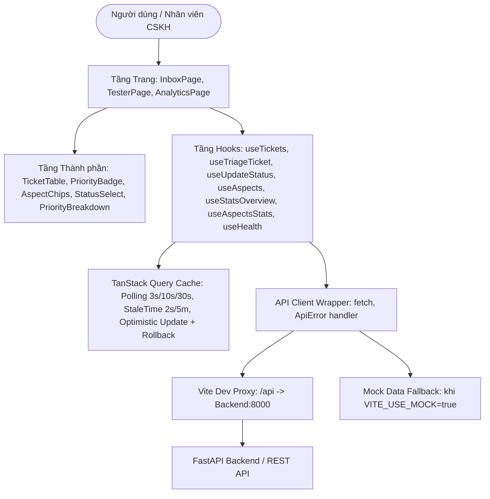
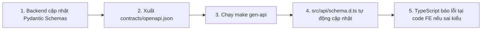

# Kế hoạch Chi tiết Cấu trúc Frontend, Trạng thái Module & Hướng dẫn Tích hợp Backend

> **Dự án:** `TICKET-TRIAGE-01` — Sentiment-Driven Ticket Triage System  
> **Thư mục phân tích:** `ticket-triage-fe/`  
> **Cập nhật:** 16/11/2026 | **Phiên bản:** Version 3.2 (Đồng bộ OpenAPI, Analytics Matrix, FSM UX Guard & Vitest Suite)  
> **Tài liệu liên quan:** [Backend-Plan.md](./Backend-Plan.md), [Project-Charter-Ticket-Triage-System.md](./Project-Charter-Ticket-Triage-System.md), [start.md](./start.md)

---

## 1. TỔNG QUAN VỀ KIẾN TRÚC FRONTEND

Hệ thống Frontend được xây dựng theo kiến trúc **Single Page Application (SPA)**, tách biệt rõ giữa tầng giao diện hiển thị (Presentational Components), helper thuần (`lib/ticketHelpers.ts`), tầng điều phối trạng thái máy chủ (Server State Management qua TanStack Query) và tầng giao tiếp mạng (API Client) theo nguyên tắc **`Server is Source of Truth`**.



### Bảng tóm tắt mức độ sẵn sàng:

| Phân hệ / Tầng chức năng | Mức độ sẵn sàng | Đánh giá & Khả năng vận hành |
| :--- | :---: | :--- |
| **Hộp thư ưu tiên (`pages/InboxPage.tsx`)** | **100% Production-ready** | Hàng đợi sắp xếp theo điểm ưu tiên từ server, phân trang `offset`/`limit` (`50`/trang), phân bố khía cạnh theo `stats.aspect_counts`, bộ lọc cố định layout (trạng thái, khía cạnh, cảm xúc), polling 3s. |
| **Thử nghiệm trực tiếp (`pages/TesterPage.tsx`)** | **100% Production-ready** | Tiếp nhận text, gọi `/tickets` theo thời gian thực, đọc `/health` hiển thị trạng thái model (`Mock` / `AI thật` / `Chưa nạp model` / `Mất kết nối`), hiển thị `sentiment_label` tiếng Việt, chip khía cạnh và `PriorityBreakdown`. |
| **Bảng điều khiển phân tích (`pages/AnalyticsPage.tsx`)** | **100% Production-ready** | 4 thẻ KPI tổng quan, 2 biểu đồ tròn Recharts (cảm xúc & mức ưu tiên giữ màu cố định theo hạng mục), biểu đồ cột xếp chồng **Ma trận Khía cạnh × Cảm xúc** từ `/stats/aspects`, và biểu đồ tần suất khía cạnh theo `name_vi`. |
| **Thành phần hiển thị vé (`components/tickets/*`)** | **100% Production-ready** | `PriorityBadge` ưu tiên `priority_level` từ API, `AspectChips` dùng `name_vi`, `StatusSelect` khóa option cấm theo FSM (BE `StateManager` kiểm duyệt cuối), `TicketTable` mở modal qua `createPortal` kèm highlight chứng cứ & `PriorityBreakdown`. |
| **Tầng giao tiếp API & Cache (`api/*`)** | **100% Production-ready** | Contract-first (`generated.ts` + `schema.d.ts`), TanStack Query v5, `useHealth()`, `useAspectsStats()`, Optimistic UI update + rollback cho `useUpdateStatus()`. |
| **Kiểm thử tự động FE (`src/**/*.test.ts(x)`)** | **23/23 tests PASSED** | 5 file test Vitest kiểm tra format, `ticketHelpers`, API client/mocks, ticket components và pages/layout qua `renderToStaticMarkup`. |
| **Dữ liệu giả lập (`mocks/tickets.ts`)** | **Demo / Fallback** | Đóng gói sẵn 5 ticket mẫu đủ 3 cấp độ ưu tiên và các khía cạnh; tự động kích hoạt khi `VITE_USE_MOCK=true` (có cắt phân trang `offset`/`limit`). |

> **Kết luận:** **Toàn bộ mã nguồn Frontend đã đồng bộ với Backend OpenAPI và sẵn sàng vận hành.** Giao diện kết nối trực tiếp với Backend FastAPI qua API `/api/v1/...`. Chế độ Mock chỉ là tùy chọn (`VITE_USE_MOCK=true`) phục vụ dev/demo độc lập.

---

## 2. CHI TIẾT TỪNG THƯ MỤC VÀ TỪNG FILE CỦA FRONTEND

### 2.1. Thư mục gốc `ticket-triage-fe/`

| Tệp tin | Logic bên trong | Vai trò & Trách nhiệm | Trạng thái |
| :--- | :--- | :--- | :---: |
| [package.json](../ticket-triage-fe/package.json) | Khai báo dependencies: React 18, React Router v6, TanStack Query v5, Lucide Icons, Recharts, TailwindCSS; devDependencies có Vitest, Testing Library, TypeScript, ESLint, `openapi-typescript`. Các script: `dev`, `build`, `check`, `lint`, `test`, `gen-api`. | Quản lý gói phụ thuộc của Frontend; quy định sử dụng độc quyền `pnpm` và sinh kiểu trực tiếp từ `../contracts/openapi.json`. | **Dùng thật** |
| [vite.config.ts](../ticket-triage-fe/vite.config.ts) | Cấu hình Vite Dev Server chạy trên cổng `5173`, thiết lập proxy ngược chuyển hướng toàn bộ request `/api` sang backend `http://127.0.0.1:8000`. | Cầu nối mạng giúp Frontend gọi API mà không gặp lỗi bảo mật Cross-Origin (CORS) trên môi trường phát triển. | **Dùng thật** |
| [tailwind.config.js](../ticket-triage-fe/tailwind.config.js) | Cấu hình quét lớp CSS trong `index.html` và `src/**/*.{js,ts,jsx,tsx}`, mở rộng bảng màu cho các mức ưu tiên (CRITICAL đỏ, MEDIUM vàng, LOW xanh). | Thiết lập bộ sinh mã CSS linh hoạt, loại bỏ CSS thừa khi đóng gói sản phẩm. | **Dùng thật** |
| [postcss.config.js](../ticket-triage-fe/postcss.config.js) | Đăng ký các plugin PostCSS (`tailwindcss`, `autoprefixer`) để tự động thêm vendor prefix cho trình duyệt. | Đảm bảo tương thích CSS trên nhiều nền tảng trình duyệt khác nhau. | **Dùng thật** |
| [tsconfig.json](../ticket-triage-fe/tsconfig.json) | Cấu hình trình biên dịch TypeScript ở chế độ nghiêm ngặt (`strict: true`, `noUnusedLocals: true`, `jsx: react-jsx`). | Đảm bảo an toàn kiểu dữ liệu (Type Safety) và bắt lỗi tĩnh trước khi chạy. | **Dùng thật** |
| [tsconfig.node.json](../ticket-triage-fe/tsconfig.node.json) | Cấu hình môi trường TypeScript dành riêng cho các tệp cấu hình của Vite (`vite.config.ts`). | Phân tách môi trường trình duyệt và môi trường Node.js. | **Dùng thật** |
| [index.html](../ticket-triage-fe/index.html) | File HTML gốc nạp thẻ `<div id="root"></div>`, nạp font Inter từ Google Fonts và nạp file thực thi `src/main.tsx`. | Khung xương trang đơn cho toàn bộ ứng dụng web. | **Dùng thật** |
| [nginx.conf](../ticket-triage-fe/nginx.conf) | Cấu hình máy chủ Nginx phục vụ tệp tĩnh, cấu hình chuyển hướng Fallback `try_files $uri /index.html` cho React Router SPA và proxy `/api/` sang backend container. | Phục vụ triển khai Production bằng Docker container siêu nhẹ. | **Dùng thật** |
| [Dockerfile](../ticket-triage-fe/Dockerfile) | Multi-stage build: Stage 1 dùng `node:20-alpine` và `pnpm` để biên dịch bundle; Stage 2 dùng `nginx:alpine` phục vụ file tĩnh. | Đóng gói Frontend thành container nhỏ gọn (<30MB) sẵn sàng cho Docker Compose. | **Dùng thật** |
| [.env.example](../ticket-triage-fe/.env.example) | Khai báo biến môi trường mẫu: `VITE_USE_MOCK=false`, `VITE_PROXY_TARGET=http://127.0.0.1:8000`. | Hướng dẫn cấu hình môi trường cho lập trình viên. | **Dùng thật** |
| [AGENT.md](../ticket-triage-fe/AGENT.md) | Bộ quy chuẩn kỹ thuật Frontend: quy tắc gọi API, màu sắc mức ưu tiên, polling interval, hợp đồng contract-first. | Kim chỉ nam kỹ thuật cho nhóm Frontend và AI Assistant. | **Dùng thật** |

---

### 2.2. Tầng Giao tiếp API & Cache Server-State: `src/api/`

*   [src/api/generated.ts](../ticket-triage-fe/src/api/generated.ts)
    *   **Logic bên trong:** File định nghĩa OpenAPI TypeScript **SINH TỰ ĐỘNG** trực tiếp từ `contracts/openapi.json` qua `pnpm run gen-api` (`openapi-typescript ../contracts/openapi.json -o src/api/generated.ts`).
    *   **Vai trò:** Nguồn kiểu thô từ OpenAPI schema của Backend (Contract-First Design).
    *   **Trạng thái:** **Dùng thật 100%**.
*   [src/api/schema.d.ts](../ticket-triage-fe/src/api/schema.d.ts)
    *   **Logic bên trong:** Ánh xạ các kiểu miền từ `components["schemas"]` của `generated.ts` (`TicketOut`, `TicketCreateIn`, `StatusUpdateIn`, `AspectMetaItem`, `StatsOverview`, `AspectStatItem`, `HealthResponse` có đủ `is_mock` và `model_loaded`).
    *   **Vai trò:** Chuẩn hóa kiểu dữ liệu giữa API Backend và các hook/component Frontend mà không phải viết tay trùng lặp schema.
    *   **Trạng thái:** **Dùng thật 100%**.
*   [src/api/client.ts](../ticket-triage-fe/src/api/client.ts)
    *   **Logic bên trong:** Bọc hàm `fetch` nguyên bản thành các phương thức `api.get`, `api.post`, `api.patch`. Bắt lỗi HTTP status $\ge 400$, trích xuất thông điệp chi tiết từ Backend và đóng gói thành đối tượng `ApiError` với thông báo tiếng Việt.
    *   **Vai trò:** Tầng truyền thông mạng trung tâm; ngăn chặn việc gọi `fetch` phân tán rải rác trong các component.
    *   **Trạng thái:** **Dùng thật 100%**.
*   [src/api/queryKeys.ts](../ticket-triage-fe/src/api/queryKeys.ts)
    *   **Logic bên trong:** Khai báo cấu trúc khóa bộ nhớ đệm (Query Key Factory) dạng phân cấp:
        `tickets.all`, `tickets.list(filters)`, `tickets.detail(id)`, `aspects`, `stats.overview`, `stats.aspects`, `health`.
    *   **Vai trò:** Giúp TanStack Query quản lý việc làm mới dữ liệu (Cache Invalidation) chính xác, tránh làm mới nhầm hoặc sót cache.
    *   **Trạng thái:** **Dùng thật 100%**.
*   [src/api/hooks.ts](../ticket-triage-fe/src/api/hooks.ts)
    *   **Logic bên trong:** Chứa các React Custom Hooks tích hợp `useQuery` và `useMutation`:
        *   `useHealth()`: Kiểm tra tình trạng API/model từ `/health` (`is_mock`, `model_loaded`, `model_name`, `queue_size`), làm mới mỗi 30 giây (`POLL_HEALTH_MS = 30000`).
        *   `useTickets(filters)`: Lấy danh sách vé phân trang (`limit`/`offset`) và lọc (`status`, `aspect`, `sentiment`), tự động làm mới sau mỗi 3 giây (`POLL_QUEUE_MS = 3000`).
        *   `useTicketDetail(id)`: Lấy chi tiết vé theo mã định danh.
        *   `useAspects()`: Lấy danh mục khía cạnh từ `/meta/aspects`, lưu cache 5 phút (`staleTime: 300_000`).
        *   `useStatsOverview()` & `useAspectsStats()`: Lấy thống kê tổng quan và ma trận `AspectStatItem[]` (`Khía cạnh × Cảm xúc`), tự động làm mới sau mỗi 10 giây (`POLL_STATS_MS = 10000`).
        *   `useTriageTicket()`: Gửi vé mới lên `POST /api/v1/tickets`; khi thành công lập tức invalidate `tickets.all`, `stats.overview`, `stats.aspects`, và `health`.
        *   `useUpdateStatus()`: Cập nhật trạng thái vé với **Optimistic Update + Rollback** (`onMutate` / `onError` / `onSuccess` / `onSettled`), đồng thời invalidate `tickets`, `stats.overview`, `stats.aspects` và `health`.
        *   Hỗ trợ chuyển đổi sang `MOCK_TICKETS` / `MOCK_ASPECTS` / `MOCK_STATS` khi `VITE_USE_MOCK=true` (có cắt slice `offset`/`limit` và báo lỗi khi không tìm thấy `id`).
    *   **Vai trò:** Trái tim điều phối luồng dữ liệu cho toàn bộ giao diện người dùng.
    *   **Trạng thái:** **Dùng thật 100%**.

---

### 2.3. Tầng Thành phần Hiển thị: `src/components/`

#### A. Khung giao diện (`components/layout/`)
*   [src/components/layout/AppShell.tsx](../ticket-triage-fe/src/components/layout/AppShell.tsx)
    *   **Logic bên trong:** Khung bao ngoài ứng dụng, đặt thanh điều hướng `Navigation` cố định ở đỉnh trang và bọc vùng nội dung chính trong thẻ `<main className="max-w-7xl mx-auto px-4 py-6">`.
    *   **Vai trò:** Duy trì bố cục nhất quán, đáp ứng tốt trên cả máy tính bảng và màn hình máy tính.
    *   **Trạng thái:** **Dùng thật 100%**.
*   [src/components/layout/Navigation.tsx](../ticket-triage-fe/src/components/layout/Navigation.tsx)
    *   **Logic bên trong:** Thanh điều hướng chính chứa logo, liên kết chuyển trang (`NavLink`) với chỉ báo trang hiện tại:
        *   `/` — Hộp thư ưu tiên (Inbox).
        *   `/tester` — Thử nghiệm trực tiếp (Live Tester).
        *   `/analytics` — Thống kê báo cáo (Analytics).
        *   Hiển thị huy hiệu trạng thái kết nối thời gian thực (Live API kết nối Backend hoặc Chế độ Mock).
    *   **Vai trò:** Giúp người dùng dễ dàng chuyển đổi các tính năng nghiệp vụ.
    *   **Trạng thái:** **Dùng thật 100%**.

#### B. Thành phần vé CSKH (`components/tickets/`)
*   [src/components/tickets/PriorityBadge.tsx](../ticket-triage-fe/src/components/tickets/PriorityBadge.tsx)
    *   **Logic bên trong:** Nhận `score` và `level?: TicketOut["priority_level"]`, gọi `resolvePriorityLevel()` để **ưu tiên nhãn cấp độ do Backend trả về** (`CRITICAL` → `"Nghiêm trọng"`, `MEDIUM` → `"Trung bình"`, `LOW` → `"Thấp"`), chỉ fallback theo ngưỡng điểm `70.0 / 30.0` khi thiếu trường; gắn `aria-label` đầy đủ cho accessibility.
    *   **Vai trò:** Giúp nhân viên hỗ trợ nhận diện đúng mức độ khẩn cấp từ Backend trong vài mili-giây.
    *   **Trạng thái:** **Dùng thật 100%**.
*   [src/components/tickets/AspectChips.tsx](../ticket-triage-fe/src/components/tickets/AspectChips.tsx)
    *   **Logic bên trong:** Hiển thị danh sách các khía cạnh trích xuất được (ABSA), ánh xạ `name_vi` từ `useAspects()` qua `getAspectDisplayName()`.
        *   Tô màu theo sắc thái cảm xúc (`SENTIMENT_CONFIG`): Tiêu cực (đỏ nhạt), Trung tính (xám nhạt), Tích cực (xanh lá nhạt).
        *   Ưu tiên sắp xếp các khía cạnh **tiêu cực lên đầu tiên** (cùng nhóm xếp theo `confidence` giảm dần).
        *   Hiển thị tối đa `maxDisplay` (mặc định 3 chip trên bảng), phần còn lại gom thành `+N`; nếu rỗng hiển thị `"Chưa phân tích khía cạnh"`.
    *   **Vai trò:** Trực quan hóa kết quả phân tích cảm xúc khía cạnh của mô hình AI.
    *   **Trạng thái:** **Dùng thật 100%**.
*   [src/components/tickets/StatusSelect.tsx](../ticket-triage-fe/src/components/tickets/StatusSelect.tsx)
    *   **Logic bên trong:** Dropdown cập nhật trạng thái vòng đời (`new` → `assigned` / `in_progress`, `assigned` → `in_progress` / `new`, `in_progress` → `resolved` / `assigned`, `resolved` → `new`). Khóa (`disabled`) các `<option>` không hợp lệ qua `canTransitionStatus()` làm UX guard (Backend `StateManager` vẫn quyết định cuối), tách spinner ra ngoài `.queue-status-control`, và hiển thị `role="alert"` khi mutation lỗi.
    *   **Vai trò:** Cho phép tổng đài viên cập nhật tiến độ xử lý khiếu nại ngay trên bảng mà hạn chế bấm nhầm bước chuyển bị cấm.
    *   **Trạng thái:** **Dùng thật 100%**.
*   [src/components/tickets/PriorityBreakdown.tsx](../ticket-triage-fe/src/components/tickets/PriorityBreakdown.tsx)
    *   **Logic bên trong:** Bảng giải trình chi tiết công thức tính điểm:
        *   Hiển thị thanh phân bổ đóng góp và 4 thành phần điểm (`base`, `urgency_bonus`, `intensity_bonus`, `aspect_bonus`) cùng `dominantAspect` theo `name_vi`.
        *   Phân loại tone cho danh sách lý do tiếng Việt/Anh qua `getEvidenceTone()` và highlight cụm từ trích dẫn trong dấu nháy đơn qua `getEvidenceLevel()`.
    *   **Vai trò:** Đảm bảo tính minh bạch, có thể kiểm toán (Auditable AI).
    *   **Trạng thái:** **Dùng thật 100%**.
*   [src/components/tickets/TicketTable.tsx](../ticket-triage-fe/src/components/tickets/TicketTable.tsx)
    *   **Logic bên trong:** Bảng danh sách hàng đợi chính:
        *   Hiển thị mã vé, `PriorityBadge`, cờ ngoại ngữ/duyệt tay/độ tin cậy thấp, nội dung trích lược, `AspectChips`, `StatusSelect` và thời gian tạo.
        *   Tương tác: Click dòng hoặc nhấn Enter/Space mở modal chi tiết qua `createPortal(..., document.body)` có header/footer cố định, body cuộn độc lập, highlight chứng cứ qua `findEvidenceRanges()` và `PriorityBreakdown`.
    *   **Vai trò:** Màn hình làm việc trọng tâm hàng ngày của đội ngũ tiếp nhận khiếu nại.
    *   **Trạng thái:** **Dùng thật 100%**.

---

### 2.4. Tầng Màn hình Chức năng: `src/pages/`

*   [src/pages/InboxPage.tsx](../ticket-triage-fe/src/pages/InboxPage.tsx)
    *   **Logic bên trong:**
        *   Hiển thị 4 thẻ thống kê hàng đợi, khối **Phân bố khía cạnh** đọc trực tiếp `stats?.aspect_counts` của server (map sang `name_vi`) và thanh **Bộ lọc** giữ vị trí cố định nút `"Xóa bộ lọc"` ở header để tránh nhảy layout.
        *   Hỗ trợ lọc theo Trạng thái, Khía cạnh, Cảm xúc gửi lên server kèm phân trang `offset` / `limit = 50` và polling mỗi 3 giây.
    *   **Vai trò:** Hộp thư xử lý vé ưu tiên của tổng đài viên.
    *   **Trạng thái:** **Dùng thật 100%**.
*   [src/pages/TesterPage.tsx](../ticket-triage-fe/src/pages/TesterPage.tsx)
    *   **Logic bên trong:**
        *   Nối `useHealth()` hiển thị tên mô hình đang chạy (`model_name`) và huy hiệu trạng thái (`Mock` / `AI thật` / `Chưa nạp model` / `Mất kết nối`).
        *   Cung cấp ô nhập văn bản kèm 5 mẫu thử nhanh và gọi mutation `useTriageTicket()` (`POST /api/v1/tickets`).
        *   Hiển thị kết quả `PriorityBadge`, cảm xúc tổng thể tiếng Việt qua `SENTIMENT_CONFIG`, tỷ lệ tin cậy (chống flicker bằng `MIN_SKELETON_MS`, hiệu ứng `useCountUp`, hỗ trợ `confidence === 0`), `AspectChips` và `PriorityBreakdown`.
    *   **Vai trò:** Phục vụ kiểm thử trực tiếp luồng toàn trình và demo trước hội đồng.
    *   **Trạng thái:** **Dùng thật 100%**.
*   [src/pages/AnalyticsPage.tsx](../ticket-triage-fe/src/pages/AnalyticsPage.tsx)
    *   **Logic bên trong:**
        *   4 thẻ KPI tổng hợp: **Tổng số ticket**, **Ưu tiên Nghiêm trọng**, **Chưa đóng** (Mới / Đã giao / Xử lý), và **Đã giải quyết** (kèm `%` hoàn tất).
        *   2 biểu đồ tròn (`PieChart` qua Recharts): Phân bố cảm xúc tổng thể và Phân bố mức độ ưu tiên — mỗi lát cắt gắn `color` cố định trước khi `.filter((d) => d.value > 0)` nên không bị lệch màu khi có nhóm bằng 0.
        *   Biểu đồ cột xếp chồng (**Ma trận Khía cạnh × Cảm xúc**): dựng từ `useAspectsStats()` (`GET /api/v1/stats/aspects`) qua `buildAspectSentimentMatrix()`, hiển thị số lượng Tiêu cực / Trung tính / Tích cực theo tên tiếng Việt (`name_vi`).
        *   Biểu đồ cột tần suất xuất hiện theo khía cạnh CSKH (`stats.aspect_counts` map sang `name_vi`), làm mới mỗi 10 giây (`POLL_STATS_MS = 10000`).
    *   **Vai trò:** Bảng điều khiển phân tích số liệu dành cho Trưởng phòng CSKH và Ban quản lý.
    *   **Trạng thái:** **Dùng thật 100%**.
*   [src/pages/NotFoundPage.tsx](../ticket-triage-fe/src/pages/NotFoundPage.tsx)
    *   **Logic bên trong:** Bắt các đường dẫn không hợp lệ (404), hiển thị thông báo thân thiện và nút điều hướng quay lại Hộp thư.
    *   **Vai trò:** Đảm bảo trải nghiệm người dùng liền mạch khi gõ sai đường dẫn.
    *   **Trạng thái:** **Dùng thật 100%**.

---

### 2.5. Tầng Tiện ích, Kiểm thử & Hỗ trợ: `src/lib/`, `src/mocks/`, `*.test.ts(x)`

*   [src/lib/constants.ts](../ticket-triage-fe/src/lib/constants.ts)
    *   **Logic bên trong:** Định nghĩa các hằng số dùng chung: Ngưỡng fallback điểm ưu tiên (`PRIORITY_HIGH = 70.0`, `PRIORITY_MED = 30.0`), chu kỳ làm mới (`POLL_QUEUE_MS = 3000`, `POLL_STATS_MS = 10000`, `POLL_HEALTH_MS = 30000`), danh sách trạng thái chuẩn `STATUSES` và bảng ánh xạ cảm xúc `SENTIMENT_CONFIG`.
    *   **Vai trò:** Tránh lặp lại "magic numbers" rải rác trong mã nguồn.
    *   **Trạng thái:** **Dùng thật 100%**.
*   [src/lib/ticketHelpers.ts](../ticket-triage-fe/src/lib/ticketHelpers.ts)
    *   **Logic bên trong:** Gom toàn bộ helper thuần tầng trình bày: `resolvePriorityLevel()`, `ALLOWED_STATUS_TRANSITIONS` + `canTransitionStatus()`, `CRITICAL_EVIDENCE_TERMS` (đồng bộ `"charged twice"`) / `HIGH_EVIDENCE_TERMS`, `getEvidenceLevel()`, `getEvidenceTone()` (hỗ trợ lý do tiếng Việt từ BE), `findEvidenceRanges()`, `getAspectDisplayName()`, và `buildAspectSentimentMatrix()`.
    *   **Vai trò:** Chia sẻ 1 nguồn sự thật tầng hiển thị giữa `PriorityBadge`, `StatusSelect`, `TicketTable`, `PriorityBreakdown`, `AspectChips`, `InboxPage` và `AnalyticsPage`.
    *   **Trạng thái:** **Dùng thật 100%**.
*   [src/lib/format.ts](../ticket-triage-fe/src/lib/format.ts)
    *   **Logic bên trong:** Các hàm tiện ích định dạng: chuyển đổi ISO timestamp thành ngày giờ thân thiện tiếng Việt (`dd/MM/yyyy HH:mm`), làm tròn số điểm ưu tiên thập phân.
    *   **Vai trò:** Chuẩn hóa định dạng hiển thị ngày giờ và số liệu.
    *   **Trạng thái:** **Dùng thật 100%**.
*   [src/lib/utils.ts](../ticket-triage-fe/src/lib/utils.ts)
    *   **Logic bên trong:** Cung cấp hàm `cn(...inputs)` kết hợp `clsx` và `tailwind-merge` để nối lớp CSS có điều kiện và xử lý xung đột lớp Tailwind.
    *   **Vai trò:** Chuẩn hóa thao tác gán class động trong toàn bộ component.
    *   **Trạng thái:** **Dùng thật 100%**.
*   Bộ kiểm thử Vitest (`23/23` tests): [format.test.ts](../ticket-triage-fe/src/lib/format.test.ts), [ticketHelpers.test.ts](../ticket-triage-fe/src/lib/ticketHelpers.test.ts), [apiAndMocks.test.ts](../ticket-triage-fe/src/api/apiAndMocks.test.ts), [ticketComponents.test.tsx](../ticket-triage-fe/src/components/tickets/ticketComponents.test.tsx), [pages.test.tsx](../ticket-triage-fe/src/pages/pages.test.tsx).
    *   **Logic bên trong:** Kiểm thử đơn vị cho helpers, `api` client / `queryKeys` / `MOCK_TICKETS`, render tĩnh `renderToStaticMarkup` cho toàn bộ ticket components và 3 page chính + `Navigation` (không cài thêm package ngoài `AGENT.md`).
    *   **Trạng thái:** **PASS 23/23**.
*   [src/mocks/tickets.ts](../ticket-triage-fe/src/mocks/tickets.ts)
    *   **Logic bên trong:** Khai báo `MOCK_TICKETS` (5 vé mẫu khớp công thức điểm, trong đó `#103` `confidence: 0.80` khớp `base = 48.0`), `MOCK_ASPECTS` và `MOCK_STATS`.
    *   **Vai trò:** Cung cấp dữ liệu mẫu khi `VITE_USE_MOCK=true`.
    *   **Trạng thái:** **Demo / Development Fallback**.
*   [src/App.tsx](../ticket-triage-fe/src/App.tsx)
    *   **Logic bên trong:** Khởi tạo `QueryClientProvider` cho TanStack Query và định nghĩa các tuyến đường `BrowserRouter`:
        `Route path="/" element={<InboxPage />} />`,
        `Route path="/tester" element={<TesterPage />} />`,
        `Route path="/analytics" element={<AnalyticsPage />} />`,
        `Route path="*" element={<NotFoundPage />} />`.
    *   **Vai trò:** Cấu hình định tuyến và bọc bộ cung cấp ngữ cảnh toàn cục (Context Providers).
    *   **Trạng thái:** **Dùng thật 100%**.
*   [src/main.tsx](../ticket-triage-fe/src/main.tsx)
    *   **Logic bên trong:** Điểm vào chính của ứng dụng: nạp `index.css`, mount `App` vào DOM node `#root` với `React.StrictMode`.
    *   **Vai trò:** Khởi động ứng dụng React.
    *   **Trạng thái:** **Dùng thật 100%**.
*   [src/index.css](../ticket-triage-fe/src/index.css)
    *   **Logic bên trong:** Nạp các chỉ thị Tailwind `@tailwind base; @tailwind components; @tailwind utilities;`, thiết lập font chữ mặc định `Inter` và màu nền thân thiện `bg-slate-50`.
    *   **Vai trò:** Quy chuẩn kiểu dáng nền tảng cho giao diện.
    *   **Trạng thái:** **Dùng thật 100%**.

---

## 3. HƯỚNG DẪN KẾT NỐI VÀ CHẠY THẬT VỚI BACKEND

### 3.1. Thiết kế "Zero-Change" khi Backend nâng cấp Model AI
Do Frontend hoạt động hoàn toàn dựa trên hợp đồng dữ liệu REST API:

> [!NOTE]
> Khi Backend chuyển từ mô hình Mock sang mô hình AI thật (DeBERTa / BART NLI fine-tuned):
> *   **Frontend TUYỆT ĐỐI KHÔNG CẦN SỬA MỘT DÒNG CODE NÀO.**
> *   Mọi kết quả khía cạnh mới, điểm ưu tiên mới và danh sách lý do suy luận mới sẽ tự động hiển thị mượt mà trên Hộp thư, Live Tester và Analytics Dashboard.

---

### 3.2. Quy trình Đồng bộ Kiểu dữ liệu khi Backend thay đổi API (Contract-First Workflow)

Khi Backend thêm endpoint hoặc đổi trường dữ liệu:



Lệnh thực thi tại thư mục gốc:
```bash
make gen-api
# hoặc tại thư mục ticket-triage-fe:
pnpm run gen-api
```

---

### 3.3. Các bước Khởi chạy Thực tế

#### Cách 1: Chạy song song độc lập bằng pnpm (Môi trường phát triển cục bộ)
1. Cài đặt các gói phụ thuộc:
   ```bash
   cd ticket-triage-fe
   pnpm install
   ```
2. Đảm bảo file `.env` đã tắt chế độ Mock:
   ```ini
   VITE_USE_MOCK=false
   VITE_PROXY_TARGET=http://127.0.0.1:8000
   ```
3. Khởi động máy chủ phát triển:
   ```bash
   pnpm run dev
   ```
4. Mở trình duyệt tại địa chỉ: `http://localhost:5173`. Mọi request `/api/v1/...` sẽ tự động được Vite chuyển tiếp sang Backend cổng 8000.

#### Cách 2: Chạy toàn bộ hệ thống bằng Docker Compose (Khuyên dùng)
Tại thư mục gốc dự án:
```bash
make up
# hoặc: docker compose -f docker.yaml up --build -d
```
*   Frontend sẽ được Nginx phục vụ tại: `http://localhost:3000` (hoặc `5173` theo cấu hình).
*   Backend API Swagger tài liệu tại: `http://localhost:8000/docs`.

---

## 4. TỔNG KẾT
Toàn bộ mã nguồn Frontend hiện tại đã được cấu trúc bài bản, tuân thủ nghiêm ngặt các tiêu chuẩn kỹ thuật hiện đại:
1. **Kiểm soát chặt chẽ trạng thái máy chủ** với cơ chế Polling thời gian thực và tự động vô hiệu hóa cache khi có thay đổi.
2. **Thiết kế giao diện đáp ứng, hiện đại** bằng TailwindCSS với bảng màu trực quan cho 3 mức độ ưu tiên.
3. **An toàn kiểu dữ liệu 100%** thông qua việc tự động sinh kiểu từ hợp đồng OpenAPI của Backend.
4. **Hỗ trợ chạy độc lập** bằng dữ liệu Mock khi phát triển giao diện và chuyển đổi sang Live Backend chỉ qua một biến môi trường.
