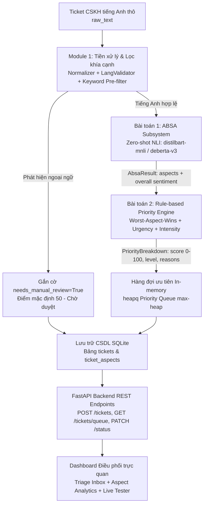
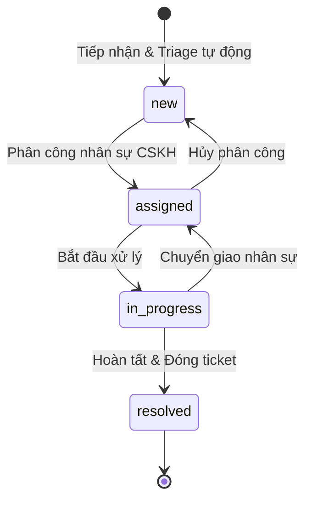
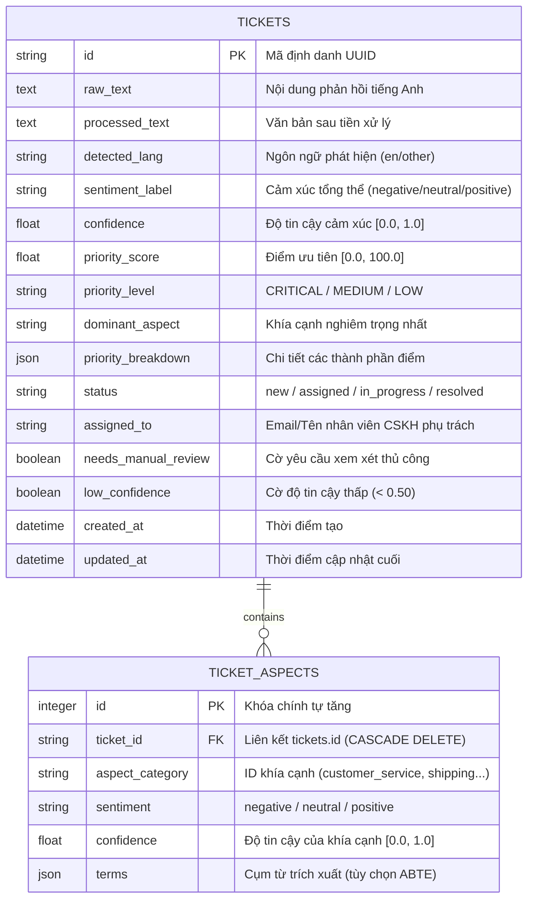

# BÁO CÁO THIẾT KẾ KIẾN TRÚC HỆ THỐNG
## Hệ thống phân loại & định tuyến phản hồi khách hàng theo cảm xúc (*Sentiment-Driven Ticket Triage System*)

**Mã dự án:** `TICKET-TRIAGE-01` | **Học phần:** Quản trị dự án phần mềm  
**Giảng viên hướng dẫn:** *Nguyễn Thanh Tuấn*  
**Nhóm thực hiện:** *DogTowFaces* (Võ Tấn Đức, Lê Công Quốc Mỹ, Nguyễn Văn Lê Duy, Nguyễn Viết Pháp, Nguyễn Phương Thảo)  
**Phiên bản tài liệu:** Version 3.0 (Chuẩn hóa toàn diện theo [Project-Charter-Ticket-Triage-System.md](file:///d:/Learning/Sentiment-Driven-Ticket-Triage-System/docs/Project-Charter-Ticket-Triage-System.md) và [WBS-Ticket-Triage-System.md](file:///d:/Learning/Sentiment-Driven-Ticket-Triage-System/docs/WBS-Ticket-Triage-System.md))  
**Ngày cập nhật:** 19/10/2026 (Đồng bộ: English-only, ABSA Zero-shot NLI, Phân tách 2 bài toán độc lập)  
**Tình trạng:** Tài liệu thiết kế kỹ thuật chính thức (Scope Baseline & Architecture Specification)

---

## 1. TỔNG QUAN BÀI TOÁN & LUẬN CỨ NGHIỆP VỤ

### 1.1. Bối cảnh vận hành & Vấn đề cốt lõi
Trong các trung tâm hỗ trợ khách hàng (Customer Support - CSKH) thương mại điện tử, số lượng yêu cầu hỗ trợ (ticket) phát sinh bằng tiếng Anh mỗi ngày có thể lên tới hàng nghìn lượt qua đa dạng các kênh giao tiếp (email, chat, web form).

Cơ chế tiếp nhận và giải quyết truyền thống vận hành theo nguyên lý **FIFO (First In, First Out)**. Điều này dẫn đến sự cố nghiêm trọng:
- Những khách hàng gặp rủi ro khẩn cấp (khiếu nại lừa đảo, bị trừ tiền hai lần, dọa khởi kiện, hàng thất lạc nhiều tuần) bị xếp hàng sau các câu hỏi tra cứu thông thường.
- Nguy cơ mất khách hàng (churn rate tăng), phát sinh tranh chấp pháp lý và suy giảm uy tín thương hiệu do thời gian phản hồi ban đầu (First Response Time) đối với các ca nghiêm trọng quá chậm.

### 1.2. Giải pháp đề xuất & Triết lý thiết kế
Dự án xây dựng hệ thống tự động tiếp nhận, phân tích khía cạnh cảm xúc và định tuyến thứ tự xử lý ticket CSKH tiếng Anh theo thời gian thực. Hệ thống được tổ chức phân tách thành **2 bài toán kỹ thuật độc lập**:
1. **Bài toán 1 — Phân tích khía cạnh cảm xúc (ABSA Subsystem):** Ứng dụng mô hình học sâu suy luận ngôn ngữ tự nhiên **Zero-shot NLI** để trích xuất đa khía cạnh nghiệp vụ (`Customer Service`, `Shipping`, `Product Quality`, `Refund/Payment`, `General`) và trạng thái cảm xúc tương ứng (`positive`, `negative`, `neutral`) cùng độ tin cậy.
2. **Bài toán 2 — Chấm điểm ưu tiên & Hàng đợi định tuyến (Priority Triage & Queue Subsystem):** Áp dụng công thức tính điểm ưu tiên **Rule-based toán học minh bạch**, hoạt động theo nguyên lý *khía cạnh tiêu cực nghiêm trọng nhất quyết định điểm nền (worst-aspect-wins)*, kết hợp trọng số từ khóa khẩn cấp và cường độ cú pháp câu; sắp xếp tự động qua cấu trúc hàng đợi `heapq`, lưu trữ bền vững trên SQLite và trực quan hóa trên Dashboard.

> [!IMPORTANT]
> **Triết lý cốt lõi của hệ thống:**
> - Mức độ nghiêm trọng của khía cạnh vấn đề là **nền tảng**, sắc thái cảm xúc và từ khóa khẩn cấp đóng vai trò **khuếch đại**. Một khách hàng bình tĩnh báo cáo *"I was charged twice"* có mức ưu tiên cao hơn một khách hàng giận dữ phàn nàn *"The packaging is ugly"*.
> - Tuyệt đối không dùng mô hình học máy hộp đen (Black-box ML) để trực tiếp dự đoán điểm ưu tiên. Bộ chấm điểm phải là **Rule-based minh bạch** với danh sách giải trình (`explanation / reasons`) chi tiết, có thể kiểm toán được bởi nhân viên vận hành và hội đồng đánh giá.
> - Phạm vi ngôn ngữ chuyên biệt: **Chỉ xử lý tiếng Anh (English-only)**. Văn bản phát hiện ngôn ngữ khác sẽ được bộ xác thực ngôn ngữ tự động gắn cờ ngoại lệ `needs_manual_review = True` và chuyển về hàng đợi kiểm tra thủ công.

---

## 2. KIẾN TRÚC TỔNG THỂ & NGUYÊN TẮC PHÂN TÁCH 2 BÀI TOÁN

### 2.1. Sơ đồ luồng toàn trình (End-to-End Pipeline)



### 2.2. Nguyên tắc phân tách và Hợp đồng giao tiếp (API Contract)
Để đảm bảo tiến độ triển khai song song theo mô hình Agile/Sprint:
- **Tính độc lập phát triển:** Nhóm phụ trách Bài toán 1 (ABSA Subsystem - Nguyễn Văn Lê Duy) và nhóm phụ trách Bài toán 2 (Priority & Queue & UI - Nguyễn Viết Pháp) làm việc trên hai luồng độc lập thông qua hợp đồng dữ liệu đóng băng `AbsaResult`.
- **Cơ chế hoạt động dự phòng (Mock / Document Fallback):** Bài toán 2 có thể chạy độc lập ngay từ cột mốc M3 bằng `MockSentimentModel` mà không bị chặn bởi quá trình fine-tune mô hình NLI ở Bài toán 1. Trong trường hợp văn bản không phát hiện được khía cạnh hoặc chạy chế độ phân loại cấp văn bản, hệ thống trả về `aspects` rỗng và Priority Engine tự động hạ cấp an toàn về công thức nền.

---

## 3. HỢP ĐỒNG DỮ LIỆU & LƯỢC ĐỒ GIAO TIẾP

### 3.1. Dữ liệu đầu vào (Input Contract)

| Trường dữ liệu | Kiểu | Bắt buộc | Mô tả nghiệp vụ |
| :--- | :---: | :---: | :--- |
| `raw_text` | `string` | **Có** | Nội dung phản hồi khách hàng bằng tiếng Anh (từ email, chat, form). |
| `ticket_id` | `string / UUID` | Không | Mã định danh ticket (nếu không cung cấp, hệ thống tự sinh mã duy nhất). |
| `created_at` | `datetime` | Không | Thời điểm tiếp nhận yêu cầu (mặc định lấy thời gian hiện tại của hệ thống). |

### 3.2. Hợp đồng dữ liệu trung gian giữa 2 bài toán (Frozen Dataclasses)
Theo định nghĩa chuẩn tại kiến trúc lõi backend:

```python
from dataclasses import dataclass
from typing import Literal

Sentiment = Literal["negative", "neutral", "positive"]

@dataclass(frozen=True)
class SentimentResult:
    """Cảm xúc tổng thể của toàn bộ ticket."""
    label: Sentiment
    confidence: float             # Đoạn [0.0, 1.0]

@dataclass(frozen=True)
class AspectSentiment:
    """Khía cạnh phát hiện được kèm trạng thái cảm xúc tương ứng."""
    aspect: str                   # Khóa định danh từ configs/aspects.yaml
    sentiment: Sentiment          # negative | neutral | positive
    confidence: float             # Đoạn [0.0, 1.0]
    terms: tuple[str, ...] = ()   # Cụm từ trích xuất (tùy chọn ABTE)

@dataclass(frozen=True)
class AbsaResult:
    """Đầu ra chuẩn hóa của Bài toán 1 bàn giao cho Bài toán 2."""
    overall: SentimentResult
    aspects: list[AspectSentiment]
```

### 3.3. Dữ liệu đầu ra hệ thống (Output & Breakdown Contract)

| Trường dữ liệu | Kiểu | Mô tả nghiệp vụ |
| :--- | :---: | :--- |
| `priority_score` | `float` | Điểm ưu tiên số học chuẩn hóa trong thang `[0.0, 100.0]`, làm tròn 2 chữ số thập phân. |
| `priority_level` | `string` | Cấp độ ưu tiên: `CRITICAL` (Cao, ≥ 70), `MEDIUM` (Trung bình, 30–69), `LOW` (Thấp, < 30). |
| `dominant_aspect` | `string` | Khía cạnh tiêu cực có trọng số cao nhất chi phối điểm số nền. |
| `needs_manual_review` | `boolean` | Cờ đánh dấu cần nhân viên kiểm tra (khi phát hiện ngoại ngữ hoặc confidence thấp). |
| `low_confidence` | `boolean` | Bật `True` khi độ tin cậy cảm xúc tổng thể < 0.50. |
| `status` | `string` | Trạng thái vòng đời 4 bước: `new` → `assigned` → `in_progress` → `resolved`. |
| `priority_breakdown` | `object` | Bản ghi giải trình chi tiết từng thành phần cấu thành điểm số. |

**Cấu trúc chi tiết của trường `priority_breakdown`:**
```json
{
  "score": 85.0,
  "base": 60.0,
  "urgency_bonus": 20.0,
  "intensity_bonus": 5.0,
  "aspect_bonus": 10.0,
  "reasons": [
    "Cảm xúc tổng thể tiêu cực (base = 60.0)",
    "Khía cạnh nghiêm trọng nhất: refund_payment (tiêu cực, trọng số = 1.0)",
    "Phát hiện từ khóa khẩn cấp ở câu kết: 'chargeback' (+20.0)",
    "Cú pháp câu chứa dấu cảm thán liên tiếp '!!!' (+5.0)"
  ]
}
```

---

## 4. BÀI TOÁN 1: HỆ THỐNG PHÂN TÍCH KHÍA CẠNH (ABSA SUBSYSTEM)

Phụ trách chính: **Nguyễn Văn Lê Duy (Lead Dev ABSA)** | Kiểm thử & Nghiệm thu: **Nguyễn Phương Thảo (QA)**  
Các gói công việc WBS liên quan: `WBS 1.3.1`, `1.3.2`, `1.3.3`, `1.3.4`, `1.4.1`, `1.4.2`, `1.4.3`, `1.4.4`, `1.4.5`.

### 4.1. Module 1 — Tiền xử lý & Cổng kiểm soát tiếng Anh
Gồm chuỗi 3 công đoạn xử lý tuần tự trước khi đưa văn bản vào mạng nơ-ron:
1. **Chuẩn hóa văn bản (`src/preprocessing/normalizer.py` - WBS 1.3.1):**
   - Chuyển đổi Unicode dạng chuẩn NFC.
   - Loại bỏ mã HTML tags, URLs và các địa chỉ email cá nhân gây nhiễu.
   - Rút gọn chuỗi ký tự lặp quá mức (ví dụ: `baaaaad!!!!` → `bad!`).
   - **Bảo toàn:** Giữ nguyên các ký tự viết hoa (CAPS LOCK), các dấu câu biểu đạt bức xúc (`!`, `?`) và các từ phủ định (`not`, `never`, `no`) phục vụ cho Module Intensity và Urgency.
2. **Xác thực ngôn ngữ tiếng Anh (`src/preprocessing/lang_validator.py` - WBS 1.3.2):**
   - Sử dụng thư viện `langdetect` để kiểm tra ngôn ngữ.
   - Nếu kết quả là tiếng Anh (`en`) với xác suất tin cậy: Tiếp tục chuyển vào pipeline ABSA.
   - Nếu phát hiện ngôn ngữ khác (tiếng Việt, tiếng Pháp, Tây Ban Nha...): Hệ thống **không kích hoạt mô hình NLI**, tự động thiết lập `language_flag = "unsupported"`, `needs_manual_review = True`, gán điểm an toàn `priority_score = 50.0` và chuyển thẳng về hàng đợi chờ duyệt.
3. **Bộ lọc trước từ khóa khía cạnh (`src/preprocessing/keyword_prefilter.py` - WBS 1.3.3):**
   - Quét sự xuất hiện của các từ vựng chỉ báo đặc trưng của từng khía cạnh trong văn bản.
   - Chỉ kích hoạt suy luận NLI trên các khía cạnh có chỉ báo tiềm năng; nếu không phát hiện từ khóa cụ thể thì chuyển sang đánh giá khía cạnh `general`.
   - Giúp giảm từ **2x đến 3x thời gian suy luận** trên mỗi ticket so với việc duyệt vét cạn toàn bộ danh mục khía cạnh.

### 4.2. Danh mục khía cạnh nghiệp vụ CSKH (Taxonomy Config)
Danh mục khía cạnh được quản lý độc lập tại tệp cấu hình `configs/aspects.yaml` (WBS 1.4.2) theo cấu trúc chuẩn hóa:

| ID Khía cạnh | Tên nghiệp vụ tiếng Việt | Trọng số mặc định | Mô tả & Bộ phận tiếp nhận |
| :--- | :--- | :---: | :--- |
| `customer_service` | Dịch vụ khách hàng | **1.0** | Thái độ nhân viên, tốc độ phản hồi hỗ trợ (CS Team). |
| `refund_payment` | Hoàn tiền & Thanh toán | **1.0** | Trừ tiền trùng, lỗi cổng thanh toán, tranh chấp giao dịch (Finance). |
| `product_quality` | Chất lượng sản phẩm | **0.8** | Hàng hỏng hóc, lỗi kỹ thuật, sai mô tả, hàng giả (Warehouse/QC). |
| `shipping` | Vận chuyển & Giao hàng | **0.7** | Giao trễ, thất lạc kiện hàng, vỡ bao bì vận chuyển (Logistics). |
| `general` | Thắc mắc chung | **0.5** | Câu hỏi tài khoản, chính sách, tra cứu hướng dẫn (General Support). |

### 4.3. Kiến trúc mô hình Zero-shot NLI & Mẫu giả thuyết
- **Mô hình triển khai:** Kiến trúc suy luận ngôn ngữ tự nhiên Natural Language Inference với `distilbart-mnli` (baseline nhanh, nhẹ) hoặc `deberta-v3-base-zeroshot` (độ chính xác cao), fine-tuned trên dữ liệu phản hồi CSKH tiếng Anh qua kỹ thuật LoRA/PEFT (WBS 1.4.3).
- **Cơ chế suy luận 4 lớp:** Với mỗi khía cạnh trong danh mục, mô hình đánh giá 4 lớp: `{not_mentioned, negative, neutral, positive}`.
- **Mẫu giả thuyết (Hypothesis Templates - WBS 1.2.5):**
  - Khám phá sự xuất hiện của khía cạnh:  
    *Premise:* `"{ticket_text}"`  
    *Hypothesis:* `"This customer feedback is related to {aspect}."`
  - Đánh giá cảm xúc khía cạnh:  
    *Hypothesis:* `"The customer expresses a {sentiment} feeling towards {aspect}."`
- Khía cạnh được xác định là `not_mentioned` sẽ bị loại khỏi danh sách đầu ra của `AbsaResult`.

---

## 5. BÀI TOÁN 2: BỘ TÍNH ĐIỂM ƯU TIÊN & QUẢN LÝ HÀNG ĐỢI

Phụ trách chính: **Nguyễn Viết Pháp (Lead Dev Priority & UI)** | Kiểm thử & Nghiệm thu: **Nguyễn Phương Thảo (QA)**  
Các gói công việc WBS liên quan: `WBS 1.5.1`, `1.5.2`, `1.5.3`, `1.5.4`, `1.6.1`, `1.6.2`, `1.6.3`, `1.6.4`.

### 5.1. Công thức tính điểm ưu tiên toán học minh bạch (Worst-Aspect Priority Engine)
Hàm `calculate_priority(result: AbsaResult, text: str) -> PriorityBreakdown` thực hiện tính toán thuần túy (Pure Function) không phụ thuộc I/O theo công thức:

$$\text{score} = \min\left(100.0, \; \text{base} + \text{urgency\_bonus} + \text{intensity\_bonus} + \text{aspect\_bonus}\right)$$

#### Thành phần 1: Điểm nền cảm xúc tổng thể ($\text{base}$)
Xác định dựa trên `result.overall.label` và độ tin cậy `confidence`:
- **Negative:** $\text{base} = 60.0 \times \text{confidence}$ (dao động từ $30.0$ đến $60.0$).
- **Neutral:** $\text{base} = 20.0$.
- **Positive:** $\text{base} = 5.0$.

#### Thành phần 2: Điểm từ khóa khẩn cấp ($\text{urgency\_bonus}$)
Quét danh mục từ khóa khẩn cấp quy định trong `configs/priority_rules.yaml` (WBS 1.5.1):
- Danh mục từ khóa: `urgent`, `immediately`, `asap`, `lawsuit`, `sue`, `lawyer`, `fraud`, `scam`, `charged twice`, `chargeback`, `stolen`, `broken`, `never arrived`, `dispute`.
- **Cơ chế cộng điểm vị trí:**
  - Từ khóa xuất hiện ở câu cuối cùng (câu kết thúc yêu cầu): **+20 điểm**.
  - Từ khóa xuất hiện ở các câu phía trước: **+10 điểm**.
  - Mỗi nhóm từ khóa chỉ tính điểm một lần.
  - Trần điểm khẩn cấp: $\text{urgency\_cap} = 30.0$.
- **Xử lý phủ định:** Nếu từ khóa khẩn cấp nằm ngay sau các từ phủ định (`not`, `never`, `no`, `won't`) hoặc trong ngữ cảnh đã giải quyết (`thanks for resolving`, `refund received`), điểm cộng cho từ khóa đó bị hủy bỏ (giảm 100%).

#### Thành phần 3: Điểm cường độ cú pháp câu ($\text{intensity\_bonus}$)
Trích xuất từ module `src/priority/intensity_extractor.py` (WBS 1.5.2):
- Cộng **+5 điểm** khi và chỉ khi:
  - Ticket chứa chuỗi dấu chấm than liên tiếp (`!!!`), HOẶC chứa từ viết hoa toàn bộ (CAPS LOCK với độ dài > 5 ký tự);
  - **ĐIỀU KIỆN KÈM THEO:** Cảm xúc tổng thể `overall.label` phải là `negative` (tránh cộng nhầm trường hợp khách hàng phấn khích khen ngợi: *"EXCELLENT SERVICE!!!"*).

#### Thành phần 4: Điểm khía cạnh tiêu cực ($\text{aspect\_bonus}$)
Áp dụng nguyên lý *worst-aspect-wins* kết hợp phạt dồn đa khía cạnh:
- Tìm khía cạnh có giá trị phạt cao nhất: $V_{\text{worst}} = \max_{\{a \in \text{aspects} \mid a.\text{sentiment} = \text{negative}\}} \left( \text{weight}[a.\text{aspect}] \times a.\text{confidence} \times 10.0 \right)$.
- Với các khía cạnh tiêu cực còn lại, cộng phạt lũy kế $25\%$:
  $$\text{aspect\_bonus} = \min\left(\text{aspect\_cap}, \; V_{\text{worst}} + 0.25 \times \sum_{a \neq \text{worst}} \left( \text{weight}[a] \times a.\text{confidence} \times 10.0 \right)\right)$$
- Trong đó $\text{aspect\_cap} = 20.0$. Nếu danh sách khía cạnh rỗng (chế độ dự phòng cấp văn bản), $\text{aspect\_bonus} = 0.0$.

### 5.2. Phân cấp ngưỡng ưu tiên & Màu sắc hiển thị
Sau khi chuẩn hóa về thang điểm $[0.0, 100.0]$:

| Ngưỡng điểm | Cấp độ ưu tiên (`priority_level`) | Mã màu nhận diện | Quy định SLA phản hồi |
| :---: | :---: | :---: | :--- |
| $\mathbf{\ge 70.0}$ | **CRITICAL / CAO** | **Đỏ (`#EF4444`)** | Xử lý ngay lập tức trong vòng 15–30 phút. |
| $\mathbf{30.0 - 69.9}$ | **MEDIUM / TRUNG BÌNH** | **Vàng / Cam (`#F59E0B`)** | Xử lý trong vòng 2–4 giờ làm việc. |
| $\mathbf{< 30.0}$ | **LOW / THẤP** | **Xanh lục (`#10B981`)** | Xử lý trong vòng 24 giờ làm việc. |

### 5.3. Cấu trúc hàng đợi ưu tiên In-memory (`heapq`) & Tie-break FIFO
- **Cấu trúc hàng đợi (WBS 1.6.3):** Hệ thống cài đặt Max-Heap trong bộ nhớ bằng module `heapq` của Python, sử dụng khóa sắp xếp dạng tuple:
  $$\text{Heap Item} = \left(-\text{priority\_score}, \; \text{created\_at}, \; \text{ticket\_id}\right)$$
- **Quy tắc giải quyết đồng điểm (FIFO Tie-break):** Khi hai ticket có cùng điểm ưu tiên (`priority_score`), ticket nào được tiếp nhận trước (`created_at` nhỏ hơn) sẽ có độ ưu tiên cao hơn và được phục vụ trước.
- **Độ phức tạp thuật toán:** Thao tác lấy phần tử ưu tiên cao nhất `peek()` đạt độ phức tạp $O(1)$; thao tác thêm `push()` và rút `pop()` đạt $O(\log n)$.
- **Khôi phục trạng thái (Resilience):** Heap chỉ đóng vai trò bộ nhớ đệm (Cache). Khi khởi động lại ứng dụng, hệ thống tự động nạp lại toàn bộ các ticket chưa hoàn tất (`status != "resolved"`) từ SQLite vào heap.

### 5.4. Máy trạng thái vòng đời 4 bước (Ticket State Lifecycle)
Quản trị qua module `src/queue/state_manager.py` (WBS 1.6.4):



- Các chuyển đổi trạng thái ngoài quy trình trên sẽ bị chặn và trả về lỗi `HTTP 400 Bad Request`.
- Mỗi lần chuyển đổi trạng thái thành công, hệ thống tự động cập nhật trường thời gian `updated_at`.

---

## 6. CƠ SỞ DỮ LIỆU & GIAO DIỆN LẬP TRÌNH ỨNG DỤNG (FASTAPI)

Phụ trách chính: **Lê Công Quốc Mỹ (Tech Lead)** | Hỗ trợ CRUD: **Nguyễn Viết Pháp**  
Các gói công việc WBS liên quan: `WBS 1.6.1`, `1.6.2`, `1.8.1`.

### 6.1. Lược đồ cơ sở dữ liệu quan hệ (SQLite + SQLAlchemy 2.0 ORM)



- Mọi thao tác ghi nhận một ticket cùng toàn bộ các khía cạnh liên quan (`ticket_aspects`) đều được thực thi trong **duy nhất một Database Transaction** đảm bảo tính toàn vẹn (ACID).

### 6.2. Danh mục RESTful API Endpoints (FastAPI Core Pipeline)

| Phương thức | Đường dẫn API | Mục đích & Nghiệp vụ | Mã HTTP |
| :---: | :--- | :--- | :---: |
| `POST` | `/api/v1/tickets` | Tiếp nhận ticket tiếng Anh thô, chạy toàn trình (ABSA → Priority Engine), lưu SQLite, đẩy vào Heap. | `201 Created` |
| `GET` | `/api/v1/tickets` | Lấy danh sách ticket từ CSDL sắp xếp theo thứ tự ưu tiên giảm dần; hỗ trợ lọc `status`, `aspect`, `sentiment` và phân trang. | `200 OK` |
| `GET` | `/api/v1/tickets/{id}` | Lấy thông tin chi tiết một ticket kèm danh sách `aspects` và bản giải trình `priority_breakdown`. | `200 OK` |
| `PATCH` | `/api/v1/tickets/{id}/status` | Cập nhật trạng thái vòng đời (`status`) và người phụ trách (`assigned_to`). | `200 OK` |
| `GET` | `/api/v1/meta/aspects` | Lấy danh mục chuẩn các khía cạnh CSKH từ `configs/aspects.yaml`. | `200 OK` |
| `GET` | `/api/v1/stats/overview` | Thống kê phân bố cảm xúc, ma trận khía cạnh x cảm xúc và tỷ lệ phân cấp ưu tiên phục vụ Dashboard. | `200 OK` |
| `GET` | `/api/v1/health` | Kiểm tra tình trạng hoạt động (Healthcheck) của API và kết nối CSDL. | `200 OK` |

---

## 7. GIAO DIỆN ĐIỀU PHỐI TRỰC QUAN (DASHBOARD SUBSYSTEM)

Phụ trách chính: **Nguyễn Viết Pháp (Lead Dev Priority & UI)**  
Các gói công việc WBS liên quan: `WBS 1.7.1`, `1.7.2`, `1.7.3`, `1.7.4`.

Dashboard được tổ chức thành 3 khung nhìn tương tác chính phục vụ các vai trò vận hành khác nhau:

### 7.1. Hộp thư ưu tiên (Triage Inbox View - WBS 1.7.1)
- Hiển thị danh sách ticket xếp theo `priority_score` giảm dần từ cao xuống thấp.
- Mỗi hàng ticket hiển thị thẻ phân màu theo mức độ (`CRITICAL`: Đỏ, `MEDIUM`: Vàng, `LOW`: Xanh), kèm nhãn văn bản và điểm số rõ ràng.
- Gắn chip khía cạnh trực quan: Mỗi chip hiển thị tên khía cạnh kèm biểu tượng cảm xúc (Tiêu cực: Đỏ, Trung tính: Xám, Tích cực: Xanh). Ưu tiên xếp chip tiêu cực lên trước.
- Hiển thị huy hiệu cảnh báo nổi bật cho các ticket bị gắn cờ `needs_manual_review` hoặc `low_confidence`.
- Bộ lọc động theo khía cạnh (`aspect`), trạng thái xử lý (`status`) và cảm xúc (`sentiment`).

### 7.2. Bảng phân tích thống kê khía cạnh cảm xúc (Aspect Analytics View - WBS 1.7.2)
- Tích hợp các biểu đồ tương tác thời gian thực sử dụng thư viện Plotly:
  - **Aspect Distribution:** Biểu đồ thanh ngang thể hiện các khía cạnh phàn nàn nhiều nhất.
  - **Aspect Sentiment Heatmap:** Ma trận nhiệt trực quan hóa tương quan giữa danh mục khía cạnh và 3 trạng thái cảm xúc.
  - **Priority Breakdown Distribution:** Biểu đồ tròn phân bổ tỷ lệ các mức ưu tiên trong hệ thống.
  - **Resolution Progress:** Biểu đồ theo dõi tiến độ xử lý ticket theo 4 trạng thái vòng đời.

### 7.3. Khung kiểm thử phân loại thời gian thực (Live Tester Simulator - WBS 1.7.3)
- Hộp nhập liệu văn bản ticket tiếng Anh bất kỳ để kiểm thử trực tiếp năng lực phân loại của hệ thống.
- Bấm nút **Analyze Ticket** để kích hoạt luồng xử lý toàn trình và trả về kết quả trong vòng 1–2 giây:
  - Cảm xúc tổng thể kèm độ tin cậy;
  - Bảng danh sách các khía cạnh trích xuất được;
  - Bảng điểm ưu tiên và **danh sách giải trình chi tiết từng thành phần (`reasons`)**;
  - Dự báo vị trí hàng đợi nếu ticket được lưu vào hệ thống.

### 7.4. Thành phần thao tác cập nhật (Ticket Action Component - WBS 1.7.4)
- Cho phép nhân viên CSKH chọn một ticket trên giao diện để xem toàn bộ nội dung gốc.
- Thao tác nhanh: Gán nhân sự xử lý (`assigned_to`), chuyển đổi trạng thái (`assigned` → `in_progress` → `resolved`).
- Cập nhật tức thì vào SQLite và tự động đồng bộ làm mới lại hàng đợi hiển thị trên Inbox.

---

## 8. VÍ DỤ MINH HỌA LUỒNG XỬ LÝ TOÀN TRÌNH

Bảng minh họa các ca kiểm thử điển hình phản ánh sự tương tác giữa Bài toán 1 (ABSA) và Bài toán 2 (Priority Engine):

| # | Nội dung phản hồi của khách hàng (`raw_text`) | Kết quả ABSA (Bài toán 1) | Tính toán điểm ưu tiên (Bài toán 2) | Điểm số & Phân cấp | Vị trí hàng đợi |
| :-: | :--- | :--- | :--- | :---: | :---: |
| **1** | *"I was charged twice for order #9921. Please refund immediately or I will dispute the chargeback with my bank!"* | `refund_payment` (neg, 0.95)<br>`overall`: neg (0.92) | Base: $60 \times 0.92 = 55.2$<br>Urgency: "chargeback" câu cuối (+20.0)<br>Aspect: $1.0 \times 0.95 \times 10 = +9.5$ | **84.7**<br><span style="color:red">**CRITICAL**</span> | **Đầu hàng đợi (#1)** |
| **2** | *"My package is 10 days late and the tracking number is completely broken. This is ridiculous!!!"* | `shipping` (neg, 0.90)<br>`overall`: neg (0.88) | Base: $60 \times 0.88 = 52.8$<br>Urgency: "broken" (+10.0)<br>Intensity: "!!!" + neg (+5.0)<br>Aspect: $0.7 \times 0.90 \times 10 = +6.3$ | **74.1**<br><span style="color:red">**CRITICAL**</span> | **Ưu tiên cao (#2)** |
| **3** | *"The material feels cheap and the zipper broke on first use. Disappointed with the quality."* | `product_quality` (neg, 0.85)<br>`overall`: neg (0.80) | Base: $60 \times 0.80 = 48.0$<br>Urgency: 0.0 (không có từ khóa khẩn cấp)<br>Aspect: $0.8 \times 0.85 \times 10 = +6.8$ | **54.8**<br><span style="color:orange">**MEDIUM**</span> | **Hàng đợi giữa (#3)** |
| **4** | *"Could you please help me check if this wireless headset is compatible with Windows 11?"* | `general` (neu, 0.80)<br>`overall`: neu (0.85) | Base: 20.0 (Neutral)<br>Urgency: 0.0<br>Aspect: 0.0 | **20.0**<br><span style="color:green">**LOW**</span> | **Hàng đợi thường (#4)** |
| **5** | *"Thank you so much, the replacement item arrived today in perfect condition. Great support!"* | `customer_service` (pos, 0.95)<br>`shipping` (pos, 0.90)<br>`overall`: pos (0.95) | Base: 5.0 (Positive)<br>Urgency: 0.0<br>Aspect: 0.0 | **5.0**<br><span style="color:green">**LOW**</span> | **Cuối hàng đợi (#5)** |
| **6** | *"Tôi muốn yêu cầu hoàn tiền gấp cho đơn hàng bị giao sai sản phẩm."* *(Ngoại ngữ tiếng Việt)* | `lang_validator` chặn:<br>`detected_lang = "vi"` | Bỏ qua NLI, gắn cờ an toàn:<br>`needs_manual_review = True`<br>`score = 50.0` (Điểm sàn trung gian) | **50.0**<br><span style="color:orange">**MEDIUM**</span><br>*(Cờ duyệt thủ công)* | **Hàng chờ kiểm tra** |

---

## 9. KẾ HOẠCH KIỂM THỬ & TIÊU CHUẨN CHẤT LƯỢNG

Theo quy chuẩn nghiệm thu trong Project Charter và WBS v3.0:

### 9.1. Chỉ tiêu định lượng theo 2 bài toán
1. **Bài toán 1 — Năng lực mô hình ABSA Zero-shot NLI (WBS 1.4.4):**
   - Đạt chỉ số **F1-macro per-aspect $\ge 0.78$** trên tập dữ liệu kiểm thử CSKH tiếng Anh chuẩn hóa.
   - Độ chính xác phân loại cảm xúc khía cạnh (Aspect Sentiment Accuracy) đạt $\ge 80\%$.
   - Thời gian suy luận trung bình $\le 300\text{ms}$/ticket trên GPU.
2. **Bài toán 2 — Độ đồng thuận của Priority Engine (WBS 1.5.4):**
   - Xây dựng tập kiểm thử 150–200 ticket CSKH tiếng Anh gán nhãn thủ công (`testset_human_labeled.json` - WBS 1.2.4) với độ đồng thuận gán nhãn giữa 2 thành viên đạt Cohen's Kappa $\ge 0.80$.
   - Thuật toán Rule-based Priority Engine phải đạt **mức độ đồng thuận (Agreement) $\ge 80\%$** so với kết quả gán nhãn ưu tiên thủ công của con người.
   - Thao tác hàng đợi `heapq` đạt độ phức tạp $O(1)$ khi lấy phần tử đầu và $O(\log n)$ khi thêm/sửa.

### 9.2. Kế hoạch kiểm thử tích hợp & Tình huống biên
- **End-to-End Integration Tests (`tests/test_end_to_end_pipeline.py` - WBS 1.8.2):** Kiểm thử toàn trình từ khi tiếp nhận chuỗi text thô, qua tiền xử lý, suy luận ABSA, tính điểm ưu tiên, nạp hàng đợi `heapq`, lưu vào SQLite và phản hồi qua FastAPI endpoint.
- **Edge Cases & Exception Testing (`reports/edge_cases_test_report.md` - WBS 1.8.3):**
  - Chuỗi rỗng hoặc chỉ chứa khoảng trắng: Trả về lỗi `HTTP 422 Unprocessable Entity` rõ ràng, không làm sập pipeline.
  - Văn bản cực dài (> 2000 từ): Xử lý trích lọc an toàn không gây tràn bộ nhớ GPU/RAM.
  - Văn bản không chứa bất kỳ khía cạnh nào: Chuyển về khía cạnh `general`, áp dụng công thức nền an toàn.
  - Văn bản ngoại ngữ: Gắn cờ `needs_manual_review = True`, không gửi sang model NLI, trả về điểm trung gian an toàn.

---

## 10. PHÂN TÍCH RỦI RO, RÀNG BUỘC & RANH GIỚI PHẠM VI

### 10.1. Ràng buộc kỹ thuật & Ranh giới ngoài phạm vi (Out-of-Scope)
- **Ranh giới ngôn ngữ (English-only):** Hệ thống chỉ phân tích và định tuyến phản hồi viết bằng tiếng Anh. Không xây dựng hay tích hợp module dịch máy (`opus-mt-vi-en`) hay mô hình đa ngôn ngữ để đảm bảo độ chính xác ngữ nghĩa và tối ưu tài nguyên.
- **Ranh giới chấm điểm (Rule-based strictly):** Tuyệt đối không dùng mô hình Machine Learning / Deep Learning hộp đen để trực tiếp dự đoán điểm số ưu tiên nhằm bảo đảm tính minh bạch, có thể giải trình và kiểm toán được.
- **Hạ tầng cục bộ ($0 budget):** Triển khai cục bộ bằng Docker Compose, CSDL SQLite; không sử dụng các dịch vụ đám mây trả phí hoặc các hệ thống hàng đợi phân tán phức tạp (Kafka, Celery, Redis).
- **Không phân quyền người dùng phức tạp (RBAC):** Không triển khai hệ thống xác thực đăng nhập đa cấp; tập trung tối đa nguồn lực vào năng lực xử lý nghiệp vụ của 2 bài toán.

### 10.2. Ma trận rủi ro kỹ thuật & Biện pháp giảm thiểu

| Rủi ro kỹ thuật chính | Xác suất | Ảnh hưởng | Biện pháp kiểm soát & Giảm thiểu đã thiết kế |
| :--- | :---: | :---: | :--- |
| **1. Độ trễ suy luận của mô hình NLI Zero-shot** | Trung bình | Cao | Tích hợp **Keyword Pre-filtering** để chỉ suy luận trên các khía cạnh tiềm năng; nạp mô hình một lần duy nhất trong lifespan FastAPI; hỗ trợ batch inference. |
| **2. Giới hạn tài nguyên GPU Colab khi fine-tune** | Trung bình | Trung bình | Sử dụng kỹ thuật fine-tuning nhẹ **LoRA (PEFT)** trên nền mô hình gọn nhẹ (`distilbart-mnli`); lưu checkpoints định kỳ lên Google Drive. |
| **3. Lệch miền dữ liệu huấn luyện (Domain Shift)** | Trung bình | Trung bình | Dữ liệu huấn luyện xuất phát từ tập công khai (Amazon Reviews / Customer Support). Khắc phục bằng cách chuẩn hóa taxonomy thống nhất và kiểm chứng trên tập 150–200 ticket CSKH thực tế. |
| **4. Hiện tượng khách hàng lạm dụng từ khóa khẩn cấp** | Thấp | Trung bình | Xây dựng cơ chế phát hiện từ phủ định và ngữ cảnh đã giải quyết; kết hợp chặt chẽ giữa điểm nền cảm xúc và điểm khía cạnh để ngăn chặn việc tăng điểm ảo. |

---

## 11. PHÂN BỔ NHÂN SỰ & MA TRẬN TRÁCH NHIỆM (RACI MATRIX)

Dự án được phân bổ công việc chặt chẽ giữa 5 thành viên nhóm **DogTowFaces** theo đúng phân công trong Project Charter v3.0 và WBS v3.0:

| STT | Thành viên | Vai trò dự án | Trách nhiệm chính được phân công | Gói WBS phụ trách chính |
| :-: | :--- | :--- | :--- | :--- |
| **1** | **Võ Tấn Đức** | **Project Lead / PM** | Lập kế hoạch, quản lý tiến độ, duy trì GitHub Projects & Issues, kiểm soát rủi ro và thay đổi phạm vi, báo cáo GVHD. | WBS 1.1.1, 1.1.2, 1.1.3, 1.1.4, 1.1.5 |
| **2** | **Lê Công Quốc Mỹ** | **Technical Lead** | Thiết kế kiến trúc tổng thể 2 bài toán, bộ tiền xử lý & kiểm soát ngôn ngữ, lược đồ SQLite ORM, thiết kế và triển khai FastAPI backend. | WBS 1.2.1, 1.3.1, 1.3.2, 1.3.4, 1.6.1, 1.8.1 |
| **3** | **Nguyễn Văn Lê Duy** | **Lead Dev - Bài toán 1 (ABSA)** | Xây dựng pipeline mô hình Zero-shot NLI, cấu hình khía cạnh CSKH, bộ lọc từ khóa khía cạnh, fine-tune mô hình NLI và API suy luận ABSA. | WBS 1.2.2, 1.2.3, 1.2.5, 1.3.3, 1.4.1, 1.4.2, 1.4.3, 1.4.5 |
| **4** | **Nguyễn Viết Pháp** | **Lead Dev - Bài toán 2 (Priority & UI)** | Xây dựng Priority Engine rule-based, trích xuất cường độ câu, cấu trúc hàng đợi `heapq`, DAL CRUD CSDL SQLite và giao diện Dashboard Streamlit. | WBS 1.5.1, 1.5.2, 1.5.3, 1.6.2, 1.6.3, 1.6.4, 1.7.1, 1.7.2, 1.7.3, 1.7.4 |
| **5** | **Nguyễn Phương Thảo** | **QA/QC Engineer** | Xây dựng testset 150–200 ticket CSKH gán nhãn thủ công; đo độ đồng thuận Cohen's Kappa; đánh giá F1-macro mô hình ABSA; kiểm thử tích hợp E2E. | WBS 1.2.4, 1.2.7, 1.4.4, 1.5.4, 1.8.2, 1.8.3 |

---

## 12. KẾ HOẠCH BÀN GIAO THEO CÁC CỘT MỐC (MILESTONES)

```text
[Tuần 1-2]  M1: Khởi tạo & Lập kế hoạch (Charter & WBS v3.0, CI Workflow)
   │
[Tuần 3-4]  M2: Thiết kế Kiến trúc, CSDL SQLite & Hợp đồng API
   │
[Tuần 5-6]  M3: Tiền xử lý, Bộ lọc từ khóa & NLI Baseline (Chạy với mock data)
   │
[Tuần 7]    M4: Sơ kết Sprint 1, Cấu hình Priority Rules & DAL CRUD
   │
[Tuần 8-9]  M5: ĐÓNG BĂNG BÀI TOÁN 1 (Mô hình ABSA Zero-shot NLI đạt F1-macro ≥ 0.78)
   │
[Tuần 10-11] M6: ĐÓNG BĂNG BÀI TOÁN 2 (Priority Engine & heapq đạt độ đồng thuận ≥ 80%)
   │
[Tuần 12]   M7: Hoàn thiện Dashboard & Tích hợp FastAPI Pipeline toàn trình
   │
[Tuần 13]   M8: ĐÓNG BĂNG MÃ NGUỒN TOÀN HỆ THỐNG (Code Freeze, Test ca biên, Seed demo)
   │
[Tuần 14]   M9: Đóng gói Evidence Package, Báo cáo kỹ thuật tổng kết & Slide bảo vệ
   │
[Tuần 15]   M10: Bảo vệ đồ án tốt nghiệp & Demo trực tiếp trước Hội đồng chuyên môn
```

---

*Tài liệu này là căn cứ kỹ thuật chính thức và duy nhất của đồ án `TICKET-TRIAGE-01`, thay thế toàn bộ các bản thảo thiết kế trước đây và có hiệu lực thi hành kể từ ngày ban hành.*