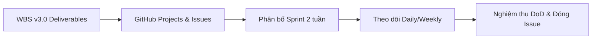
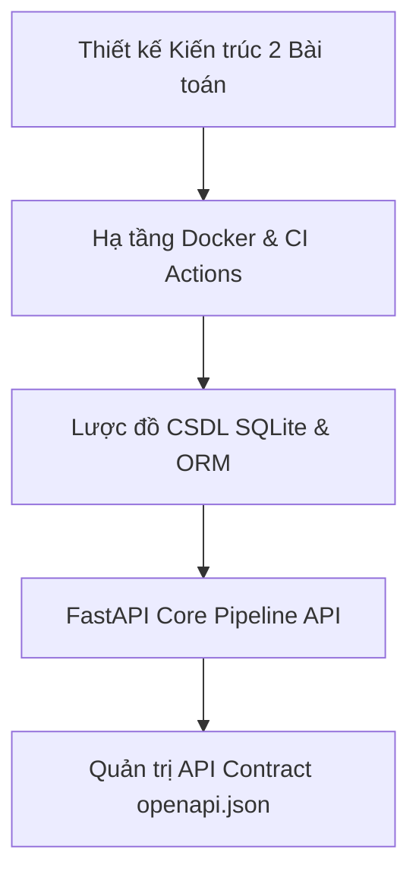
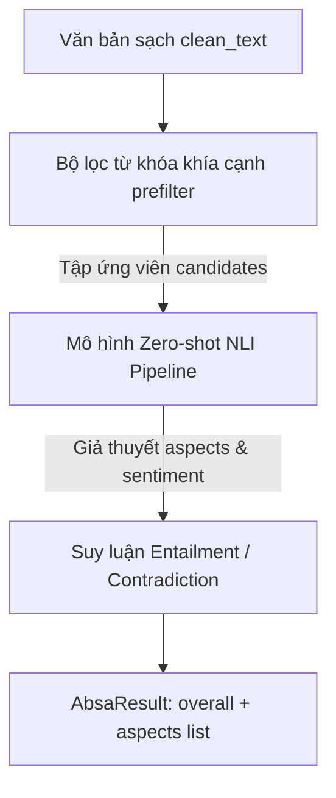
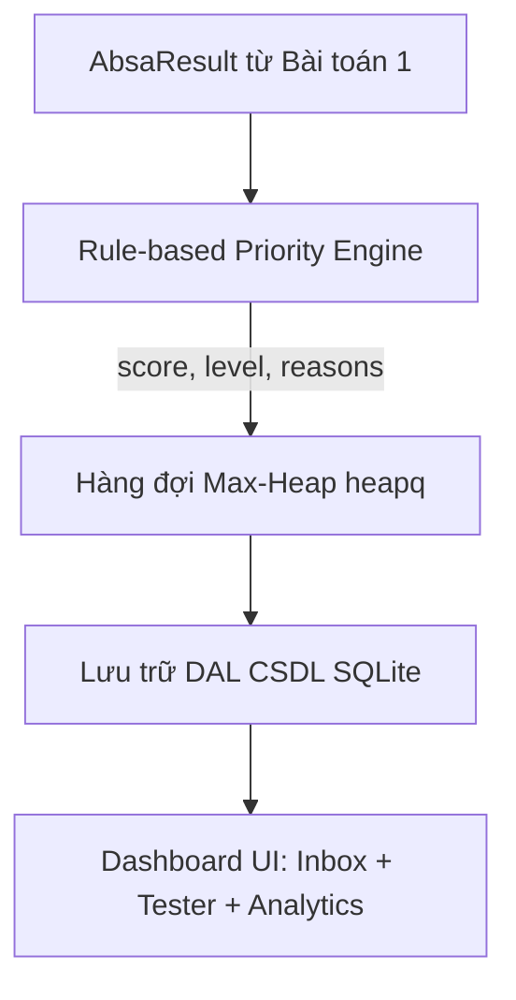
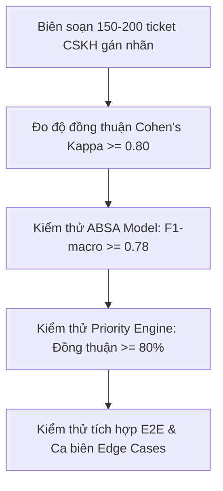

# HƯỚNG DẪN THỰC THI TOÀN TRÌNH THEO VAI TRÒ (PROJECT ONBOARDING & EXECUTION GUIDE)

## Hệ thống phân loại & định tuyến phản hồi khách hàng theo cảm xúc (*Sentiment-Driven Ticket Triage System*)

**Mã dự án:** `TICKET-TRIAGE-01` | **Học phần:** Quản trị dự án phần mềm  
**Giảng viên hướng dẫn:** *Nguyễn Thanh Tuấn*  
**Nhóm thực hiện:** *DogTowFaces* 
**Phiên bản tài liệu:** Version 3.1 | **Ngày ban hành:** 24/10/2026  
---

## MỤC LỤC
1. [Khởi động nhanh cho toàn bộ thành viên (Quick Start)](#1-khởi-động-nhanh-cho-toàn-bộ-thành-viên-quick-start)
2. [Quy chuẩn phát triển & Phối hợp Git chung](#2-quy-chuẩn-phát-triển--phối-hợp-git-chung)
3. [Hướng dẫn chi tiết cho Vai trò 1: Project Lead / PM (Võ Tấn Đức)](#3-vai-trò-1-project-lead--pm-võ-tấn-đức)
4. [Hướng dẫn chi tiết cho Vai trò 2: Technical Lead (Lê Công Quốc Mỹ)](#4-vai-trò-2-technical-lead-lê-công-quốc-mỹ)
5. [Hướng dẫn chi tiết cho Vai trò 3: Lead Dev - Bài toán 1 ABSA & AI Model (Nguyễn Văn Lê Duy)](#5-vai-trò-3-lead-dev---bài-toán-1-absa--ai-model-nguyễn-văn-lê-duy)
6. [Hướng dẫn chi tiết cho Vai trò 4: Lead Dev - Bài toán 2 Priority & UI (Nguyễn Viết Pháp)](#6-vai-trò-4-lead-dev---bài-toán-2-priority--ui-nguyễn-viết-pháp)
7. [Hướng dẫn chi tiết cho Vai trò 5: QA/QC Engineer (Nguyễn Phương Thảo)](#7-vai-trò-5-qaqc-engineer-nguyễn-phương-thảo)
8. [Cơ chế phát triển song song & Hợp đồng API Contract](#8-cơ-chế-phát-triển-song-song--hợp-đồng-api-contract)
9. [Bảng tra cứu lệnh nhanh (Cheat Sheet)](#9-bảng-tra-cứu-lệnh-nhanh-cheat-sheet)

---

## 1. KHỞI ĐỘNG NHANH CHO TOÀN BỘ THÀNH VIÊN (QUICK START)

Mọi thành viên trong nhóm khi nhận máy cần thực hiện các bước sau để khởi chạy dự án:

### Bước 1: Clone kho mã nguồn và chuyển sang nhánh phát triển
```bash
git clone https://github.com/CRP-2026/Sentiment-Driven-Ticket-Triage-System.git
cd Sentiment-Driven-Ticket-Triage-System
git checkout dev
```

### Bước 2: Chọn phương thức khởi chạy
Dự án hỗ trợ 2 phương thức khởi chạy:

#### Cách A: Sử dụng Docker (Khuyên dùng - Chuẩn môi trường)
*Yêu cầu: Bật Docker Desktop trên máy.*
```bash
# Khởi động cả Backend (FastAPI) và Frontend (Vite + React)
make up
# (Hoặc dùng Docker CLI: docker compose -f docker.yaml up --build)

# Nạp 15 ticket mẫu vào CSDL SQLite (mở tab terminal mới):
make seed
# (Hoặc: docker compose -f docker.yaml exec backend python scripts/seed_demo_data.py)
```

#### Cách B: Chạy trực tiếp Cục bộ (Local không cần Docker)
*Dành cho trường hợp máy yếu hoặc muốn debug trực tiếp mã nguồn.*

1. **Khởi động Backend (Terminal 1):**
   ```powershell
   cd ticket-triage-be
   python -m venv .venv
   .venv\Scripts\activate
   pip install -r requirements-dev.txt
   pip install -e . --no-deps
   python scripts/seed_demo_data.py
   uvicorn ticket_triage.api.main:app --host 127.0.0.1 --port 8000 --reload
   ```
2. **Khởi động Frontend (Terminal 2):**
   ```powershell
   cd ticket-triage-fe
   pnpm install
   pnpm run dev
   ```

### Bước 3: Kiểm tra các địa chỉ truy cập
- **Giao diện Dashboard:** [http://localhost:5173](http://localhost:5173) (Hộp thư Inbox, Live Tester, Analytics).
- **Tài liệu API (Swagger UI):** [http://localhost:8000/api/v1/docs](http://localhost:8000/api/v1/docs).
- **Kiểm tra trạng thái hệ thống:** [http://localhost:8000/api/v1/health](http://localhost:8000/api/v1/health).

---

## 2. QUY CHUẨN PHÁT TRIỂN & PHỐI HỢP GIT CHUNG

Toàn bộ 5 thành viên phải tuân thủ nghiêm ngặt các kỷ luật kỹ thuật sau:
1. **Tuyệt đối không push trực tiếp vào nhánh `main` và `dev`:**
   - Mọi công việc phải tạo nhánh chức năng từ `dev` theo định dạng:
     - Bài toán 1 (ABSA): `feat/absa-<tên-chức-năng>`
     - Bài toán 2 (Priority & Queue): `feat/priority-<tên-chức-năng>`, `feat/queue-<tên-chức-năng>`
     - CSDL & API: `feat/db-<tên-chức-năng>`, `feat/api-<tên-chức-năng>`
     - Frontend: `feat/web-<tên-chức-năng>`
     - Kiểm thử: `test/<tên-kịch-bản>`
2. **Quy tắc commit (Conventional Commits):**
   - Định dạng: `<loại>(<phạm-vi>): <mô-tả-ngắn>`
   - Ví dụ: `feat(absa): add keyword prefiltering for shipping aspect`, `fix(priority): handle negation prefix in urgency keywords`.
3. **Quy tắc tạo Pull Request (PR):**
   - PR phải gắn liên kết với GitHub Issue (`Fixes #<số_issue>`).
   - Phải có tối thiểu **1 phê duyệt (approval)** từ Tech Lead hoặc thành viên chuyên trách trước khi merge.
   - Luồng CI (GitHub Actions) phải chạy **Pass 100%** (xanh).
4. **Không commit vào Git:**
   - Tuyệt đối không commit: file CSDL `*.db`, file môi trường `.env`, thư mục `node_modules/`, `.venv/`, bộ nhớ đệm `__pycache__/`, file checkpoint mô hình nặng (`*.pt`, `*.bin`, `*.safetensors`).

---

## 3. VAI TRÒ 1: PROJECT LEAD / PM (VÕ TẤN ĐỨC)

> **Mã sinh viên:** `23IT.EB024` | **GitHub:** `@Ducinviciable`  
> **Nhiệm vụ trọng tâm:** Quản trị tiến độ, giám sát phạm vi (Scope Baseline), vận hành bảng Agile Kanban, kiểm soát rủi ro và làm việc với GVHD.



### 3.1. Các gói công việc WBS phụ trách chính
- `WBS 1.1.1`: Bộ hồ sơ khởi tạo dự án v3.0 (`Project-Charter-Ticket-Triage-System.md`).
- `WBS 1.1.2`: Bản kế hoạch phạm vi & Từ điển WBS v3.0 (`WBS-Ticket-Triage-System.md`).
- `WBS 1.1.3`: Hệ thống theo dõi tiến độ Agile & Bảng Kanban trên GitHub Projects.
- `WBS 1.1.4`: Sổ theo dõi rủi ro (Risk Register) & Nhật ký thay đổi phạm vi (Change Log).
- `WBS 1.1.5`: Bộ hồ sơ minh chứng hoàn tất (Evidence Package), báo cáo tổng kết và slide bảo vệ.

### 3.2. Quy trình làm việc từng bước của PM
1. **Khởi tạo và Duy trì GitHub Projects Board:**
   - Truy cập: [GitHub Projects Board](http://github.com/orgs/CRP-2026/projects/1/views/1).
   - Thiết lập 4 cột chuẩn Kanban: `To do` $\rightarrow$ `In Progress` $\rightarrow$ `In Review` $\rightarrow$ `Done`.
   - Chuyển đổi toàn bộ gói công việc trong WBS thành các **GitHub Issues**, gắn đúng Milestone (M1 đến M10), gán Assignee và Story Points.
2. **Quản trị chu kỳ Sprint & Báo cáo tiến độ:**
   - Điều phối cuộc họp Sprint Planning đầu mỗi 2 tuần và Sprint Sync ngắn hằng tuần.
   - Báo cáo tiến độ cho Giảng viên hướng dẫn (*Nguyễn Thanh Tuấn*) theo đúng các cột mốc:
     - **M1 (T2):** Duyệt Charter & WBS v3.0.
     - **M4 (T7):** Sơ kết Sprint Iteration 1 & Cập nhật Risk Register.
     - **M5 (T9):** Đóng băng Bài toán 1 (ABSA Subsystem).
     - **M6 (T11):** Đóng băng Bài toán 2 (Priority Engine).
     - **M8 (T13):** Code Freeze toàn bộ hệ thống.
     - **M10 (T15):** Bảo vệ đồ án và demo trực tiếp.
3. **Kiểm soát rủi ro & Thay đổi phạm vi (Scope Control):**
   - Theo dõi rủi ro về giới hạn GPU Colab của Duy và độ trễ NLI; đảm bảo phương án dự phòng (Fallback) luôn khả dụng.
   - Mọi đề xuất đổi taxonomy hoặc đổi công thức phải lập Issue gắn nhãn `change-request` và đánh giá tác động trước khi thực hiện.
4. **Nghiệm thu Definition of Done (DoD):**
   - Trước khi đóng thẻ Issue sang cột `Done`, PM kiểm tra biên bản kiểm thử từ Thảo (QA) và xác nhận PR đã được merge vào `dev`.

---

## 4. VAI TRÒ 2: TECHNICAL LEAD (LÊ CÔNG QUỐC MỸ)

> **Mã sinh viên:** `23IT.EB060` | **GitHub:** `@lupinname`  
> **Nhiệm vụ trọng tâm:** Thiết kế kiến trúc tổng thể, hạ tầng Docker, luồng CI/CD, chuẩn hóa tiền xử lý, CSDL SQLite ORM và FastAPI Backend Core Pipeline.



### 4.1. Các gói công việc WBS phụ trách chính
- `WBS 1.2.1`: Kho lưu trữ mã nguồn, bảo vệ nhánh Git & CI Actions (`.github/workflows/ci.yml`).
- `WBS 1.3.1`: Module chuẩn hóa văn bản tiếng Anh (`src/ticket_triage/core/preprocessing/normalizer.py`).
- `WBS 1.3.2`: Module xác thực ngôn ngữ & Cổng kiểm soát tiếng Anh (`lang_validator.py`).
- `WBS 1.3.4`: Giao diện tiền xử lý tích hợp (`pipeline.py`) & Unit tests (`test_preprocessing.py`).
- `WBS 1.6.1`: Lược đồ CSDL vé và khía cạnh (`db/models.py`) & Khởi tạo CSDL (`db/init_db.py`).
- `WBS 1.8.1`: FastAPI Core Pipeline API (`api/main.py`, `api/services/pipeline.py`).
- `WBS 1.8.5`: Bản phát hành đóng gói ứng dụng hoàn chỉnh và kịch bản khởi chạy.

### 4.2. Quy trình thực hiện kỹ thuật chi tiết
1. **Cấu hình Hạ tầng & Luồng CI Tự động:**
   - Duy trì file [docker.yaml](file:///d:/Learning/Sentiment-Driven-Ticket-Triage-System/docker.yaml) chuẩn hóa 2 service `backend` và `frontend`.
   - Đảm bảo luồng [.github/workflows/ci.yml](file:///d:/Learning/Sentiment-Driven-Ticket-Triage-System/.github/workflows/ci.yml) kiểm tra `ruff check .`, `pytest`, và `pnpm run check` trên mọi PR.
2. **Module Tiền xử lý & Cổng chặn tiếng Anh (Module 1):**
   - Duy trì hàm `clean_text()`: Giữ nguyên từ viết hoa (CAPS) và dấu `!` cho Pháp tính điểm cường độ; xử lý rút gọn ký tự lặp (`terribleeee` $\rightarrow$ `terrible`).
   - Duy trì `validate_english()`: Sử dụng `langdetect`; nếu phát hiện ngoại ngữ $\rightarrow$ gắn cờ `needs_manual_review = True`, gán điểm an toàn 50.0, **không chuyển sang NLI để tiết kiệm tài nguyên**.
3. **Cơ sở dữ liệu SQLite & SQLAlchemy 2.0 ORM:**
   - File [db/models.py](file:///d:/Learning/Sentiment-Driven-Ticket-Triage-System/ticket-triage-be/src/ticket_triage/db/models.py): Thiết kế 2 bảng `tickets` và `ticket_aspects` với quan hệ 1-N (`cascade="all, delete-orphan"`).
   - Đảm bảo cơ chế Transaction an toàn: Lưu ticket và toàn bộ khía cạnh con trong duy nhất một lần `db.commit()`.
   - File [db/session.py](file:///d:/Learning/Sentiment-Driven-Ticket-Triage-System/ticket-triage-be/src/ticket_triage/db/session.py): Cấu hình `connect_args={"check_same_thread": False}` và bật WAL mode trong `init_db.py`.
4. **FastAPI Pipeline Điều phối toàn trình:**
   - File [api/services/pipeline.py](file:///d:/Learning/Sentiment-Driven-Ticket-Triage-System/ticket-triage-be/src/ticket_triage/api/services/pipeline.py): Kết nối tuần tự: `preprocess_ticket()` $\rightarrow$ gọi `sentiment_model.predict()` của Duy $\rightarrow$ gọi `calculate_priority()` của Pháp $\rightarrow$ gọi `TicketRepository.create_ticket()` $\rightarrow$ đẩy vào `priority_queue.push()`.
5. **Quản trị Hợp đồng API Contract:**
   - Khi thay đổi router hoặc schema tại `api/schemas.py`, lập tức chạy:
     ```bash
     make gen-api
     ```
   - Xác nhận file [contracts/openapi.json](file:///d:/Learning/Sentiment-Driven-Ticket-Triage-System/contracts/openapi.json) và [schema.d.ts](file:///d:/Learning/Sentiment-Driven-Ticket-Triage-System/ticket-triage-fe/src/api/schema.d.ts) được cập nhật đồng bộ.

---

## 5. VAI TRÒ 3: LEAD DEV - BÀI TOÁN 1 ABSA & AI MODEL (NGUYỄN VĂN LÊ DUY)

> **Mã sinh viên:** `23IT.EB026` | **GitHub:** `@conangamo`  
> **Nhiệm vụ trọng tâm:** Xây dựng pipeline trích xuất đa khía cạnh và cảm xúc sử dụng mô hình học sâu Zero-shot NLI trên dữ liệu CSKH tiếng Anh; đóng băng đầu ra `AbsaResult` tại M5.



### 5.1. Các gói công việc WBS phụ trách chính
- `WBS 1.2.2`: Môi trường huấn luyện GPU (Google Colab/Kaggle T4) & `requirements-ml.txt`.
- `WBS 1.2.3`: Thu thập & chuẩn hóa bộ dữ liệu phản hồi CSKH tiếng Anh (Amazon Reviews / Customer Support).
- `WBS 1.2.5`: Xây dựng bộ template giả thuyết NLI (`configs/aspect_hypotheses.yaml`).
- `WBS 1.3.3`: Bộ lọc trước từ khóa khía cạnh (`keyword_prefilter.py`).
- `WBS 1.4.1`: Pipeline Zero-shot NLI Baseline (`src/ticket_triage/core/sentiment/baseline.py`).
- `WBS 1.4.2`: Quản lý danh mục khía cạnh CSKH (`configs/aspects.yaml` & `core/taxonomy.py`).
- `WBS 1.4.3`: Tinh chỉnh mô hình ABSA Zero-shot NLI (LoRA/PEFT trên Colab GPU).
- `WBS 1.4.5`: Đóng gói API suy luận phân tích khía cạnh (`predict(text, candidates)`).

### 5.2. Quy trình thực hiện kỹ thuật chi tiết
1. **Quản lý danh mục Khía cạnh & Mẫu giả thuyết NLI:**
   - Quản trị file [configs/aspects.yaml](file:///d:/Learning/Sentiment-Driven-Ticket-Triage-System/ticket-triage-be/configs/aspects.yaml) gồm 5 khía cạnh chuẩn: `customer_service`, `refund_payment`, `product_quality`, `shipping`, `general`.
   - File [configs/aspect_hypotheses.yaml](file:///d:/Learning/Sentiment-Driven-Ticket-Triage-System/ticket-triage-be/configs/aspect_hypotheses.yaml): Chuẩn hóa mẫu giả thuyết cho NLI:
     - Khám phá khía cạnh: `"This customer feedback is related to {aspect}."`
     - Cảm xúc khía cạnh: `"The customer expresses a {sentiment} feeling towards {aspect}."`
2. **Bộ lọc trước từ khóa khía cạnh (`keyword_prefilter.py`):**
   - Quét sự xuất hiện của các từ chỉ báo (ví dụ: `refund`, `chargeback`, `broken`, `shipping`, `agent`) trước khi đưa vào NLI.
   - Chỉ suy luận NLI trên các khía cạnh tiềm năng để giảm thời gian xử lý mỗi ticket xuống dưới 300ms.
3. **Mô hình Mock phục vụ phát triển song song (`core/sentiment/mock.py`):**
   - Duy trì `MockSentimentModel` để Viết Pháp có dữ liệu kiểm thử Bài toán 2 ngay từ Tuần 3 mà không phải đợi mô hình thật.
4. **Mô hình Zero-shot NLI Baseline & Fine-tuning:**
   - File [baseline.py](file:///d:/Learning/Sentiment-Driven-Ticket-Triage-System/ticket-triage-be/src/ticket_triage/core/sentiment/baseline.py): Nạp mô hình `valhalla/distilbart-mnli-12-3` hoặc `MoritzLaurer/deberta-v3-base-zeroshot-v1.1-all-33` theo kiểu lazy import.
   - Huấn luyện trên Colab T4 GPU:
     - Cài đặt: `pip install -r requirements-ml.txt`.
     - Áp dụng kỹ thuật LoRA (`peft`) để tối ưu hóa bộ nhớ GPU và lưu checkpoints định kỳ.
5. **Đóng băng Hợp đồng đầu ra của Bài toán 1 (`AbsaResult`):**
   - Hàm suy luận bắt buộc trả về kiểu dữ liệu đóng băng theo đúng [base.py](file:///d:/Learning/Sentiment-Driven-Ticket-Triage-System/ticket-triage-be/src/ticket_triage/core/sentiment/base.py):
     ```python
     @dataclass(frozen=True)
     class AbsaResult:
         overall: SentimentResult            # label (negative/neutral/positive), confidence [0.0, 1.0]
         aspects: list[AspectSentiment]      # aspect, sentiment, confidence, terms
     ```
   - Khía cạnh không xuất hiện (`not_mentioned`) tuyệt đối không đưa vào danh sách `aspects`.
   - Mục tiêu nghiệm thu tại cột mốc **M5 (Tuần 9)**: Đạt **F1-macro per-aspect $\ge 0.78$**.

---

## 6. VAI TRÒ 4: LEAD DEV - BÀI TOÁN 2 PRIORITY & UI (NGUYỄN VIẾT PHÁP)

> **Mã sinh viên:** `23IT.EB070` | **GitHub:** `@vietphap035`  
> **Nhiệm vụ trọng tâm:** Xây dựng Priority Engine rule-based minh bạch (*worst-aspect-wins*), hàng đợi `heapq`, CRUD DAL, và toàn bộ giao diện Dashboard (React + Vite + pnpm); đóng băng Bài toán 2 tại M6.



### 6.1. Các gói công việc WBS phụ trách chính
- `WBS 1.5.1`: Bộ từ điển từ khóa khẩn cấp & Trọng số khía cạnh (`configs/priority_rules.yaml`).
- `WBS 1.5.2`: Module trích xuất cường độ cảm xúc câu (`core/priority/intensity_extractor.py`).
- `WBS 1.5.3`: Bộ tính điểm ưu tiên khía cạnh nghiêm trọng nhất (`core/priority/priority_engine.py`).
- `WBS 1.6.2`: Bộ thao tác dữ liệu DAL CRUD (`db/repository.py`).
- `WBS 1.6.3`: Cấu trúc hàng đợi ưu tiên nội bộ `heapq` (`core/queue/priority_queue.py`).
- `WBS 1.6.4`: Bộ quản trị vòng đời 4 trạng thái vé (`core/queue/state_manager.py`).
- `WBS 1.7.1` $\rightarrow$ `1.7.4`: Toàn bộ phân hệ giao diện Dashboard Streamlit/React (Hộp thư Inbox, Biểu đồ Analytics, Khung Live Tester, Nút cập nhật trạng thái).

### 6.2. Quy trình thực hiện kỹ thuật chi tiết
1. **Xây dựng Bộ tính điểm ưu tiên Rule-based (Worst-Aspect-Wins):**
   - File [priority_engine.py](file:///d:/Learning/Sentiment-Driven-Ticket-Triage-System/ticket-triage-be/src/ticket_triage/core/priority/priority_engine.py): Cài đặt hàm thuần `calculate_priority(result: AbsaResult, text: str)`:
     - $\text{base}$: Negative $\rightarrow 60.0 \times \text{confidence}$; Neutral $\rightarrow 20.0$; Positive $\rightarrow 5.0$.
     - $\text{urgency}$: Từ khóa rủi ro (`lawsuit`, `fraud`, `chargeback`...). Câu kết thúc $+20$, câu trước $+10$ (trần 30.0). Xử lý phủ định (`not urgent` $\rightarrow 0$).
     - $\text{intensity}$: $+5.0$ nếu có `!!!` hoặc CAPS LOCK và cảm xúc là negative.
     - $\text{aspect\_bonus}$: Khía cạnh tiêu cực nghiêm trọng nhất cộng đủ 100%, các khía cạnh tiêu cực còn lại cộng $25\%$ (trần 20.0).
     - $\text{score} = \min(100.0, \text{base} + \text{urgency} + \text{intensity} + \text{aspect})$; sinh danh sách giải trình `reasons` chi tiết.
   - Phân cấp chuẩn: $\ge 70.0$ **CRITICAL (Đỏ)**, $30.0 - 69.9$ **MEDIUM (Vàng)**, $< 30.0$ **LOW (Xanh)**.
2. **Hàng đợi ưu tiên In-memory (`priority_queue.py`):**
   - Sử dụng `heapq` với khóa: `(-priority_score, created_at, ticket_id)`.
   - Cơ chế Tie-break FIFO: Khi đồng điểm, vé đến trước (`created_at` nhỏ hơn) đứng trước.
3. **Phát triển Giao diện Frontend (`ticket-triage-fe/`):**
   - Luôn sử dụng lệnh **`pnpm`**: `pnpm install`, `pnpm run dev`, `pnpm run check`.
   - **Trang Inbox ([InboxPage.tsx](file:///d:/Learning/Sentiment-Driven-Ticket-Triage-System/ticket-triage-fe/src/pages/InboxPage.tsx)):** Hiển thị danh sách ticket sắp xếp theo điểm giảm dần, thẻ màu, chip khía cạnh cảm xúc, bộ lọc đa tiêu chí, modal giải trình `PriorityBreakdown`.
   - **Trang Live Tester ([TesterPage.tsx](file:///d:/Learning/Sentiment-Driven-Ticket-Triage-System/ticket-triage-fe/src/pages/TesterPage.tsx)):** Cung cấp form nhập ticket và các nút mẫu để demo phản hồi trong 1-2 giây.
   - **Trang Analytics ([AnalyticsPage.tsx](file:///d:/Learning/Sentiment-Driven-Ticket-Triage-System/ticket-triage-fe/src/pages/AnalyticsPage.tsx)):** Vẽ biểu đồ Recharts phân bố cảm xúc, mức ưu tiên và khía cạnh.
4. **Mục tiêu nghiệm thu tại cột mốc M6 (Tuần 11):**
   - Priority Engine đạt **mức độ đồng thuận $\ge 80\%$** so với nhãn thủ công của nhóm QA.

---

## 7. VAI TRÒ 5: QA/QC ENGINEER (NGUYỄN PHƯƠNG THẢO)

> **Mã sinh viên:** `23IT.EB098` | **GitHub:** `@phuongthaonee`  
> **Nhiệm vụ trọng tâm:** Biên soạn tập dữ liệu kiểm thử gán nhãn thủ công, đo lường độ đồng thuận liên người đánh giá, kiểm thử độc lập mô hình ABSA và Priority Engine, kiểm thử tích hợp E2E và ca biên.



### 7.1. Các gói công việc WBS phụ trách chính
- `WBS 1.2.4`: Tập dữ liệu kiểm thử 150–200 ticket CSKH gán nhãn thủ công (`data/testset_human_labeled.json`).
- `WBS 1.2.7`: Bảng ánh xạ khía cạnh CSKH & Đo lường độ đồng thuận (Cohen's Kappa $\ge 0.70$).
- `WBS 1.4.4`: Báo cáo đánh giá hiệu năng mô hình ABSA (`reports/absa_evaluation_report.md`).
- `WBS 1.5.4`: Báo cáo kiểm nghiệm độ đồng thuận Priority Engine (`reports/priority_validation_report.md`).
- `WBS 1.8.2`: Bộ kiểm thử tích hợp luồng xử lý toàn trình (`tests/test_end_to_end_pipeline.py`).
- `WBS 1.8.3`: Kịch bản kiểm thử tình huống biên và ngoại lệ (`reports/edge_cases_test_report.md`).

### 7.2. Quy trình thực hiện kỹ thuật chi tiết
1. **Xây dựng Tập kiểm thử gán nhãn thủ công (`WBS 1.2.4`):**
   - Thu thập và biên soạn 150–200 ticket tiếng Anh mô phỏng thực tế bao gồm đủ các trường hợp: khiếu nại khẩn cấp, hàng hỏng, trễ hẹn, thái độ nhân viên, hoàn tiền, câu hỏi thường, và 5-10 ticket ngoại ngữ.
   - Tiến hành gán nhãn độc lập bởi ít nhất 2 thành viên về: các khía cạnh đề cập, cảm xúc từng khía cạnh, mức ưu tiên dự kiến (`CRITICAL`, `MEDIUM`, `LOW`).
   - Tính toán chỉ số **Cohen's Kappa $\ge 0.80$** để chứng minh tính khách quan của dữ liệu.
2. **Kiểm thử Nghiệm thu Mô hình ABSA (Bài toán 1 - `WBS 1.4.4`):**
   - Đánh giá checkpoint NLI của Lê Duy trên tập kiểm thử benchmark.
   - Đo lường F1-macro per-aspect, lập ma trận nhầm lẫn (Confusion Matrix).
   - **Cam kết nghiệm thu (M5):** F1-macro trên từng khía cạnh phải đạt **$\ge 0.78$**.
3. **Kiểm thử Nghiệm thu Priority Engine (Bài toán 2 - `WBS 1.5.4`):**
   - Chạy toàn bộ 150–200 ticket qua hàm `calculate_priority()` của Viết Pháp.
   - So sánh thứ bậc và cấp độ ưu tiên của thuật toán với nhãn thủ công.
   - **Cam kết nghiệm thu (M6):** Tỷ lệ đồng thuận giữa hệ thống và con người đạt **$\ge 80\%$**.
4. **Kiểm thử Toàn trình (E2E) & Ca biên Ngoại lệ (`WBS 1.8.2`, `1.8.3`):**
   - Chạy lệnh kiểm thử tự động:
     ```bash
     make test
     # Hoặc: pytest ticket-triage-be/tests/ -v
     ```
   - Xác thực các tình huống dữ liệu xấu không làm sập hệ thống:
     - Chuỗi rỗng $\rightarrow$ HTTP 422 rõ ràng.
     - Văn bản cực dài (> 2000 từ) $\rightarrow$ xử lý an toàn không tràn RAM/GPU.
     - Văn bản ngoại ngữ $\rightarrow$ gắn cờ `needs_manual_review = True`, điểm sàn 50.0.
     - Văn bản không có khía cạnh nào $\rightarrow$ gắn khía cạnh `general` an toàn.

---

## 8. CƠ CHẾ PHÁT TRIỂN SONG SONG & HỢP ĐỒNG API CONTRACT

Hệ thống được thiết kế theo nguyên tắc phân tách rạch ròi 2 bài toán độc lập, cho phép cả nhóm làm việc song song mà không bị nghẽn tiến độ:

```text
┌────────────────────────────────────────────────────────────────────────┐
│                        TIẾN ĐỘ PHÁT TRIỂN SONG SONG                    │
├───────────────────────────────────┬────────────────────────────────────┤
│ TRACK 1: Bài toán 1 (Lê Duy + Thảo)│ TRACK 2: Bài toán 2 (Viết Pháp+Mỹ) │
├───────────────────────────────────┼────────────────────────────────────┤
│ 1. Chuẩn hóa dataset CSKH         │ 1. Khởi tạo CSDL SQLite & DAL CRUD │
│ 2. Xây dựng Keyword Pre-filter    │ 2. Cài đặt Priority Engine         │
│ 3. Tạo MockSentimentModel (Xong)  │ 3. Chạy kiểm thử Priority bằng Mock│
│ 4. Fine-tune NLI trên Colab GPU   │ 4. Xây dựng Dashboard UI (pnpm)    │
│ 5. Đóng băng AbsaResult tại M5    │ 5. Đóng băng Priority tại M6       │
└───────────────────────────────────┴────────────────────────────────────┘
                                     │
                  ┌──────────────────┴──────────────────┐
                  ▼                                     ▼
           CỘT MỐC M7 (Tuần 12): TÍCH HỢP TOÀN TRÌNH 2 BÀI TOÁN
```

### Quy tắc bảo vệ hợp đồng (Contract Rules):
1. **Không tự ý sửa Dataclass `AbsaResult`:** Nếu có nhu cầu bổ sung trường dữ liệu giữa 2 bài toán, phải họp nhóm và có sự đồng ý của cả Lê Duy, Viết Pháp và Tech Lead Quốc Mỹ.
2. **Quy trình cập nhật API Schema:**
   Khi Backend thêm hoặc đổi trường dữ liệu:
   ```bash
   # Bước 1: Backend cập nhật schemas.py
   # Bước 2: Chạy lệnh xuất hợp đồng
   make gen-api
   # Bước 3: Frontend nhận kiểu dữ liệu mới tại src/api/schema.d.ts và sửa component
   # Bước 4: Commit cả openapi.json và schema.d.ts trong cùng 1 PR
   ```

---

## 9. BẢNG TRA CỨU LỆNH NHANH (CHEAT SHEET)

### Lệnh chạy với Docker:
```bash
make up        # Khởi động hệ thống (Backend :8000, Frontend :5173)
make down      # Dừng hệ thống
make seed      # Nạp 15 ticket mẫu vào SQLite
make test      # Chạy kiểm thử pytest (Backend) và vitest (Frontend)
make lint      # Kiểm tra chuẩn mã nguồn ruff và eslint
make gen-api   # Tự động xuất openapi.json và sinh schema TypeScript cho Frontend
make reset-db  # Xóa sạch và tạo lại cơ sở dữ liệu SQLite mới
```

### Lệnh chạy Cục bộ (Local không dùng Docker):
```bash
# Backend:
cd ticket-triage-be
.venv\Scripts\activate
uvicorn ticket_triage.api.main:app --reload --port 8000
pytest -v

# Frontend:
cd ticket-triage-fe
pnpm install
pnpm run dev
pnpm run check
pnpm run test
```

---

*Tài liệu này được biên soạn để đảm bảo tính minh bạch, kỷ luật kỹ thuật và sự phối hợp nhịp nhàng giữa 5 thành viên nhóm DogTowFaces trong suốt quá trình triển khai dự án.*
